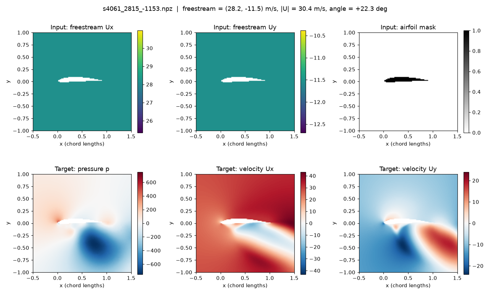
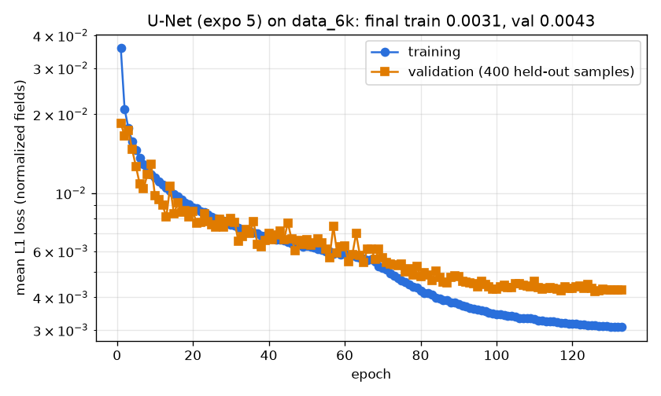
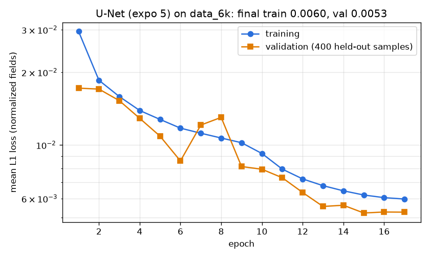

# Deep Flow Prediction: Reproduction on OpenFOAM v2606

A reproduction of **Thuerey et al., "Deep Learning Methods for Reynolds-Averaged
Navier-Stokes Simulations of Airfoil Flows"** (*AIAA Journal*, 2020) on current
software: OpenFOAM v2606, gmsh 4 and Docker on Windows. It is the first step
towards an extension to **inverted airfoils in ground effect** (F1 front wings).

- Paper: https://arxiv.org/abs/1810.08217
- Original code: https://github.com/thunil/Deep-Flow-Prediction (Apache-2.0)

---

## Progress

| Stage | Status |
|---|---|
| 1. Environment (Docker + OpenFOAM v2606 + gmsh + Python) | Done |
| 2. Port the data generation pipeline to OpenFOAM v2606 | Done |
| 3. First simulation and training sample | Done (about 95 s per sample on a laptop) |
| 4. Download the authors' precomputed dataset | Done (`data_6k`: 6,400 train / 90 test, SHA-512 verified) |
| 5. Train the U-Net and reproduce the paper's error numbers | Done: 1 run + 5 repeated seeds (CPU, about 47 min each). See [Results](#results) |
| 6. Compare my results with the paper | Done: 5-seed mean ± std, plus an 80k-iteration run that matches the paper's pressure and velocity errors |
| 7. Extension: inverted airfoil in ground effect | Planned |

### Log
- **2026-11-07**: Set up the Docker environment. Found and fixed four
  incompatibilities between the original OpenFOAM 5 setup and OpenFOAM v2606
  (see below). Generated and plotted the first training sample.
- **2026-11-07**: Downloaded the authors' `data_6k` dataset
  ([TUM data service](https://dataserv.ub.tum.de/index.php/s/m1470791),
  1.3 GB): 6,400 training and 90 test samples. Checksum verified. The training
  code expects it in `Deep-Flow-Prediction/data/train` and `data/test`.
- **2026-11-07**: First training run on CPU (Ryzen 7 7730U, PyTorch 2.15 CPU).
  U-Net with `expo = 5` (2.33M parameters) trained for 10k iterations in 48 min.
  Test error on 90 unseen airfoils: 3.17% overall, 2.61% velocity, 16.6%
  pressure, close to the paper (see Results).
- **2026-11-07**: Repeated the same training with 5 fixed random seeds
  (`scripts/run_seeds.ps1`, 3 h 55 min unattended). Combined test error
  3.42 ± 0.18%, velocity 2.85 ± 0.13%, pressure 17.06 ± 0.94%. Run 1 (3.17%)
  was at the lucky end of the spread.
- **2026-11-08**: Overnight run with the paper's training length (80k
  iterations, 6 h on CPU). Combined error 2.96%, pressure 14.86%, velocity
  2.45%. Pressure and velocity now match the paper's best model.

---

## What the model learns

Each training sample is a 6 × 128 × 128 array covering a 2 × 2 chord-length
region around the airfoil:

| Channel | Meaning | Role |
|---|---|---|
| 0 | Freestream velocity X | Input |
| 1 | Freestream velocity Y | Input |
| 2 | Airfoil mask (1 = inside the airfoil) | Input |
| 3 | Pressure *p* | Target |
| 4 | Velocity *Ux* | Target |
| 5 | Velocity *Uy* | Target |

The network, a U-Net, takes the airfoil shape and inflow conditions and
predicts the full RANS flow field in milliseconds. The CFD simulation takes
about 95 s.



*First sample generated with this setup: airfoil `s4061` at about 22° to the
flow, |U| = 30 m/s. The flow separates under the airfoil, visible as reversed
flow (blue in Ux) and a strong low-pressure region.*

---

## Results

### Run 1: U-Net, `expo = 5`, `data_6k`, CPU

| Setting | This run | Paper (best model, Sec. 4) |
|---|---|---|
| Trainable parameters | 2.33M | 30.9M |
| Training samples | 6,000 (+400 validation) | 12,800 |
| Training iterations | 10,000 (repo default) | 80,000 |
| Hardware / time | Laptop CPU, 48 min | GPU |

Relative error on the **90 unseen test airfoils**
(`runTestCpu.py`, mean of |prediction − CFD| / |CFD|):

| Quantity | This run | Paper, largest model, 12.8k samples |
|---|---|---|
| Velocity | **2.61%** | 2.15% (Ux), 2.6% (Uy) |
| Pressure | **16.6%** | 14.76% |
| Combined | **3.17%** | 2.6% |

For reference, the paper's *smallest* model (123k parameters) reached 3.3% with
12.8k samples.

**Interpretation:** the first run lands where the paper's scaling study says it
should. It is between the paper's smallest and largest models, while using half
the data, an eighth of the iterations, and a laptop CPU. Pressure has a much
higher relative error than velocity, as in the paper: pressure values are often
small, so small absolute errors become large relative errors.

**Caveat:** a single training run can be lucky or unlucky. See the repeated
seeds below.

### Run 2: same setup, 5 random seeds

Same settings as Run 1, trained 5 times with seeds 1–5
(`scripts/run_seeds.ps1`, summary from `scripts/summarize_seeds.py`). The paper
also reports averages over 5 runs.

| Seed | Pressure % | Velocity % | Combined % |
|---|---|---|---|
| 1 | 17.41 | 2.89 | 3.50 |
| 2 | 17.12 | 2.75 | 3.33 |
| 3 | 15.71 | 2.68 | 3.17 |
| 4 | 18.29 | 2.99 | 3.63 |
| 5 | 16.78 | 2.91 | 3.48 |
| **Mean ± std** | **17.06 ± 0.94** | **2.85 ± 0.13** | **3.42 ± 0.18** |
| Paper, largest model | 14.76 | about 2.4 | 2.6 |
| Paper, smallest model | | | 3.3 |

(std = sample standard deviation over the 5 runs.)

**What this shows:**
- The result is **stable**. The combined error varies by only ±0.18 percentage
  points between seeds, so the gap to the paper is real and not seed noise.
- Run 1 (3.17%) was on the good side of the spread. The honest number for this
  setup is **3.42 ± 0.18%**.
- That is about 0.8 points above the paper's best model, which has 13× more
  parameters, 2× more data and 8× more training iterations. It is close to the
  paper's smallest model.
- Pressure varies most between seeds (±0.94), as expected from its higher
  relative error.

### Run 3: same setup, 80k iterations (paper's training length)

Same model, data and seed (1) as above. Only the training length changes, from
10k to 80k iterations (133 epochs, 6 h 3 min on the laptop CPU).

| Quantity | 10k iterations, seed 1 | 10k, 5-seed mean | **80k iterations, seed 1** | Paper, largest model |
|---|---|---|---|---|
| Pressure | 17.41% | 17.06% | **14.86%** | 14.76% |
| Velocity | 2.89% | 2.85% | **2.45%** | about 2.4% |
| Combined | 3.50% | 3.42% | **2.96%** | 2.6% |

**What this shows:**
- Training 8× longer cuts the combined error by about 15% (3.50 → 2.96%).
  Pressure and velocity now **match the paper's best model** almost exactly,
  with 13× fewer parameters and half the training data.
- The remaining gap in the combined number (2.96 vs 2.6%) is small.
- The learning curve below shows the limit of `data_6k`: after about epoch 90
  the validation loss flattens (0.0043) while the training loss keeps falling
  (0.0031). The model is starting to memorise the training set, so **more
  data**, not more training, is the next lever.



*Training and validation L1 loss over 133 epochs (80k iterations). A gap
opens after about epoch 90: mild overfitting on 6,000 training samples.*

**Caveat:** this is one seed. Given the ±0.18 spread between seeds at 10k, the
improvement from 3.42% to 2.96% is well beyond seed noise.



*Training and validation L1 loss per epoch. Both fall steadily and end close
together (0.0060 / 0.0053), so the model is not overfitting.*

---

## Changes needed for OpenFOAM v2606

The original code targets OpenFOAM 5 (openfoam.org). Running it on OpenFOAM
v2606 (openfoam.com) with gmsh 4 required these fixes, collected in
[`patches/openfoam-v2606.patch`](patches/openfoam-v2606.patch):

| # | Problem | Error seen | Fix |
|---|---|---|---|
| 1 | gmsh 4 writes the MSH 4 mesh format by default | mesh conversion fails | add `-format msh2` to the gmsh call in `dataGen.py` |
| 2 | v2606's `freestreamPressure` requires an explicit far-field value | `Required entry 'freestreamValue' missing in dictionary "0/p/boundaryField/inlet"` | add `freestreamValue uniform 0;` to the four far-field patches in `0/p` |
| 3 | v2606 writes sampled fields to one file, not one per field | `cloud_p.xy not found` | read `cloud_p_U.xy` |
| 4 | the combined file's columns are `x y z p Ux Uy Uz` | (wrong values, no error) | read Ux and Uy from columns 4 and 5 instead of 3 and 4 |

Windows-specific issues:
- Clone with `core.autocrlf=false`. Otherwise the shell scripts get Windows
  line endings and fail inside Linux.
- If pasted commands show up as `[200~...`, run
  `bind 'set enable-bracketed-paste off'` inside the container.

---

## How to run it

**Requirements:** Docker Desktop. No local OpenFOAM install is needed.

```powershell
# 1. Build the image: OpenFOAM v2606 + gmsh + Python
docker build -t openfoam-ml .

# 2. Get the original code with Linux line endings, then apply the v2606 fixes
git clone --config core.autocrlf=false https://github.com/thunil/Deep-Flow-Prediction.git
cd Deep-Flow-Prediction
git apply ../patches/openfoam-v2606.patch
cd ..

# 3. Start the container with this folder shared as /work
docker run -it --rm -v ${PWD}:/work openfoam-ml
```

Inside the container:
```bash
cd /work/Deep-Flow-Prediction/data
bash download_airfoils.sh        # about 1,500 training and 30 test airfoils (UIUC database)
python3 dataGen.py               # number of simulations set by `samples` in dataGen.py
python3 /work/scripts/view_sample.py train/<file>.npz /work/results/sample.png
```

## Repository layout

```
Dockerfile                  OpenFOAM v2606 + gmsh + Python environment
patches/openfoam-v2606.patch  fixes to the original code for OpenFOAM v2606
scripts/view_sample.py      plots all six channels of a training sample
scripts/plot_learning_curve.py  plots training/validation loss
scripts/run_seeds.ps1       trains + tests with several seeds, unattended
scripts/summarize_seeds.py  mean ± std table over the seed runs
results/                    figures and reproduction results
Deep-Flow-Prediction/       the original repo, cloned locally (not committed)
```

---

## Reference

```bibtex
@article{thuerey2020deepFlowPred,
  title   = {Deep learning methods for Reynolds-averaged Navier--Stokes simulations of airfoil flows},
  author  = {Thuerey, Nils and Weissenow, Konstantin and Prantl, Lukas and Hu, Xiangyu},
  journal = {AIAA Journal},
  volume  = {58},
  number  = {1},
  pages   = {25--36},
  year    = {2020}
}
```

Airfoil coordinates come from the UIUC Airfoil Coordinates Database
(https://m-selig.ae.illinois.edu/ads/coord_database.html).

## License

[Apache License 2.0](LICENSE), the same license as the original
[Deep-Flow-Prediction](https://github.com/thunil/Deep-Flow-Prediction) code
that the patch in this repo modifies.
