# Deep Flow Prediction: Reproduction on OpenFOAM v2606

A reproduction of **Thuerey et al., "Deep Learning Methods for Reynolds-Averaged
Navier-Stokes Simulations of Airfoil Flows"** (*AIAA Journal*, 2020) on current
software: OpenFOAM v2606, gmsh 4 and Docker on Windows. It is the first step
towards an extension to **inverted airfoils in ground effect** (F1 front wings).

- Paper: https://arxiv.org/abs/1810.08217
- Original code: https://github.com/thunil/Deep-Flow-Prediction (Apache-2.0)

---

## Progress

| Stage | Status |
|---|---|
| 1. Environment (Docker + OpenFOAM v2606 + gmsh + Python) | Done |
| 2. Port the data generation pipeline to OpenFOAM v2606 | Done |
| 3. First simulation and training sample | Done (about 95 s per sample on a laptop) |
| 4. Download the authors' precomputed dataset | Done (`data_6k`: 6,400 train / 90 test, SHA-512 verified) |
| 5. Train the U-Net and reproduce the paper's error numbers | Done: 1 run + 5 repeated seeds (CPU, about 47 min each). See [Results](#results) |
| 6. Compare my results with the paper | Done: 5-seed mean ± std, plus an 80k-iteration run that matches the paper's pressure and velocity errors |
| 7. Extension: inverted airfoil in ground effect | In progress: setup validated against LES (surface pressure and skin friction close to the LES), mesh chosen (boundary layer with y+ ≈ 1, 20-chord domain), numerical verification done (downforce mesh-converged within 0.04%, sampled flow field within 0.2%; runs without a steady solution are detected and kept out of the data), a sample now takes about 3 minutes. Validated in ground effect against wind tunnel tests (Tyrrell 026 wing, Zerihan 2001; 33 runs on three meshes): downforce within 1.5% of Zerihan's own 2D RANS from h/c 0.671 down to 0.224, largest downforce at the same height, numerical uncertainty 0.04–1.8% down to h/c 0.134. Like his, our values are 14–19% above the tunnel's estimate, and the sparse tappings explain only 1% of that. Airfoil files smoothed for the dataset: 1,462 of the 1,497 UIUC files kept, 15 times closer to known shapes than gmsh's spline through the original points. Next: the parameter scan, then the dataset. See [Extension](#extension-inverted-airfoil-in-ground-effect-in-progress) |

### Log
- **2026-11-07**: Set up the Docker environment. Found and fixed four
  incompatibilities between the original OpenFOAM 5 setup and OpenFOAM v2606
  (see below). Generated and plotted the first training sample.
- **2026-11-07**: Downloaded the authors' `data_6k` dataset
  ([TUM data service](https://dataserv.ub.tum.de/index.php/s/m1470791),
  1.3 GB): 6,400 training and 90 test samples. Checksum verified. The training
  code expects it in `Deep-Flow-Prediction/data/train` and `data/test`.
- **2026-11-07**: First training run on CPU (Ryzen 7 7730U, PyTorch 2.15 CPU).
  U-Net with `expo = 5` (2.33M parameters) trained for 10k iterations in 48 min.
  Test error on 90 unseen airfoils: 3.17% overall, 2.61% velocity, 16.6%
  pressure, close to the paper (see Results).
- **2026-11-07**: Repeated the same training with 5 fixed random seeds
  (`scripts/run_seeds.ps1`, 3 h 55 min unattended). Combined test error
  3.42 ± 0.18%, velocity 2.85 ± 0.13%, pressure 17.06 ± 0.94%. Run 1 (3.17%)
  was at the lucky end of the spread.
- **2026-11-08**: Overnight run with the paper's training length (80k
  iterations, 6 h on CPU). Combined error 2.96%, pressure 14.86%, velocity
  2.45%. Pressure and velocity now match the paper's best model.
- **2026-11-08**: Started the ground-effect extension
  ([`ground_effect/`](ground_effect/)): an inverted airfoil above a moving
  ground, saved in the same sample format as the original dataset.
- **2026-11-09**: First ground-effect simulations. 500 solver iterations (the
  original setting) leave Cl about 14% short of its converged value. The
  incoming turbulence level changes downforce by 9% and halves drag (see
  [Extension](#extension-inverted-airfoil-in-ground-effect-in-progress)).
- **2026-11-09**: Validated the setup against LES of a NACA 4412 at Re = 1M.
  The realistic turbulence level (3ν) predicts surface pressure clearly better
  than the original 0.14. Skin friction and drag are off with both, because of
  the mesh. SIMPLEC gives the same answer as SIMPLE in 3.5× fewer iterations.
  Both choices are now the defaults. Next: a mesh study.
- **2026-11-09**: Mesh study, round 1. A boundary-layer mesh in a 20-chord
  domain matches the LES surface pressure 2.5–4 times better than the original
  mesh. Two problems found and fixed for round 2: the first cell was at y+ 4–8,
  and a larger domain coarsened the cells near the wing.
- **2026-11-09**: Mesh study, round 2. With the first cell at y+ ≈ 1, skin
  friction matches the LES within 6–7% on average. Getting there needed a correction:
  the LES files normalise skin friction with the local edge velocity, not the
  freestream, so all earlier Cf comparisons were redone. In ground effect, going
  from 20 to 40 chords changes Cl by 0.1%, so the boundary-layer mesh in a
  20-chord domain is now the default. Also found that nuTilda is clipped in
  almost every iteration with the realistic turbulence level. Round 3 tests a
  fix, together with a grid convergence study.
- **2026-11-09**: Mesh study, round 3 (numerical verification, 11 runs). A
  limited gradient for nuTilda stops the clipping. On the default mesh,
  downforce is mesh-converged within 0.04% (GCI). The sampled flow field is
  within 0.2%, 16–70 times below the U-Net's error. Drag carries about 10%
  numerical uncertainty. A very cambered wing close to the ground (S1223 at
  h/c = 0.1) separates and has no steady solution, so the generator now
  detects such runs and keeps them out of the training data. Also found:
  locating the sample points took 37–66% of every run. Sampling the grid row
  by row instead gives identical samples and cuts the start-up to 4 s, so a
  sample now takes about 3 minutes.
- **2026-11-09**: Validation in ground effect, first run (Tyrrell 026 front
  wing, 20 runs, all converged). From h/c 0.671 down to 0.224 our downforce is
  within 1.4% of Zerihan's own 2D RANS with the same turbulence model, and
  both peak at h/c 0.134. Both are about 15% above the wind-tunnel estimate.
  Integrating our pressures at the tunnel's tapping positions explains only
  about 1% of that. The flow separates at the same ride height as in the oil
  flow, but further forward on the wing. The pressure plots showed spikes:
  gmsh's spline puts kinks between the 44 table points per surface. The second
  run uses a wing shape smoothed within the table's rounding, and adds a coarse
  mesh for an uncertainty estimate at every height.
- **2026-11-09**: Validation in ground effect, second run (smoothed wing, three
  meshes, 33 runs in 1 h 51 min). The numerical uncertainty (GCI) of the
  downforce is 0.04–0.4% down to h/c 0.313, rising to 1.8% at 0.134 and about
  3% below. Smoothing removed the pressure spikes, but changed downforce by at
  most 0.6%, so the first run's findings stand. On a mesh about as large as
  Zerihan's, our downforce is 1.6–2.2% below his at every height. This
  suggests that the growing difference near the ground on finer meshes comes
  from mesh resolution, not from the model. Table 14 of the thesis shows that
  his "freestream" CFD had no ground, while the tests were 3.36 chords above
  it. With our run at that height, ours is 14–15% above the experiment at
  every height from 3.36 down to 0.224. The default mesh stays for the
  dataset: its flow fields are within 0.1–2.4% of the fine mesh, far below the
  U-Net's error.
- **2026-11-10**: Airfoil shapes for the dataset. gmsh's spline puts kinks
  into most UIUC files: the median largest wiggle in the inviscid Cp is 0.046,
  and 475 of the 1,497 files are above 0.1, worse than the Tyrrell table. The
  files are now smoothed before meshing, with a quintic smoothing spline of y
  against √x that stays within the rounding of each file. On stand-ins with
  known shapes at the files' own stations, it is 15 times closer to the true
  shape than gmsh's spline (median 3.4e-5 chords), with a 13 times smaller Cp
  error. Along the way: 849 files are padded with zeros (most written with
  seven decimals carry five), so the rounding is read from the digits each
  file carries. 35 files are left out (errors in the points, partial
  airfoils, crossing contours, or shapes whose pressure still wiggles after
  smoothing); the dataset keeps 1,462 airfoils (see
  [Airfoil shapes](#airfoil-shapes-for-the-dataset)).

---

## What the model learns

Each training sample is a 6 × 128 × 128 array covering a 2 × 2 chord-length
region around the airfoil:

| Channel | Meaning | Role |
|---|---|---|
| 0 | Freestream velocity X | Input |
| 1 | Freestream velocity Y | Input |
| 2 | Airfoil mask (1 = inside the airfoil) | Input |
| 3 | Pressure *p* | Target |
| 4 | Velocity *Ux* | Target |
| 5 | Velocity *Uy* | Target |

The network, a U-Net, takes the airfoil shape and inflow conditions and
predicts the full RANS flow field in milliseconds. The CFD simulation takes
about 95 s.


*First sample generated with this setup: airfoil `s4061` at about 22° to the
flow, |U| = 30 m/s. The flow separates under the airfoil, visible as reversed
flow (blue in Ux) and a strong low-pressure region.*

---

## Results

### Run 1: U-Net, `expo = 5`, `data_6k`, CPU

| Setting | This run | Paper (best model, Sec. 4) |
|---|---|---|
| Trainable parameters | 2.33M | 30.9M |
| Training samples | 6,000 (+400 validation) | 12,800 |
| Training iterations | 10,000 (repo default) | 80,000 |
| Hardware / time | Laptop CPU, 48 min | GPU |

Relative error on the **90 unseen test airfoils**
(`runTestCpu.py`, mean of |prediction − CFD| / |CFD|):

| Quantity | This run | Paper, largest model, 12.8k samples |
|---|---|---|
| Velocity | **2.61%** | 2.15% (Ux), 2.6% (Uy) |
| Pressure | **16.6%** | 14.76% |
| Combined | **3.17%** | 2.6% |

For reference, the paper's *smallest* model (123k parameters) reached 3.3% with
12.8k samples.

**Interpretation:** the first run lands where the paper's scaling study says it
should. It is between the paper's smallest and largest models, while using half
the data, an eighth of the iterations, and a laptop CPU. Pressure has a much
higher relative error than velocity, as in the paper: pressure values are often
small, so small absolute errors become large relative errors.

**Caveat:** a single training run can be lucky or unlucky. See the repeated
seeds below.


*Training and validation L1 loss per epoch. Both fall steadily and end close
together (0.0060 / 0.0053), so the model is not overfitting.*

### Run 2: same setup, 5 random seeds

Same settings as Run 1, trained 5 times with seeds 1–5
(`scripts/run_seeds.ps1`, summary from `scripts/summarize_seeds.py`). The paper
also reports averages over 5 runs.

| Seed | Pressure % | Velocity % | Combined % |
|---|---|---|---|
| 1 | 17.41 | 2.89 | 3.50 |
| 2 | 17.12 | 2.75 | 3.33 |
| 3 | 15.71 | 2.68 | 3.17 |
| 4 | 18.29 | 2.99 | 3.63 |
| 5 | 16.78 | 2.91 | 3.48 |
| **Mean ± std** | **17.06 ± 0.94** | **2.85 ± 0.13** | **3.42 ± 0.18** |
| Paper, largest model | 14.76 | about 2.4 | 2.6 |
| Paper, smallest model | | | 3.3 |

(std = sample standard deviation over the 5 runs.)

**What this shows:**
- The result is **stable**. The combined error varies by only ±0.18 percentage
  points between seeds, so the gap to the paper is real and not seed noise.
- Run 1 (3.17%) was on the good side of the spread. The honest number for this
  setup is **3.42 ± 0.18%**.
- That is about 0.8 points above the paper's best model, which has 13× more
  parameters, 2× more data and 8× more training iterations. It is close to the
  paper's smallest model.
- Pressure varies most between seeds (±0.94), as expected from its higher
  relative error.

### Run 3: same setup, 80k iterations (paper's training length)

Same model, data and seed (1) as above. Only the training length changes, from
10k to 80k iterations (133 epochs, 6 h 3 min on the laptop CPU).

| Quantity | 10k iterations, seed 1 | 10k, 5-seed mean | **80k iterations, seed 1** | Paper, largest model |
|---|---|---|---|---|
| Pressure | 17.41% | 17.06% | **14.86%** | 14.76% |
| Velocity | 2.89% | 2.85% | **2.45%** | about 2.4% |
| Combined | 3.50% | 3.42% | **2.96%** | 2.6% |

**What this shows:**
- Training 8× longer cuts the combined error by about 15% (3.50 → 2.96%).
  Pressure and velocity now **match the paper's best model** almost exactly,
  with 13× fewer parameters and half the training data.
- The remaining gap in the combined number (2.96 vs 2.6%) is small.
- The learning curve below shows the limit of `data_6k`: after about epoch 90
  the validation loss flattens (0.0043) while the training loss keeps falling
  (0.0031). The model is starting to memorise the training set, so **more
  data**, not more training, is the next lever.


*Training and validation L1 loss over 133 epochs (80k iterations). A gap
opens after about epoch 90: mild overfitting on 6,000 training samples.*

**Caveat:** this is one seed. Given the ±0.18 spread between seeds at 10k, the
improvement from 3.42% to 2.96% is well beyond seed noise.

---

## Extension: inverted airfoil in ground effect (in progress)

This is the next step towards F1 front wings: the same kind of 2D RANS data,
but with the airfoil upside down above a moving ground. The code is in
[`ground_effect/`](ground_effect/).

| Change from the original setup | Why |
|---|---|
| Airfoil turned upside down | It makes downforce, like a front wing |
| Angle of attack set by rotating the airfoil (positive = trailing edge up), with the air flowing parallel to the ground | With a ground, the incoming air must flow parallel to it |
| Ground placed a distance *h* (the ride height) below the airfoil's lowest point | The new design parameter |
| Ground moves at the air speed | Seen from the car, the road moves backwards at the same speed as the air, so the ground has no boundary layer |
| Finer mesh in the gap (gmsh Box field, about 10 cells across it) | The strongest flow is in the gap |
| Thin cell layers along the wing (first cell at y+ ≈ 1) and a 20-chord domain | Chosen by the mesh study below: surface pressure and skin friction match the LES, and in ground effect the result no longer depends on the domain size |
| Airfoil files smoothed before meshing (200 points per surface; see [Airfoil shapes](#airfoil-shapes-for-the-dataset)) | gmsh's spline through the original points puts kinks into the surface, which show up as spikes in the pressure |
| Same 6 × 128 × 128 sample format, with the ground in the mask channel | The same U-Net code can train on it |
| Cl, Cd, residuals, Cl history and surface pressure / wall shear stress stored with every sample | Physics checks and data quality control |

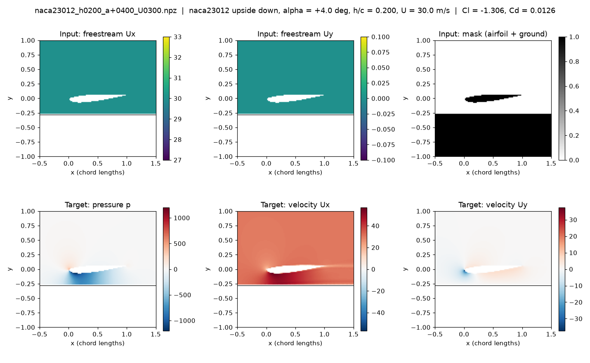

*NACA 23012 upside down at 4°, ride height 0.2 chords, 30 m/s, converged,
incoming nuTilda = 3e-5. The air speeds up to about 55 m/s in the gap, and the
low pressure there creates the downforce (Cl = −1.31).*

### Convergence and turbulence-level test (one case)

The same case run with two levels of incoming turbulence, up to 3000 iterations:

| Incoming turbulence | Stopped at | Cl at 500 iterations | Final Cl | Final Cd | Cl within 0.5% of its last value from |
|---|---|---|---|---|---|
| nuTilda = 0.14 m²/s (original dataset) | 1342 (residuals below 1e-5) | −1.023 | −1.194 | 0.0241 | iteration 1210 |
| nuTilda = 3e-5 m²/s (3 ν, the usual Spalart–Allmaras value) | 3000 (the nuTilda residual stays at 1e-3) | −1.137 | −1.306 | 0.0126 | iteration 1429 |

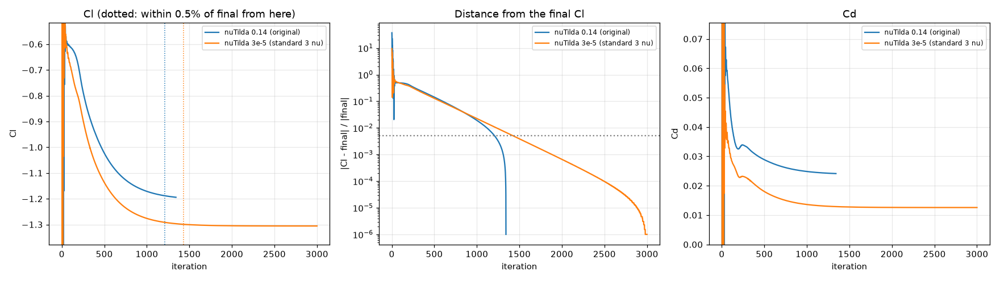

**What this shows:**
- **500 iterations is not enough in ground effect.** The original dataset uses
  500, but Cl is then still 13–14% from its converged value. Getting within 0.5%
  takes about 1,450 iterations, unless faster solver settings (SIMPLEC, being
  tested) reach the same answer sooner.
- **The solver's residual limit is not a reliable stop signal.** One run stopped
  while Cl was still drifting. The other never stopped, although Cl had been
  steady for a long time. The Cl history is used to judge convergence instead.
  (The stalled nuTilda residual was later traced to nuTilda being clipped in
  every iteration, see mesh study round 2.)
- **The incoming turbulence level matters.** The original value
  (nuTilda = 0.14 m²/s) is 14,000 times the molecular viscosity (ν = 1e-5 m²/s).
  The usual recommendation for this model is 3–5 ν (Spalart & Rumsey, 2007).
  Switching changes the downforce by 9% and halves the drag. We are checking
  which setting is closer to reality against high-fidelity LES data for a
  NACA 4412 in free air (Vinuesa et al., 2018), using `groundGen.py --free-air`
  and `validate_les.py` (see below).

### Validation against LES: NACA 4412 in free air, Re = 1M

Before generating data, the CFD setup is checked against well-resolved LES of
a NACA 4412 at 5° and Re_c = 1,000,000 (Vinuesa et al., 2018). The comparison
uses the surface pressure Cp and skin friction Cf along the wing, between 15%
and 98% of the chord, where the LES data is. The RANS runs use the same mesh and
solver as the ground-effect runs, but with no ground (`groundGen.py --free-air`).
Our 10 m/s, 1 m chord and ν = 1e-5 m²/s give exactly Re = 1M.

| Incoming nuTilda | Cl | Cd | Mean \|ΔCp\| suction side | Mean \|ΔCp\| pressure side | Mean \|ΔCf\| suction side | Mean \|ΔCf\| pressure side |
|---|---|---|---|---|---|---|
| 0.14 m²/s (original) | 0.818 | 0.0488 | 0.053 | 0.025 | 0.00169 | 0.00077 |
| 3e-5 m²/s (3ν) | 0.876 | 0.0275 | **0.033** | **0.021** | 0.00158 | 0.00107 |

(The Cf columns were corrected after mesh study round 2: the LES files
normalise skin friction differently from us. See the note there.)

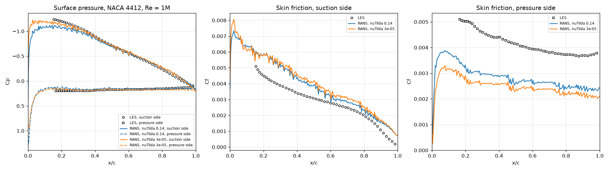

- **The realistic turbulence level (3ν) predicts the pressure clearly better.**
  The suction-side error drops by 38% and the suction peak moves closer to the
  LES. The pressure at the nose (the stagnation point) is Cp ≈ 1.0, as it must
  be. With 0.14 it is 1.25, which only happens in an unrealistically viscous
  flow.
- **Neither setting predicts skin friction or drag well on this mesh.** Cf is
  about 30% off on average, and Cd (0.028 and 0.049) is far above the 0.017–0.019
  of the finer meshes in the mesh study below. The turbulence level is not the
  cause; the mesh is. Only triangles about 0.005 chords in size touch the wall
  (picture below), so the thin boundary layer (0.005–0.04 chords) gets 1–6
  cells across it. The domain also reaches only 5 chords from the wing.
- Note on the LES data: the stored pressure has an arbitrary offset. It is
  removed using the total pressure outside the boundary layer, which is
  constant along the wing (P∞ = −0.058 for Re ≥ 200k).

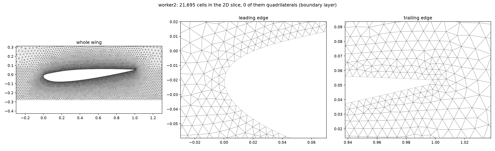

*The original mesh near the wing: triangles only, about 0.005 chords at the
surface.*

### Faster convergence: SIMPLEC

The same ground-effect case, solved with the original SIMPLE settings and with
SIMPLEC (`consistent yes`, relaxation 0.9):

| Solver | Final Cl | Final Cd | Cl within 0.5% of final from |
|---|---|---|---|
| SIMPLE (original settings) | −1.3057 | 0.0126 | iteration 1429 |
| SIMPLEC | −1.3035 | 0.0126 | **iteration 406** |

Both give the same answer (0.17% apart), but SIMPLEC needs 3.5 times fewer
iterations: about 1 minute per sample instead of 4.

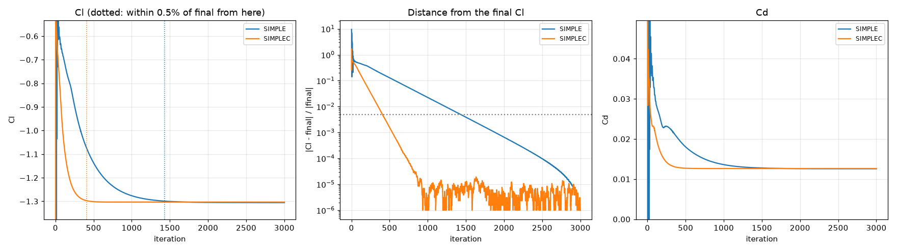

### Decisions so far, and next step

- **Incoming nuTilda = 3ν = 3e-5 m²/s, SIMPLEC and 1000 iterations** are now
  the defaults of `groundGen.py`. The original setup is still available with
  `--nutilda 0.14 --solver simple --iterations 500`.
- **Next: a mesh study** (below).

### Mesh study, round 1

This round compared the original mesh with a boundary-layer mesh (`--bl`:
thin quadrilateral layers along the wing, the first one 0.0002 chords thick),
each in a 5-chord and a 20-chord domain (`--domain 20`). The case is the
free-air NACA 4412 at Re = 1M, checked against the LES:

| Mesh | Domain | Cl | Cd | Mean \|ΔCp\| suction side | Mean \|ΔCp\| pressure side | Mean \|ΔCf\| suction side | Mean \|ΔCf\| pressure side |
|---|---|---|---|---|---|---|---|
| original | 5 chords | 0.875 | 0.0276 | 0.034 | 0.021 | 0.00159 | 0.00108 |
| original | 20 chords | 0.978 | 0.0158 | 0.036 | 0.033 | 0.00161 | 0.00113 |
| boundary layer | 5 chords | 0.819 | 0.0309 | 0.043 | 0.020 | 0.00094 | 0.00032 |
| boundary layer | 20 chords | 0.906 | 0.0202 | **0.013** | **0.008** | **0.00069** | 0.00036 |

(Cf columns corrected after round 2, see the note there.)

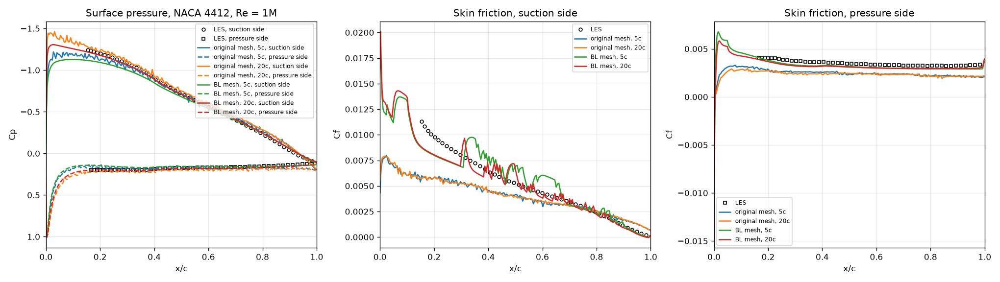

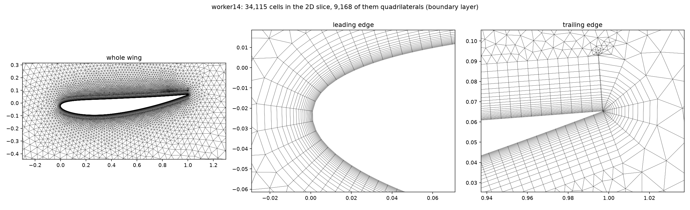

**What round 1 showed:**
- **The boundary-layer mesh in the 20-chord domain matches the LES surface
  pressure 2.5–4 times better** than any other combination.
- **Domain size matters.** Going from 5 to 20 chords raises Cl by 11–12% and
  cuts Cd by 35–43%.
- **The boundary-layer mesh brings skin friction 2–3 times closer to the LES**,
  but the suction-side Cf became jagged. Its first cell sat at y+ 4–8
  (measured with `mesh_quality.py`). That is the buffer layer, where neither
  the wall-resolved nor the wall-function treatment works well.
- **The larger domain coarsened the cells near the wing.** The sampled window
  had 37% fewer cells, and in ground effect cells 1 chord from the wing were up
  to 3 times larger. gmsh interpolates the cell size between the wing and the
  now distant, coarse outer boundary.
- **In ground effect the mesh matters too.** For the NACA 23012 test case the
  downforce changed from Cl −1.30 (original mesh) to −1.12.

### Mesh study, round 2

This round fixes both problems:
- The first cell height is set from each sample's speed, so that y+ is about 1
  (`first_layer` in `groundGen.py`). This gives 36–46 layers between 10 and
  50 m/s.
- Cell sizes grow as 0.005 + 0.05 × distance from the wing (in chords),
  whatever the domain size.

It also checks 5, 20 and 40-chord domains, in free air against the LES and in
ground effect (`mesh_study.sh`, then `mesh_study_report.py`).

Free air, NACA 4412 at 5°, Re = 1M, against the LES:

| Domain | Cells (in the sampled window) | \|Cl\| | Cd | Mean \|ΔCp\| suction / pressure side | Mean \|ΔCf\| suction / pressure side |
|---|---|---|---|---|---|
| 5 chords | 50,736 (36,627) | 0.834 | 0.0299 | 0.038 / 0.019 | 0.00036 / 0.00020 |
| 20 chords | 59,076 (36,187) | 0.921 | 0.0190 | **0.009** / 0.014 | 0.00028 / 0.00025 |
| 40 chords | 63,178 (35,915) | 0.937 | 0.0167 | 0.010 / 0.018 | **0.00027** / 0.00026 |

Ground effect, NACA 23012 at 4°, h/c = 0.2, 30 m/s:

| Mesh | Domain | Cells | Cl | Cd | Cl within 0.5% of final from | Time, 2000 iterations |
|---|---|---|---|---|---|---|
| original (triangles at the wall) | 5 chords | 21,695 | −1.3035 | 0.0126 | iteration 406 | (3000 iterations: 361 s) |
| round 1: boundary layer, y+ 4–8 | 20 chords | 23,614 | −1.1249 | 0.0203 | iteration 442 | 385 s |
| round 2: boundary layer, y+ ≈ 1 | 20 chords | 50,360 | −1.1329 | 0.0182 | iteration 466 | 604 s |
| round 2: boundary layer, y+ ≈ 1 | 40 chords | 52,413 | −1.1315 | 0.0181 | iteration 471 | 624 s |

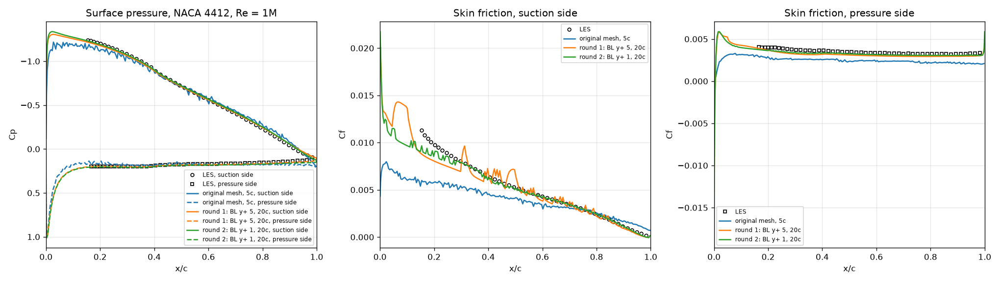

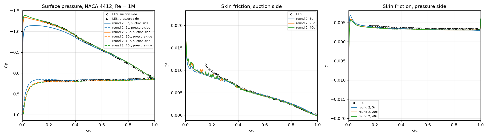

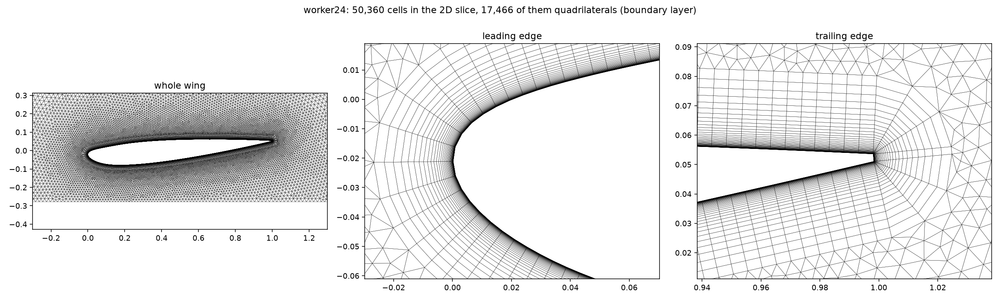

*The round-2 mesh in ground effect (the ground is the bottom edge of the left
picture). Thin layers wrap the nose and fan out at both corners of the blunt
trailing edge.* More pictures: [the mesh around the NACA 4412](results/mesh_bl2_naca4412.png),
[the S1223 at 50 m/s](results/mesh_bl2_s1223_U50.png) (thinnest first cell,
7e-6 chords), and [the Cl histories](results/convergence_bl2_ground.png).

**What round 2 showed:**
- **y+ ≈ 1 along the whole wing**: median 0.6–0.8, at most 1.2 (free air,
  10 m/s) and 1.5 (ground effect, 30 m/s).
- **Skin friction now matches the LES within 6–7% on average**: mean |ΔCf|
  0.00028 / 0.00025 is 5.6% / 7.2% of the mean LES value, against 31% for the
  original mesh. The surface pressure stays as close as in round 1.
- **The domain no longer changes the mesh near the wing.** The sampled window
  has 35,900–36,600 cells in all three domains, and the median cell size at each
  distance from the wing agrees within a few percent (round 1: 37% fewer cells
  at 20 chords).
- **Domain size in free air:** lift keeps growing with the domain size R, as
  Cl∞ − Cl ∝ 1/R. The far field of a lifting wing decays only as 1/distance,
  and the far-field boundary forces the undisturbed flow onto it. Extrapolating
  from 20 and 40 chords gives Cl∞ ≈ 0.952, which also predicts the 5-chord
  value within 1%. 20 chords is 3.3% low, 40 chords 1.6%. The agreement with the
  LES is equally good at 20 and 40 chords.
- **Domain size in ground effect: 20 chords is enough.** From 20 to 40 chords,
  Cl changes by 0.13% and Cd by 0.6%. With a ground, the wing's mirror image
  below it cancels most of the far field (a vortex pair decays as
  1/distance²). Round 3 checks this at the largest ride height.
- **The mesh decides the downforce.** The two boundary-layer meshes agree
  within 0.7% in Cl. The original mesh over-predicted the downforce by 15% and
  under-predicted the drag by 30%.
- **Decision:** the boundary-layer mesh with y+ ≈ 1 and a 20-chord domain are
  now the defaults of `groundGen.py` (`--no-bl --domain 5` gives the original
  mesh). A sample takes about 5 minutes for 1000 iterations on one CPU core.

**Correction: how the LES files define skin friction.** The Cf stored in the
WING LES files is based on the local edge velocity U_e, the peak of each
velocity profile, not on the freestream: Cf = 2(u_τ/U_e)². On the suction
side U_e reaches 1.49 U∞. Our RANS values, like most CFD, use the freestream.
The files also store u_τ, so `validate_les.py` now uses Cf = 2u_τ²/U∞² for
the LES. This was checked at every station: the stored Cf equals
2(u_τ/U_max)² exactly at all 100 stations. All Cf numbers and figures in this README use
the corrected comparison. Before the correction, the boundary-layer meshes
looked about twice too high on the suction side and the original mesh looked
best. With matching definitions the order reverses: each mesh improvement
brings Cf closer to the LES. The remaining difference just after 15% chord is
expected, because the LES boundary layer was tripped at 10% chord.

**Found: nuTilda is clipped in almost every iteration.** Every run with the
realistic incoming nuTilda (3e-5) printed `bounding nuTilda` in more than 99%
of its iterations. The convection scheme for nuTilda (linearUpwind with an
unlimited gradient) undershoots below zero where nuTilda drops steeply at the
edge of the boundary layer, and OpenFOAM resets those cells in every
iteration. This is why the nuTilda residual has stalled near 1e-3 since the
first realistic run. With the original 0.14, the clipping stops after 15
iterations and the residual converges. We suspected it also caused the small
steps left in the suction-side skin friction (rms 3%). They are about 0.04
chords apart, roughly the distance over which the boundary-layer edge climbs
one mesh layer. Round 3 showed that the steps stay when the clipping is gone,
so they come from the mesh itself. Wall distance, surface shape and wall
cells were checked and ruled out as causes of the clipping. Forces and pressures are steady (Cl changes by less than 0.01%
over the last 50 iterations), but the dataset should come from clean,
converging solutions.

### Mesh study, round 3: numerical verification

With the round-2 settings, `verification.sh` ran 11 cases of 2000 iterations
each, 4 at a time on separate CPU cores (54 minutes in all).
`verification_report.py` makes the tables and figures. It asks three
questions:
- Does a limited scheme stop the nuTilda clipping?
- How far is the default mesh from the mesh-independent answer?
- Is a 20-chord domain big enough at the largest ride height?

Cl and Cd are averages over the last 100 iterations (see "the drag flips" below).

**A. The nuTilda scheme.** The original linearUpwind is compared with two
alternatives: the same scheme with a limited gradient (`cellLimited`), and
the TVD scheme `limitedLinear`. Each runs in free air (the LES case) and in
ground effect (NACA 23012, 4°, h/c = 0.2, 30 m/s):

| Case | nuTilda scheme | Iterations with clipping | Most negative nuTilda clipped, last 100 iterations | Final nuTilda residual | Cl | Cd |
|---|---|---|---|---|---|---|
| free air | linearUpwind (round 2) | 1981 of 2000 | −8.6e-5 | 1.5e-3 | −0.9209 | 0.0190 |
| free air | **cellLimited** | **0** | none | **7.5e-5** | −0.9209 | 0.0190 |
| free air | limitedLinear | 1883 of 2000 | −2.2e-5 | 4.2e-4 | −0.9214 | 0.0190 |
| ground effect | linearUpwind (round 2) | 1990 of 2000 | −2.7e-4 | 4.7e-3 | −1.1329 | 0.0181 |
| ground effect | **cellLimited** | **10** (none after iteration 133) | none | **8.4e-5** | −1.1323 | 0.0181 |
| ground effect | limitedLinear | 1950 of 2000 | −1.1e-4 | 5.2e-4 | −1.1328 | 0.0181 |

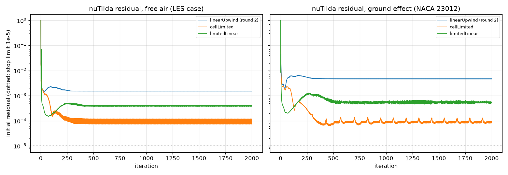

- **The limited gradient stops the clipping; limitedLinear does not.** With
  cellLimited, nothing is clipped in free air. In ground effect, clipping
  happens only while the flow develops, in the first 133 iterations. The
  final nuTilda residual is 20–56 times lower. limitedLinear still clips in
  94–98% of the iterations. The clipped values were not rounding noise: up to
  9 times the incoming nuTilda (3e-5), but negative.
- **The forces hardly change**: Cl by at most 0.06%, Cd by at most 0.3%.
- **The clipping did not cause the small steps in the skin friction.** They
  stay with cellLimited (scatter 2.8% on the suction side in free air, 4.3% in
  ground effect), so they come from the mesh.
- **Against the LES**, the surface pressure is the same with all three
  schemes. Between 15% and 40% chord, cellLimited's suction-side skin friction
  is 2–5% lower than linearUpwind's (less than 1% further back). This is the
  region just behind the LES trip (10% chord), where all three runs are
  already below the LES. Its mean |ΔCf| on the suction side is 0.00038
  instead of 0.00028 (7.6% instead of 5.6% of the mean LES value).
  ([Figure](results/scheme_test_les.png))
- **Decision: cellLimited stays the default.** A dataset should come from
  solutions that actually converge, and the small local change in Cf is
  smaller than the difference between RANS and LES there.

**B. Grid convergence.** Each case runs on three meshes. Every cell is √2
times smaller from one mesh to the next (`--refine 0.7071, 1, 1.4142`), so
each mesh has about twice the cells of the previous one. The grid convergence
index (GCI) follows Celik et al. (2008).

NACA 23012, 4°, h/c = 0.2, 30 m/s:

| Mesh | Cells | Cl | Cd | Cl within 0.5% of final from | y+ of the first cell, suction side (median / max) |
|---|---|---|---|---|---|
| fine (`--refine 1.4142`) | 99,563 | −1.1325 | 0.0175 | iteration 734 | 0.58 / 1.02 |
| **medium (default)** | 50,360 | −1.1323 | 0.0181 | iteration 477 | 0.82 / 1.53 |
| coarse (`--refine 0.7071`) | 25,480 | −1.1214 | 0.0192 | iteration 342 | 1.15 / 2.27 |
| extrapolated to zero cell size | | −1.1327 | 0.0168 | | |

| | Observed order of convergence | GCI, fine mesh | GCI, medium mesh |
|---|---|---|---|
| Cl | 11.7 | 0.02% (0.05% with safety factor 3) | **0.04%** (0.11% with safety factor 3) |
| Cd | 1.7 | 5.4% | 9.7% |

| Flow field, difference from the fine mesh (measured like the U-Net test error) | Pressure | Velocity |
|---|---|---|
| medium mesh (default) | **0.22%** | **0.15%** |
| coarse mesh | 1.11% | 0.42% |

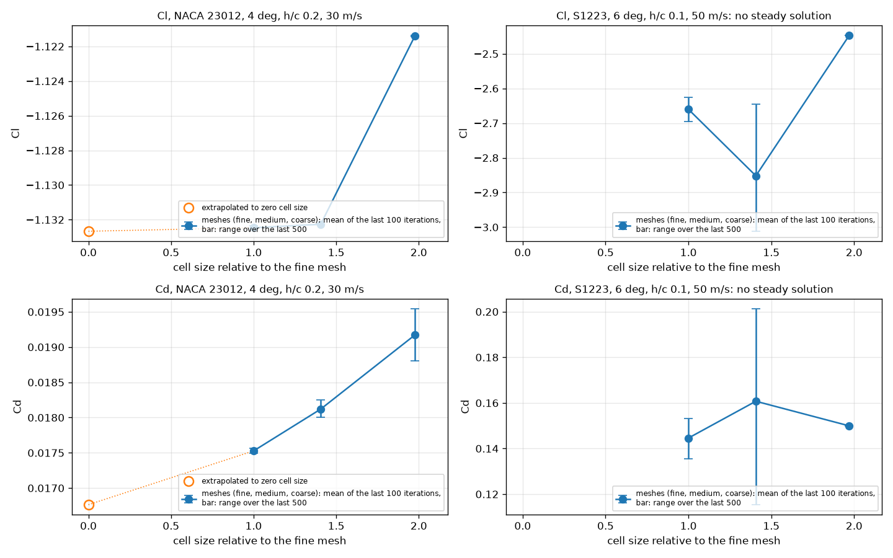

- **Downforce is mesh-converged on the default mesh.** Its GCI is 0.04%. The
  observed order, 11.7, is far above the formal order 2. That means the
  coarse mesh is not yet in the asymptotic range (its Cl is 1% off). The GCI
  therefore uses order 2. Even with the more cautious safety factor 3
  recommended for such cases (Roache, 1998), it is 0.11%.
- **Drag converges more slowly.** It carries about 10% numerical uncertainty
  on the default mesh, and the extrapolated Cd is 7.5% below the default
  mesh's value. Drag depends on the thin boundary layer and wake, so it is
  the most mesh-sensitive quantity in 2D RANS. For drag predictions, for
  example the comparison with experiments, the fine mesh is the better
  choice.
- **The flow field that the U-Net learns is converged far below what the
  network can resolve.** The default mesh differs from the fine one by 0.22%
  in pressure and 0.15% in velocity, measured like the U-Net's test error. On
  the original dataset, the U-Net's own errors are 14.9% (pressure) and 2.5%
  (velocity): about 70 and 16 times larger.
- **1000 iterations are enough on the default mesh.** Cl and Cd averaged over
  iterations 901–1000 differ from those over 1901–2000 by 0.013% and 0.015%.
  The fine mesh needs about 1500 iterations (0.16% and 0.27% after 1000).
- **The drag flips between two values every iteration.** The flip is ±0.19%,
  ±0.67% and ±1.9% on the fine, medium and coarse meshes, against ±0.002%
  for Cl. The solver has settled into a cycle of two iterations. The cycle
  appears with all three nuTilda schemes, and it is also the band in the
  residual plot above. Averaging over the last 100 iterations removes it; with
  last-iteration values, the Cd convergence order looked like 1.3 instead of
  1.7. `groundGen.py` now saves the averages.

S1223, 6°, h/c = 0.1, 50 m/s (the hard case):

| Mesh | Cells | Cl | Cd | Cl range over the last 200 iterations | nuTilda clipped | Wing surface with reversed flow |
|---|---|---|---|---|---|---|
| fine | 114,167 | −2.66 | 0.145 | 2.6% | until the end | 19% |
| medium | 57,677 | −2.85 | 0.161 | 12.3% | until the end | 19% |
| coarse | 29,417 | −2.45 | 0.150 | 0.02% | until the end | 20% |

- **This case has no steady solution.** On the side facing the ground, the
  flow separates at about 62% chord on all three meshes. Behind that point,
  the flow next to the wall runs backwards over the rest of that side (19% of
  the whole surface).
  - On the medium and fine meshes, the forces keep swinging, Cl by 2.6–12%
    even after 2000 iterations.
  - The coarse mesh looks steady only because its larger numerical
    dissipation damps the motion. It still clips nuTilda in every iteration.
  - A GCI needs converged solutions, so none is computed.
- **This is the force-reduction region of ground effect.** Experiments on an
  inverted wing found the same: below a critical ride height, the boundary
  layer on the side facing the ground separates and the downforce stops
  growing (Zerihan & Zhang, 2000). A steady RANS solver cannot represent this
  unsteady flow.
- **Consequence for the dataset: every run is now checked.**
  - A run counts as converged if Cl varies by less than 0.1% over its last
    200 iterations and nuTilda is no longer clipped at the end.
  - Every normal run on the default mesh passes with a wide margin:
    0.003–0.03% after 1000 iterations. The S1223 runs fail: the fine and medium on both criteria,
    the coarse on the clipping.
  - Runs that fail are saved in `not_converged/`, so they cannot slip into the
    training data, and their share can be reported.
  - Every sample also stores the share of the wing surface with reversed
    flow.

**C. Domain size at the largest ride height.** NACA 23012, 4°, h/c = 0.6:
going from 20 to 40 chords changes Cl by 0.02% (−0.6985 vs −0.6986) and Cd by
0.14%. So 20 chords is enough at every ride height in the planned range.

**D. Cost: finding the sample points.** Before the first iteration, OpenFOAM
searches the mesh for each of the 16,384 points of the output grid. In these
runs, the start-up before the first iteration took 4 to 20 minutes, most of it
this search. That is 37–66% of the run time, and in 9 of the 11 runs longer
than the 2000 iterations themselves. `groundGen.py` now samples
the same points as 128 lines, one per grid row (`--sampling lines`, the new
default). OpenFOAM then searches only for the start of each line and walks
along it from cell to cell. The lines contain exactly the original points.
Inside the container, `sampling_test.py` re-sampled two finished round-2 runs
this way (one in ground effect, one in free air). The masks and the values at
every point were identical to the original samples. Re-sampling took 22–23 s,
including reading the mesh and the fields. The start-up of those runs had
taken 317 s and 152 s. In a full run, the first iteration now ends after 4 s.

**End-to-end check with the new defaults** (1000 iterations, one run at a
time, `data/smoke`):
- **NACA 23012 test case:** Cl −1.1321, Cd 0.0181, converged (Cl varies by
  0.028% over the last 200 iterations).
  - The sampled flow field differs from the 2000-iteration run by 0.009% in
    pressure and 0.001% in velocity, so stopping at 1000 iterations makes no
    measurable difference.
  - The whole sample took 182 s, meshing included; with the point cloud the
    start-up alone had taken 317 s.
- **S1223 hard case:** marked as not converged (Cl varies by 5.5%, nuTilda is
  clipped to the end, 19% of the surface has reversed flow) and saved in
  `not_converged/`.
- **Exactly reproducible:** for both cases, Cl in every one of the 1000
  iterations is bit-for-bit the same as in round 3. That run was made with the
  old sampling and 4 runs at a time.

**Decisions after round 3:**
- Defaults stay: cellLimited, the medium mesh, 20 chords, 1000 iterations.
- Cl and Cd are averages over the last 100 iterations.
- Runs that do not converge are kept out of the training data.
- The sample points are found row by row (`--sampling lines`): the same
  samples, with a much faster start.

**Next:** validation in ground effect against wind-tunnel data. Then a scan
of the parameter ranges, to find where steady RANS converges, and finally
the dataset.

### Validation in ground effect: the Tyrrell 026 wing

The LES comparison checked the setup in free air. With a ground, the
reference is the wind tunnel study of Zerihan (2001; summarised in Zerihan &
Zhang, 2000). It is the standard test case for inverted wings in ground
effect.

**The experiment** (thesis, Chapters 2, 4 and 9):
- **Model:** the main element of the 1998 Tyrrell 026 F1 front wing at 80%
  scale. Chord 223.4 mm, span 1100 mm, with endplates; a modified NASA
  GA(W) section with a 0.007c thick trailing edge.
- **Tunnel:** the 2.1 m × 1.7 m tunnel at Southampton. It has a moving belt
  and boundary-layer suction ahead of it, so the ground has no boundary layer.
- **Flow:** 30 m/s, Reynolds number 0.43–0.46 million.
- **Transition:** free. Oil flow shows a laminar separation bubble at about
  30% chord on the suction surface. A second series had trips at 10% chord.
- **Incidence:** quoted incidences are 2.45° below the true angle to the
  chord line. The reference incidence, quoted 1°, is a true 3.45°.
- **Ride height:** measured to the lowest point with the wing at quoted 0°.
  The wing is then rotated about its quarter chord.
- **"Freestream" tests:** made 750 mm above the moving ground (h/c = 3.36),
  in the middle of the tunnel, not in free air.

**What we compare with:**
- **Sectional downforce at the wing centre** at eight ride heights (Table 15).
  It comes from integrating 45 surface pressure tappings. Zerihan calls it an
  estimate for trends: the tappings are too sparse to catch the suction spike
  at the leading edge.
- **His own 2D RANS results** (the CFL3D code; Spalart–Allmaras, the model we
  use, and k-ω; y+ ≈ 1; moving ground; fully turbulent; structured grids of
  25,000–30,600 cells in ground effect, 20,500 in free air). With
  Spalart–Allmaras, the trend with height was right,
  and the values were 12–17% above the tapping estimate. His "freestream" case
  has no ground: its grid has no ground block (Table 14).
- **Where the flow separates near the trailing edge**, from oil flow. At
  h/c = 0.224 a very small separated region appears at x/c ≈ 0.99. It moves
  forward to x/c 0.91 at h/c = 0.134, about 0.8 at 0.090 and about 0.7 at
  0.067. This is the separation that limits the downforce.

**Our setup** (`validation_zerihan.sh`):
- **Wing shape:** the coordinates of Table 2 (44 points per surface), read
  from the thesis and rotated back to zero incidence (`make_tyrrell026.py`).
  The table is printed at the reference incidence. Rotating it back needs
  3.454°, the thesis says 3.45°, and the thickness (12.6% at 24% chord,
  trailing edge 0.0073c) matches the description. The shape is smoothed
  within the rounding of the table (see "Problem found" below). The first
  run used the table points as they are. The coordinates are not part of this
  repository.
- **Conditions as in the experiment:** true incidence 3.45°, ride height
  set at 2.45° and the wing then rotated about the quarter chord
  (`--h-alpha 2.45`). Re = 462,000 (4.62 m/s with our 1 m chord).
- **Runs:** free air, h/c 3.36, and nine heights from h/c 0.671 down to
  0.067. Each runs on three meshes, each with about twice the cells of the one
  before: coarse, default and fine (`--refine` 0.7071, 1 and 1.4142). 2000
  iterations each; 33 runs, 1 h 51 min at 4 at a time.
- **Like-for-like integration:** `validation_zerihan.py` also integrates our
  pressures at the experiment's tapping positions, in the same way as the
  experiment. This tests how much of the 15% gap comes from the sparse
  tappings.

**Results** (fine mesh; `validation_zerihan.py`, table 1). GCI: the numerical
uncertainty of our downforce, from the three meshes (see the mesh study
below).

| h/c | Experiment | CFL3D S-A | Ours | GCI | Ours, at the tappings | vs experiment | vs CFL3D | Separation x/c, ours | Separation x/c, oil flow |
|---|---|---|---|---|---|---|---|---|---|
| free air | – | 0.885¹ | 0.842 | 0.1% | 0.831 | – | −4.9% | – | – |
| 3.36 | 0.766¹ | – | 0.892 | 0.0% | 0.879 | +14.8% | – | – | – |
| 0.671 | 0.902 | 1.052 | 1.046 | 0.2% | 1.032 | +14.4% | −0.6% | – | – |
| 0.448 | 1.009 | 1.174 | 1.168 | 0.3% | 1.153 | +14.3% | −0.5% | – | – |
| 0.313 | 1.145 | 1.320 | 1.325 | 0.4% | 1.309 | +14.3% | +0.4% | – | – |
| 0.224 | 1.286 | 1.475 | 1.498 | 0.9% | 1.480 | +15.1% | +1.5% | 0.94 | ≈ 0.99 |
| 0.179 | 1.362 | 1.565 | 1.603 | 1.3% | 1.585 | +16.4% | +2.4% | 0.88 | – |
| 0.134 | 1.385 | 1.604 | 1.666 | 1.8% | 1.648 | +19.0% | +3.9% | 0.79 | 0.91 |
| 0.112 | – | – | 1.669 | 3.0%² | 1.651 | – | – | 0.74 | – |
| 0.090 | 1.371 | 1.539 | 1.633 | 3.1%² | 1.615 | +17.8% | +6.1% | 0.69 | ≈ 0.8 |
| 0.067 | – | – | 1.560 | –³ | 1.544 | – | – | 0.63 | ≈ 0.7 |

"vs experiment" compares our pressures integrated at the tappings with the
experiment, "vs CFL3D" our force coefficients with CFL3D.

¹ The "freestream" row of Table 15 holds two different cases. The tests
were made 3.36 chords above the ground; the CFD for it had no ground.

² The coarse mesh did not pass the convergence test: its downforce still
varies by 0.12% (h/c 0.112) and 0.18% (0.090). That is less than a tenth of
the differences between the meshes, so the GCI uses the mean of its last 100
iterations.

³ No GCI: on the coarse mesh the downforce oscillates by 0.7% and nuTilda is
still clipped; on the default mesh it still drifts (0.15%).

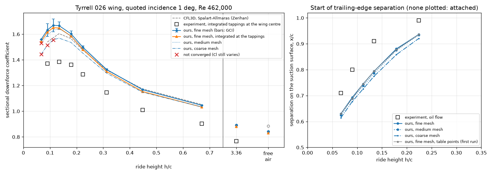

*Left: sectional downforce. Grey dashes: Zerihan's 2D RANS (CFL3D); squares:
the experiment; blue: ours on the three meshes, with the GCI as bars on the
fine mesh; orange: ours integrated at the experiment's tapping positions;
crosses: runs that did not converge. Right of the vertical line: the height of
the "freestream" tests (h/c 3.36) and free air. Right: where the flow starts to
separate on the suction surface.*

**Mesh study** (`validation_zerihan.py`, table 2). Downforce on the three
meshes; the observed order of convergence p; the extrapolated value and the GCI
(Celik et al. 2008, with p at most 2 in the GCI); and how far the sampled flow
field of the default mesh is from the fine mesh's, measured like the U-Net
error.

| h/c | Downforce: coarse | default | fine | p | Extrapolated | GCI, fine mesh | Field, default vs fine: p / v |
|---|---|---|---|---|---|---|---|
| free air | 0.835 | 0.843 | 0.842 | (up and down) | 0.841 | 0.09% | 0.14% / 0.03% |
| 3.36 | 0.883 | 0.891 | 0.892 | 9.5 | 0.892 | 0.04% | 0.10% / 0.03% |
| 0.671 | 1.033 | 1.045 | 1.046 | 6.5 | 1.048 | 0.18% | 0.17% / 0.09% |
| 0.448 | 1.148 | 1.165 | 1.168 | 5.5 | 1.171 | 0.30% | 0.28% / 0.13% |
| 0.313 | 1.296 | 1.321 | 1.325 | 5.3 | 1.329 | 0.40% | 0.36% / 0.16% |
| 0.224 | 1.451 | 1.487 | 1.498 | 3.8 | 1.508 | 0.86% | 0.74% / 0.24% |
| 0.179 | 1.536 | 1.586 | 1.603 | 3.2 | 1.620 | 1.35% | 1.09% / 0.30% |
| 0.134 | 1.569 | 1.642 | 1.666 | 3.3 | 1.690 | 1.82% | 1.54% / 0.38% |
| 0.112 | 1.556* | 1.630 | 1.669 | 2.0 | 1.709 | 3.00% | 2.37% / 0.40% |
| 0.090 | 1.514* | 1.593 | 1.633 | 2.1 | 1.673 | 3.08% | 2.39% / 0.36% |
| 0.067 | 1.444* | 1.529* | 1.560 | – | – | – | 1.86% / 0.32% |

\* not converged (see the notes under the results table). Cells: coarse
23,000–48,000, default 46,000–95,000, fine 90,000–190,000 (the most at h/c
3.36).

- **Downforce converges steadily with the mesh.** Down to h/c 0.134, p is 3 to
  10, above the formal order of 2: the coarse mesh is not yet in the
  asymptotic range, so the GCI uses p = 2, the cautious choice. Below, p is
  about 2. In free air the three values go up and down, within 0.1%.
- **The uncertainty grows towards the ground:** from 0.04–0.4% down to h/c
  0.313, to 1.8% at 0.134 and about 3% at 0.112 and 0.090.

**Against CFL3D on each of our meshes** (`validation_zerihan.py`, table 4).
Zerihan's grids in ground effect had 25,000–30,600 cells (Table 14), about as
many as our coarse mesh:

| h/c | Ours, coarse | default | fine | extrapolated |
|---|---|---|---|---|
| 0.671 | −1.8% | −0.7% | −0.6% | −0.4% |
| 0.448 | −2.2% | −0.7% | −0.5% | −0.3% |
| 0.313 | −1.8% | +0.1% | +0.4% | +0.7% |
| 0.224 | −1.6% | +0.8% | +1.5% | +2.2% |
| 0.179 | −1.9% | +1.3% | +2.4% | +3.5% |
| 0.134 | −2.2% | +2.4% | +3.9% | +5.4% |
| 0.090 | −1.6%* | +3.5% | +6.1% | +8.7% |

**What the results show:**
- **The same curve as Zerihan's 2D RANS, down to h/c 0.224.** Same
  turbulence model, but a different code, mesh and solver. Our downforce is
  within 0.6% of his from h/c 0.671 down to 0.313, and within 1.5% at 0.224.
  Our largest downforce is at h/c 0.112–0.134 (1.669 and 1.666, equal within
  0.2%). CFL3D and the experiment also peak at 0.134, with 0.179 and 0.090 as
  their nearest heights.
- **Closer to the ground ours is higher, and that looks like mesh
  resolution.** The difference grows from +2.4% at h/c 0.179 to +6.1% at
  0.090. On our coarse mesh, which is about as large as his grids, our
  downforce is 1.6–2.2% below his at every height: the two curves have the
  same shape. Refining the mesh raises our downforce, most of all near the
  ground, where the GCI is largest. This suggests that most of the growing
  difference comes from mesh resolution, not from the model. A structured grid
  like his can do more with the same number of cells. But his grids had even
  fewer cells at the two lowest heights (Table 14), where ours need the most.
- **Both 2D RANS results are well above the experiment.** Integrated at the
  tappings, ours is 14.3–15.1% above the experiment from h/c 3.36 down to
  0.224, and 16–19% closer to the ground; CFL3D is 12–17% above. Zerihan put
  part of the gap down to the sparse tappings, which would miss the suction
  spike at the leading edge. But integrating our pressures only at the
  tapping positions lowers our downforce by just 1.0–1.2%: the tappings catch
  most of it. So the experiment's pressures themselves are lower. More likely
  causes are the differences between 2D RANS and the tunnel. The wing is
  finite (aspect ratio 4.9), and its tip vortices reduce the effective
  incidence even at the centre. And transition is free.
- **"Freestream" was two different cases.** The tests were made 3.36 chords
  above the moving ground. Zerihan's CFD for this case had no ground: Table 14
  lists no ground block for its grid. At the tests' height, our h/c 3.36 run
  is 14.8% above the experiment, in line with the other heights (the tunnel
  roof makes this comparison less exact; see below). Our free air is 4.9%
  below CFL3D's. Free air is the one case where our 20-chord domain
  matters: in round 2 it lowered the NACA 4412's lift by 3.3% (lift ∝ 1/R).
  A ground 3.36 chords away still adds 5.9% downforce, on all three meshes;
  part of that is this domain effect.
- **Separation: right onset, too far forward.** As in the oil flow, the flow
  starts to separate at the trailing edge around h/c 0.224, and the
  separation moves forward as the wing gets lower. But ours lies 0.05–0.12
  chords further forward. This is expected from a turbulence model that is
  turbulent from the leading edge. In the experiment the boundary layer stays
  laminar up to the bubble at 0.3c, so it reaches the trailing edge thinner.
  Zerihan's tests with trips at 10% chord had more separation and less
  downforce near the ground (3D balance: maximum CL 1.39 instead of 1.72).
  The mesh moves our separation point by 0.015–0.023 chords from the coarse
  to the fine mesh, and by at most 0.007 from the default to the fine mesh.
- **Converged:** all 11 runs on the fine mesh, 10 of 11 on the default and 8
  of 11 on the coarse mesh. The failures are all at the lowest heights, where
  13–20% of the wing surface has reversed flow. There the coarse mesh
  oscillates (and at h/c 0.067 still clips nuTilda), and on the default mesh
  the downforce still drifts at h/c 0.067. Zerihan had the same problem with
  CFL3D: steady runs oscillated, and only time-accurate runs settled on a
  steady result, after 3–4 days per case.
- **y+ of the first cell** (5–95% chord): at most 1.6–2.3 on the coarse mesh,
  1.2–1.7 on the default and 0.8–1.2 on the fine mesh (medians 0.9–1.2,
  0.7–0.9 and 0.5–0.65).
- **Run time:** 2000 iterations took 5–6 minutes on the coarse mesh, 9–11 on
  the default and 19–25 on the fine mesh, with 4 runs at a time. h/c 3.36 has
  1.6 times the cells and took 8, 18 and 44 minutes.

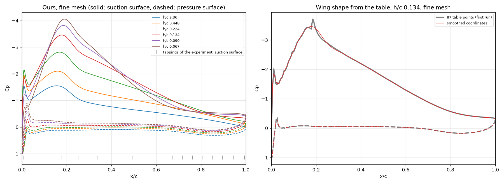

*Left: our surface pressure on the fine mesh at six heights; the ticks at the
bottom mark the experiment's tappings on the suction surface. As the wing gets
closer to the ground, the suction peak grows and moves back, and the pressure
recovery behind it gets steeper. Right: the first run (grey, the table points
as they are) against the smoothed wing (red), at h/c 0.134.*

**Problem found: kinks in the wing surface.** Our pressure distributions had
spikes, the largest at x/c = 0.18, next to the suction peak. They are not
physical. gmsh joins the points of an airfoil with a Catmull-Rom spline, which
bends sharply wherever the spacing of the points jumps. The spacing in the
table changes in steps from 0.001 to 0.05 chords. The shape changes very
little (at most 0.07 mm on the 223 mm model), but the pressure reacts to the
curvature. `shape_check.py` builds the same curve and computes the inviscid
pressure on it. It shows the same spikes:

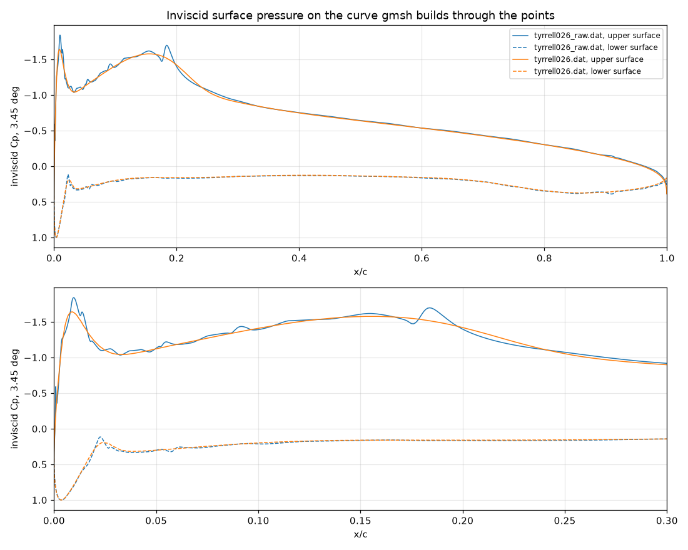

The fix: `make_tyrrell026.py` now fits a smoothing spline (quintic, in arc
length) that stays within the rounding of the table's four decimals. The
table points are 9 µm (rms) and at most 34 µm from it, on the 223.4 mm model.
It is written with 200 points per surface.
- **Effect on the inviscid Cp:** the largest wiggle drops from 0.043 to
  0.003 on the suction surface, and from 0.103 to 0.017 on the pressure
  surface.
- **Effect in the RANS runs** (`validation_zerihan.py`, table 3): the spikes
  are gone (right of the figure above). Downforce changed by 0.0–0.6% and the
  separation point by at most 0.004 chords, so the first run's findings
  stand. The sampled pressure field changed by 0.1–0.7%, as much as the
  default mesh's own error at moderate heights. Kinks matter more for training
  data than for forces. The first run is kept in
  `ground_effect/data/validation_zerihan_raw` (not in this repository).
- **What remains** is a real, smooth bump in the shape at x/c 0.02. Zerihan's
  CFD shows it as well (a small deceleration at x/c 0.03 on the pressure
  surface); the experiment does not.
- **Earlier tests:** the airfoil files used there are much less affected
  (largest wiggle 0.010 for the NACA 23012 and 0.009 for the S1223).

**Known differences we cannot remove:**
- The experiment had free transition with a laminar bubble. Our turbulence
  model assumes turbulent flow from the leading edge.
- The wing is three-dimensional: aspect ratio 4.9, with endplates. The flow
  at its centre is close to 2D, but the tip vortices change it somewhat.
- The tunnel has a roof. It is about 7 chords above the wing near the ground,
  but only about 4 chords above it in the "freestream" tests, almost as close
  as the ground (3.36 chords). There it partly cancels the ground's effect,
  so that test lies somewhere between our free-air and our h/c 3.36 runs.
  Neither CFD has the roof: Zerihan's top boundary at 7 chords is not a wall
  (it extrapolates the flow), and ours is 20 chords away.

**What this means for the dataset:**
- **The default mesh stays.** Its sampled flow fields are within 0.1–0.4%
  (pressure) of the fine mesh's down to h/c 0.313, 0.7–1.5% from 0.224 to
  0.134 and 1.9–2.4% below; velocity within 0.4% everywhere. The U-Net's test
  errors are about 15% (pressure) and 2.5% (velocity), 6 to 100 times larger.
  The fine mesh would take 2.2 times as long.
- **Separated flow close to the ground may not converge,** even at this
  moderate incidence: the default mesh failed at h/c 0.067, with 19% of the
  wing surface in reversed flow. The convergence test keeps such runs out of
  the data; the parameter scan will show how much of the range they affect.
- **Airfoil files:** the UIUC files have the same kinks, most of them worse
  than the Tyrrell table. They are smoothed before the dataset is made (next
  section).

### Airfoil shapes for the dataset

The Tyrrell wing showed that gmsh's spline puts kinks into the surface wherever
the spacing of the points jumps. Before making the dataset, all 1,497 UIUC
files that `groundGen.py` draws from (and the 30 test files) were checked in
the same way, and smoothed.

**The files.**
- **Few points.** A file has 61 points (median), and 10% of the files have 33
  or fewer. Next to the leftmost point, the longer of its two segments is 0.011
  chords long (median; 0.03 in 10% of the files). So for most files, the curve
  between the points decides the shape of the nose, not the points themselves.
- **Kinks.** On the surface groundGen meshes from the points, the largest
  wiggle in the inviscid Cp of a file (`shape_check.py`, at 3.45°) is 0.046
  (median). It is above 0.03 in 843 files and above 0.1 in 475. The Tyrrell
  table had 0.043 and 0.103.
- **Padded with zeros.** 849 files carry fewer decimals than they are written
  with. Of the 837 files written with seven decimals, 566 carry five (like
  0.1234500), and 137 carry four. Most of them are Göttingen sections. The x
  values are often round stations (0.05), so only the y values tell how
  precisely a file was given: 3 decimals in 35 files, 4 in 234, 5 in 986, 6 in
  106, 7 in 89 and 8 in 47.

**The smoothing** (`smooth_airfoils.py`) replaces the points of each file with
a smooth curve through them:
- **y as a function of ξ = ±√(x − x₀)** (+ on the upper surface, − on the
  lower), with x₀ the nose. Behind a round leading edge, y grows like
  √(x − x₀). So as a function of ξ the surface runs smoothly over the nose, and
  a spline gets the nose right from the few points most files have there.
- **A quintic smoothing spline** (Schoenberg 1964, Reinsch 1967): of all curves
  that stay within the rounding of the points, the one with the smallest third
  derivative. "Within the rounding" means Σ((y − f)/σ)² = n, with σ from the
  decimals the file carries (and the rounding of x, through its effect on ξ).
  The spline has a knot at every point, so it cannot swing out between points
  that are far apart. The two trailing-edge points stay in place.
- **The nose x₀** is the leftmost point of a quintic smoothing spline in arc
  length (FITPACK, as for the Tyrrell wing), near the leftmost point of the file.
- **Resampled** with 200 points per surface, spaced by a cosine in arc length:
  dense at the nose and at the trailing edge, without jumps.

**Test against known shapes** (`smoothing_test.py`). The true shapes of the
files are unknown, so each file gets a stand-in whose shape is known: a NACA
4-digit airfoil with about the file's thickness, camber and kind of trailing
edge, sampled at the file's own stations and rounded to its decimals. Three
surfaces are compared with the exact shape: gmsh's spline through the points
(what groundGen did so far), the arc-length smoothing of the Tyrrell wing, and
the √x smoothing.

| Stand-ins of the 1,462 files used | gmsh through the points | smoothed in arc length | smoothed in √x |
|---|---|---|---|
| Largest distance from the exact shape (chords): median / 90% / 99% | 5.2e-4 / 1.3e-3 / 2.2e-3 | 7.8e-5 / 2.5e-4 / 1.6e-3 | **3.4e-5 / 1.8e-4 / 7.9e-4** |
| Largest error in inviscid Cp, 2–95% chord: median / 90% / 99% | 0.085 / 0.24 / 0.83 | 0.018 / 0.083 / 0.19 | **0.0065 / 0.023 / 0.051** |
| Largest wiggle in inviscid Cp: median / largest | 0.039 / 39,756 | 0.0021 / 5,767 | **0.0014 / 0.0049** |

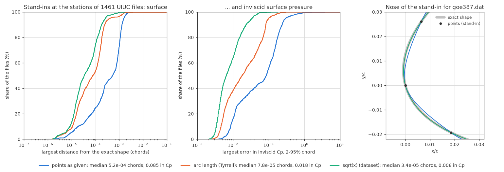

*Left and middle: share of the files below a given error (one stand-in per
file). Right: the nose of the stand-in for goe387, which has only one point
between x/c = 0 and 0.02 on each surface. gmsh's spline (blue) misses the
nose; the √x curve (green) follows the exact shape (grey).*

- The √x curve is closer to the exact shape than gmsh's spline in 93% of the
  files, and its Cp error is smaller in 99%. Against the arc-length smoothing:
  closer in 83%, smaller Cp error in 88%.
- Gmsh's spline and the arc-length spline both go far off for a few station
  layouts (largest Cp errors 41,350 and 12,551). The √x curve never does.
- Its error follows the precision of the file: median 6.4e-4 chords for the
  35 files that carry three decimals, 1.4e-4 for four, 2.8e-5 for five, and
  below 1.5e-5 for six to eight. All its errors above 1e-3 chords and above
  0.1 in Cp come from four files whose lower surface stops short of the
  trailing edge (dbln526, ste87151, ste87391, stf86361). groundGen closes them
  with a straight line, smoothed or not, and all three surfaces have the same
  error there.
- One stand-in fails (n63215b): it has two leading-edge points at the same x,
  and the nose comes out to their right. The smoothing then stops with an
  error instead of writing a file. The real n63215b file smooths normally.

**The real files** (`shape_check.py`):

| 1,462 files used | As given | Smoothed |
|---|---|---|
| Largest wiggle in inviscid Cp: median / 90% / 99% | 0.045 / 0.22 / 0.43 | **0.0027 / 0.0088 / 0.039** |
| Files with a wiggle above 0.03 / above 0.1 | 817 / 453 | **25 / 0** |

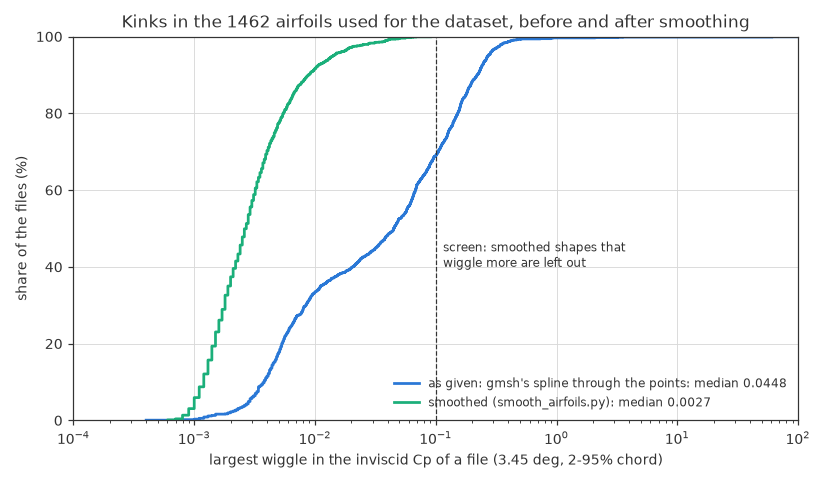

- **How far the surface moves:** 4.5e-4 chords (median), 2.1e-3 (90%) and
  4.0e-3 (99%). In 80% of the files it moves most at the nose (x/c < 0.05),
  where gmsh's spline was furthest off on the stand-ins. On the 223 mm Tyrrell
  model, 4.5e-4 chords would be 0.1 mm.
- **How far the curve stays from the points:** 0.58 half units of the last
  decimal they carry (rms), as intended: that is the rounding error of the
  decimals (1/√3). The largest distance is 2.6 half units in the median file
  and 5.8 in 99% of the files.
- The 30 test files are all kept: their largest wiggle drops from 0.035
  (median) to 0.0018, and is at most 0.017.

**Files left out (35).** Rules in `smooth_airfoils.py`, with the reason
printed for each file. The dataset keeps 1,462 of the 1,497 files, and all 30
test files:
- **Errors in the points (8):** a station missing or listed twice (cap21c;
  wb140: 0.175 twice, where 0.200 belongs), a copied leading-edge point
  (eh3012), or a misplaced point, where the contour turns by more than 30° at
  one point between 10% and 90% chord: naca63206 (0.6002 where about 0.650
  belongs), naca63a210, du861372 (0.29795 where about 0.248 belongs), goe481,
  goe802a. 99% of the files stay below 14° there.
- **Not a whole airfoil (3):** the chord does not run from 0 to 1: e664ex
  (with an extended flap, to 1.2), ua79sff (a flap alone) and ua79sfm (a main
  element alone).
- **The contour crosses itself (9),** as groundGen closes it: dsma523a, e340,
  e378, fx38153, fx62k131, fx63147, fx72150b, fx72ls160, mh150. In fx63147
  the lower surface lies above the upper one over the last 1% of the chord; in
  e378 the surfaces cross back and forth over the rear half.
- **After smoothing, the contour crosses itself (3):** e341, s4180, strand.
  Both surfaces run into a cusp at the trailing edge, closer together than the
  rounding of their points can resolve.
- **After smoothing, the pressure still wiggles (12):** the inviscid Cp of the
  smoothed shape wiggles by more than 0.1, the level of the raw Tyrrell table
  that needed smoothing. The points have errors, or features finer than they
  resolve: wrong points near the nose (goe451, goe388), surfaces that almost
  touch over the rear half (e377), a cove resolved by too few points
  (goe802b), points noisier than their seven decimals (npl9615, npl9660),
  chamfered blunt trailing edges (fx79w470a, fx79w660a), and b707c, p51hroot,
  goe229 and dfvlrr4.
- Two files had a point that groundGen treats as part of a blunt trailing
  edge's base at the end of the lower surface (bacj, naca6412). That point is
  dropped before smoothing; groundGen closes the base with a straight line, as
  before.

**Tried and dropped** (on the stand-ins of all files, or of every fifth file):
- **A cubic smoothing spline in ξ** (Reinsch's original): its curvature is
  pulled to zero at the ends, which bends the last few percent of the chord.
  On 300 files its median error was 4.3e-5 chords against 2.8e-5 for the
  quintic, and its largest error lay beyond 90% chord in 108 files (11 with
  the quintic).
- **FITPACK's quintic spline in ξ:** as accurate as the quintic smoothing
  spline, but between two trailing-edge points 0.1 chords apart it swung 4.2
  chords off on goe411 (0.07 on goe420), because it places its own knots.
- **Other noses:** a parabola through the nearest points fails where they are
  sparse. The smoothest curve in ξ, and smoothing splines with a knot at every
  point in arc length, put the nose further from the exact one (the latter:
  35 of 300 files more than 20% further off, 2 closer).
- **Other smoothing levels:** generalized cross-validation smooths clean files
  too much. The unbiased risk estimate (UBRE) gives the same as the rounding.
- **A cap on the decimals:** smoothing every file as if it had at most 4
  decimals makes precise files 3.5 times less accurate (median 4.3e-5 → 1.5e-4
  chords). At 5 decimals it does not help the files that are noisier than their
  digits. Reading the decimals each file carries handles the padded files
  instead.
- **An automatic outlier test** on the points (how far a point lies from the
  cubic through its four neighbours in ξ): the noses and trailing-edge
  closures of good airfoils score as high as the errors. Instead, the rules
  were set after looking at the worst files of the scan. The 30° limit for a
  misplaced point lies in a gap: no file turns by between 23° and 31°, and the
  files at 20–23° are sparse, strongly cambered sections whose points look
  consistent (saratov, goe462). The
  wiggle limit is the raw Tyrrell table's level. The files just below it are
  mostly Wortmann sections (0.03–0.09), whose pressure wiggles as much before
  smoothing as after: the wiggle is in their tabulated shape near the nose.

**Decision:** the dataset uses the smoothed files (1,462 airfoils, written to
`data/airfoil_database_smooth` by `smooth_airfoils.py`; see
[How to run it](#how-to-run-it)): `groundGen.py --airfoil-dir
/work/data/airfoil_database_smooth`. The default stays the original folder, so
that all earlier runs can be repeated. The Tyrrell 026 wing keeps its
arc-length smoothing, which was validated; for that table the √x curve differs
from it by at most 21 µm.

**Next:** scan the parameter ranges (where steady RANS converges), then
generate the dataset.

---

## Changes needed for OpenFOAM v2606

The original code targets OpenFOAM 5 (openfoam.org). Running it on OpenFOAM
v2606 (openfoam.com) with gmsh 4 required these fixes, collected in
[`patches/openfoam-v2606.patch`](patches/openfoam-v2606.patch):

| # | Problem | Error seen | Fix |
|---|---|---|---|
| 1 | gmsh 4 writes the MSH 4 mesh format by default | mesh conversion fails | add `-format msh2` to the gmsh call in `dataGen.py` |
| 2 | v2606's `freestreamPressure` requires an explicit far-field value | `Required entry 'freestreamValue' missing in dictionary "0/p/boundaryField/inlet"` | add `freestreamValue uniform 0;` to the four far-field patches in `0/p` |
| 3 | v2606 writes sampled fields to one file, not one per field | `cloud_p.xy not found` | read `cloud_p_U.xy` |
| 4 | the combined file's columns are `x y z p Ux Uy Uz` | (wrong values, no error) | read Ux and Uy from columns 4 and 5 instead of 3 and 4 |

Windows-specific issues:
- Clone with `core.autocrlf=false`. Otherwise the shell scripts get Windows
  line endings and fail inside Linux.
- If pasted commands show up as `[200~...`, run
  `bind 'set enable-bracketed-paste off'` inside the container.

---

## How to run it

**Requirements:** Docker Desktop. No local OpenFOAM install is needed.

```powershell
# 1. Build the image: OpenFOAM v2606 + gmsh + Python
docker build -t openfoam-ml .

# 2. Get the original code with Linux line endings, then apply the v2606 fixes
git clone --config core.autocrlf=false https://github.com/thunil/Deep-Flow-Prediction.git
cd Deep-Flow-Prediction
git apply ../patches/openfoam-v2606.patch
cd ..

# 3. Start the container with this folder shared as /work
docker run -it --rm -v ${PWD}:/work openfoam-ml
```

Inside the container:
```bash
cd /work/Deep-Flow-Prediction/data
bash download_airfoils.sh        # about 1,500 training and 30 test airfoils (UIUC database)
python3 dataGen.py               # number of simulations set by `samples` in dataGen.py
python3 /work/scripts/view_sample.py train/<file>.npz /work/results/sample.png
```

Ground-effect samples, also inside the container (`python3 groundGen.py --help`
lists all options):
```bash
cd /work/ground_effect
python3 groundGen.py --airfoil naca23012.dat --alpha 4 --h 0.2 --U 30   # one case
python3 groundGen.py --free-air --airfoil naca4412 --alpha 5 --U 10      # no ground
python3 groundGen.py --mesh-only --airfoil naca4412 --alpha 5 --h 0.2   # check a mesh
python3 /work/scripts/view_sample.py data/train/<file>.npz /work/results/<name>.png
bash mesh_study.sh       # mesh study, round 2
bash verification.sh     # round 3: nuTilda scheme, grid convergence, domain (4 runs at a time)
python3 sampling_test.py <work folder> <its sample .npz>   # check the row-by-row sampling on a finished run
bash validation_zerihan.sh   # Tyrrell 026 wing vs the wind tunnel tests of Zerihan (2001): 33 runs, 4 at a time
```

The validation needs the wing coordinates, which are not in this repository.
Copy the 44 rows of Table 2 of Zerihan's thesis into
`data/airfoils/tyrrell026_table2.txt`, then run
`.venv\Scripts\python.exe ground_effect\make_tyrrell026.py` on Windows. It
writes `data/airfoils/tyrrell026.dat` (smoothed, used by the runs) and
`tyrrell026_raw.dat` (the table points as they are). After the runs,
`ground_effect\validation_zerihan.py` makes the comparison.

The ground-effect dataset uses smoothed airfoil files (see
[Airfoil shapes](#airfoil-shapes-for-the-dataset)). They are made on Windows,
because the smoothing needs scipy, which the container does not have:
```powershell
# smooth the airfoil files (a few minutes with 8 cores; the files left out are listed with the reason)
.venv\Scripts\python.exe ground_effect\smooth_airfoils.py Deep-Flow-Prediction\data\airfoil_database --out data\airfoil_database_smooth --jobs 8
.venv\Scripts\python.exe ground_effect\smooth_airfoils.py Deep-Flow-Prediction\data\airfoil_database_test --out data\airfoil_database_test_smooth --jobs 8
# optional checks: kinks before and after smoothing (about 13 minutes with 8 cores),
# and the test against stand-in shapes (about 22 minutes)
.venv\Scripts\python.exe ground_effect\shape_check.py Deep-Flow-Prediction\data\airfoil_database --jobs 8 --csv results\airfoil_shape_scan.csv
.venv\Scripts\python.exe ground_effect\smoothing_test.py Deep-Flow-Prediction\data\airfoil_database --jobs 8 --csv results\smoothing_test.csv
# the two figures, from those tables
.venv\Scripts\python.exe ground_effect\shape_check.py --from-csv results\airfoil_shape_scan.csv --wiggle-plot results\airfoil_wiggles.png
.venv\Scripts\python.exe ground_effect\smoothing_test.py --from-csv results\smoothing_test.csv --plot results\airfoil_smoothing.png --example Deep-Flow-Prediction\data\airfoil_database\goe387.dat
```
Then, in the container, `groundGen.py` draws its airfoils from the smoothed
folder: `python3 groundGen.py --airfoil-dir /work/data/airfoil_database_smooth ...`.
Without `--airfoil-dir` it uses the original files, as in all runs before.

The Windows scripts (training, `make_tyrrell026.py` and the airfoil scripts)
run in a local Python environment, `.venv`: Python 3.14 with numpy 2.5,
scipy 1.18, matplotlib 3.11 and PyTorch 2.15 (CPU).

Runs that do not converge (Cl still changing, or nuTilda still clipped at the
end) are saved in `not_converged/` inside the output folder, not with the
training samples. `samples.csv` lists every run, with a `converged` column.

## Repository layout

```
Dockerfile                  OpenFOAM v2606 + gmsh + Python environment
patches/openfoam-v2606.patch  fixes to the original code for OpenFOAM v2606
scripts/view_sample.py      plots all six channels of a training sample
scripts/plot_learning_curve.py  plots training/validation loss
scripts/run_seeds.ps1       trains + tests with several seeds, unattended
scripts/summarize_seeds.py  mean ± std table over the seed runs
ground_effect/groundGen.py        data generation: inverted airfoil above a moving ground
ground_effect/case_template/      OpenFOAM case and gmsh template for ground effect
ground_effect/plot_convergence.py Cl and Cd histories of runs
ground_effect/plot_mesh.py        draws the mesh around the wing
ground_effect/mesh_quality.py     y+ of the first cell, and cell sizes in the sampled window
ground_effect/validate_les.py     free-air runs vs LES surface pressure and skin friction
ground_effect/mesh_study.sh       runs the mesh study, round 2 (inside the container)
ground_effect/mesh_study_report.py  figures and tables of round 2
ground_effect/verification.sh     round 3: nuTilda scheme, grid convergence, domain (inside the container)
ground_effect/verification_report.py  tables and figures of round 3, including the GCI
ground_effect/sampling_test.py    checks the row-by-row sampling on finished runs (inside the container)
ground_effect/make_tyrrell026.py  Tyrrell 026 wing coordinates (Zerihan 2001, Table 2) -> airfoil files (smoothed, and as tabulated)
ground_effect/panel.py            inviscid surface pressure on the curve gmsh builds through airfoil points (panel method)
ground_effect/shape_check.py      kinks in that curve, before and after smoothing, for many airfoil files
ground_effect/smooth_airfoils.py  smooths the airfoil files for the dataset (quintic spline in sqrt(x)); leaves out files with errors
ground_effect/smoothing_test.py   tests the smoothing against stand-in airfoils whose shape is known exactly
ground_effect/validation_zerihan.sh   runs the ground-effect validation (inside the container)
ground_effect/validation_zerihan.py   compares those runs with Zerihan's experiments and CFD
results/                    figures and reproduction results
Deep-Flow-Prediction/       the original repo, cloned locally (not committed)
```

---

## Reference

```bibtex
@article{thuerey2020deepFlowPred,
  title   = {Deep learning methods for Reynolds-averaged Navier--Stokes simulations of airfoil flows},
  author  = {Thuerey, Nils and Weissenow, Konstantin and Prantl, Lukas and Hu, Xiangyu},
  journal = {AIAA Journal},
  volume  = {58},
  number  = {1},
  pages   = {25--36},
  year    = {2020}
}
```

Other references used in the extension:
- P. R. Spalart and C. L. Rumsey, "Effective inflow conditions for turbulence
  models in aerodynamic calculations", *AIAA Journal* 45(10), 2007.
- R. Vinuesa et al., "Turbulent boundary layers around wing sections up to
  Re_c = 1,000,000", *International Journal of Heat and Fluid Flow* 72, 2018,
  https://doi.org/10.1016/j.ijheatfluidflow.2018.04.017 (the LES data used
  for validation: NACA 4412 at 5°).
- I. B. Celik, U. Ghia, P. J. Roache, C. J. Freitas, H. Coleman and P. E. Raad,
  "Procedure for estimation and reporting of uncertainty due to discretization
  in CFD applications", *Journal of Fluids Engineering* 130(7), 078001, 2008
  (the grid convergence index used in round 3).
- P. J. Roache, *Verification and Validation in Computational Science and
  Engineering*, Hermosa Publishers, 1998 (safety factor 3 for the GCI when
  the observed order is unreliable).
- J. Zerihan and X. Zhang, "Aerodynamics of a single element wing in ground
  effect", *Journal of Aircraft* 37(6), 2000 (wind-tunnel tests of an
  inverted wing above a moving ground; downforce reduction from flow
  separation at small ride heights).
- J. Zerihan, *An Investigation into the Aerodynamics of Wings in Ground
  Effect*, PhD thesis, University of Southampton, 2001 (the Tyrrell 026 wing
  coordinates, test conditions, sectional downforce, oil flow and 2D RANS
  results used for the ground-effect validation).
- C. H. Reinsch, "Smoothing by spline functions", *Numerische Mathematik*
  10, 1967 (how much a smoothing spline may depart from the data points;
  used for the Tyrrell 026 coordinates and the dataset airfoils).
- I. J. Schoenberg, "Spline functions and the problem of graduation",
  *Proceedings of the National Academy of Sciences* 52(4), 1964 (smoothing
  splines of higher order: the quintic spline used for the dataset airfoils).
- P. Dierckx, *Curve and Surface Fitting with Splines*, Oxford University
  Press, 1993 (FITPACK, used for the arc-length splines).
- J. L. Hess and A. M. O. Smith, "Calculation of potential flow about
  arbitrary bodies", *Progress in Aerospace Sciences* 8, 1967 (the panel
  method in `panel.py`).

Airfoil coordinates come from the UIUC Airfoil Coordinates Database
(https://m-selig.ae.illinois.edu/ads/coord_database.html).

## License

[Apache License 2.0](LICENSE), the same license as the original
[Deep-Flow-Prediction](https://github.com/thunil/Deep-Flow-Prediction) code
that the patch in this repo modifies.
