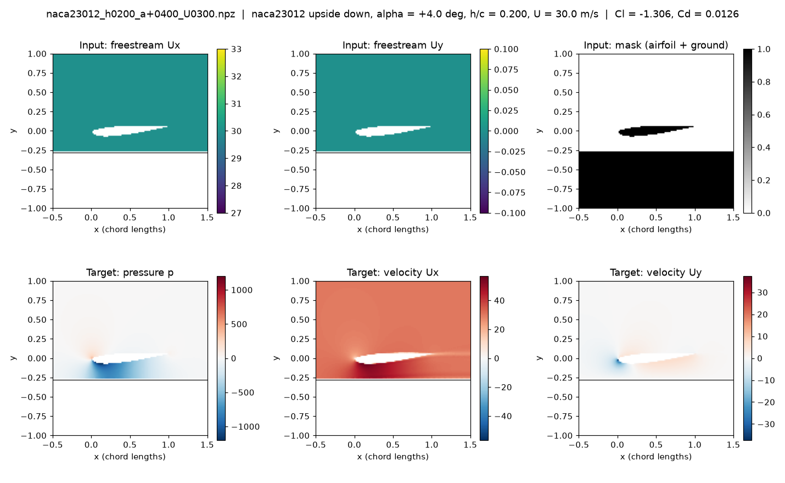
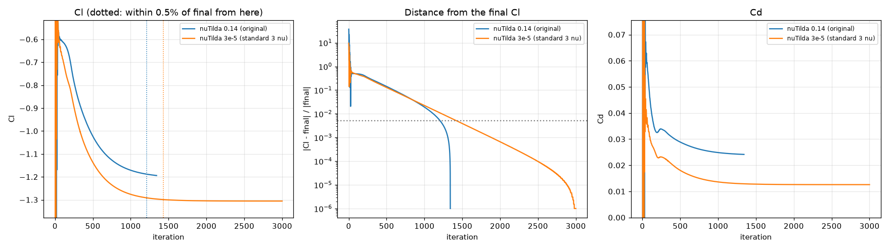
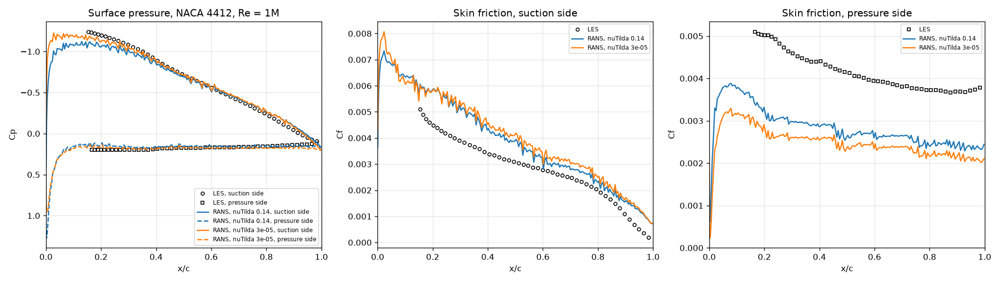
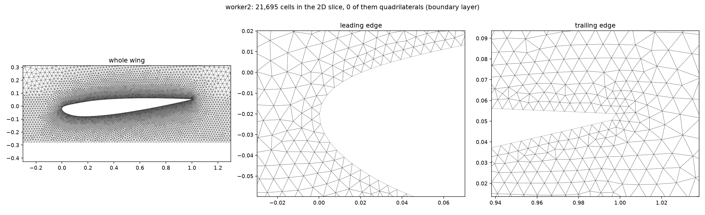
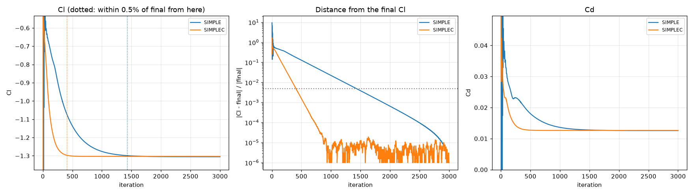

# 2. Ground-effect setup and first checks

[README](../README.md) · ← [1. Reproduction](01-reproduction.md) · [3. Mesh study](03-mesh-study.md) → · [All steps](../README.md#how-we-got-here)

Next we turned the airfoil upside down above a moving ground, the setting of an
F1 front wing, and checked the basics on single cases. The original 500
iterations were not enough near the ground, and the original incoming
turbulence was far too high: high-resolution LES of a NACA 4412 in free air
favoured the realistic value. The LES also showed that the original mesh was too
coarse at the wall, which led to the mesh study (step 3). A faster solver
setting (SIMPLEC) needs 3.5 times fewer iterations.

*Words used here: [glossary](glossary.md). References: [list](references.md).*

**On this page:**

- [Setup: inverted airfoil above a moving ground](#setup-inverted-airfoil-above-a-moving-ground)
- [Convergence and turbulence-level test (one case)](#convergence-and-turbulence-level-test-one-case)
- [Validation against high-resolution LES: NACA 4412 in free air, Re = 1M](#validation-against-high-resolution-les-naca-4412-in-free-air-re--1m)
- [Faster convergence: SIMPLEC](#faster-convergence-simplec)
- [Decisions so far, and next step](#decisions-so-far-and-next-step)

---

## Setup: inverted airfoil above a moving ground

This is the next step towards F1 front wings: the same kind of 2D RANS data,
but with the airfoil upside down above a moving ground. The code is in
[`ground_effect/`](../ground_effect/).

| Change from the original setup | Why |
|---|---|
| Airfoil turned upside down | It makes downforce, like a front wing |
| Angle of attack set by rotating the airfoil (positive = trailing edge up), with the air flowing parallel to the ground | With a ground, the incoming air must flow parallel to it |
| Ground placed a distance *h* (the ride height) below the airfoil's lowest point | The new design parameter |
| Ground moves at the air speed | Seen from the car, the road moves backwards at the same speed as the air, so the ground has no boundary layer |
| Finer mesh in the gap (gmsh Box field, about 10 cells across it) | The strongest flow is in the gap |
| Thin cell layers along the wing (first cell at y+ ≈ 1) and a 20-chord domain | Chosen by the [mesh study](03-mesh-study.md): surface pressure and skin friction match the LES, and in ground effect the result no longer depends on the domain size |
| Airfoil files smoothed before meshing (200 points per surface; see [Airfoil shapes](05-airfoil-shapes.md)) | gmsh's spline through the original points puts kinks into the surface, which show up as spikes in the pressure |
| Same 6 × 128 × 128 sample format, with the ground in the mask channel | The same U-Net code can train on it |
| Cl, Cd, residuals, Cl history and surface pressure / wall shear stress stored with every sample | Physics checks and data quality control |
| Every run checked: Cl must be steady over the last 200 iterations; a run whose Cl is still settling continues, up to 3000 iterations; the others are kept out of the training data | Close to the ground the flow separates, and steady RANS finds no steady solution in part of the range (see [Parameter scan](06-parameter-scan.md)) |
| Ride height drawn log-uniformly (h/c 0.05–0.6) | The flow changes fastest close to the ground |

*NACA 23012 upside down at 4°, ride height 0.2 chords, 30 m/s, converged,
incoming nuTilda = 3e-5. The air speeds up to about 55 m/s in the gap, and the
low pressure there creates the downforce (Cl = −1.31).*

## Convergence and turbulence-level test (one case)

The same case run with two levels of incoming turbulence, up to 3000 iterations:

| Incoming turbulence | Stopped at | Cl at 500 iterations | Final Cl | Final Cd | Cl within 0.5% of its last value from |
|---|---|---|---|---|---|
| nuTilda = 0.14 m²/s (original dataset) | 1342 (residuals below 1e-5) | −1.023 | −1.194 | 0.0241 | iteration 1210 |
| nuTilda = 3e-5 m²/s (3 ν, the usual Spalart–Allmaras value) | 3000 (the nuTilda residual stays at 1e-3) | −1.137 | −1.306 | 0.0126 | iteration 1429 |

**What this shows:**
- **500 iterations is not enough in ground effect.** The original dataset uses
  500, but Cl is then still 13–14% from its converged value. Getting within 0.5%
  takes about 1,450 iterations, unless faster solver settings (SIMPLEC, being
  tested) reach the same answer sooner.
- **The solver's residual limit is not a reliable stop signal.** One run stopped
  while Cl was still drifting. The other never stopped, although Cl had been
  steady for a long time. The Cl history is used to judge convergence instead.
  (The stalled nuTilda residual was later traced to nuTilda being clipped in
  every iteration, see round 2 of the [mesh study](03-mesh-study.md).)
- **The incoming turbulence level matters.** The original value
  (nuTilda = 0.14 m²/s) is 14,000 times the molecular viscosity (ν = 1e-5 m²/s).
  The usual recommendation for this model is 3–5 ν (Spalart & Rumsey, 2007).
  Switching changes the downforce by 9% and halves the drag. We are checking
  which setting is closer to reality against high-resolution LES data for a
  NACA 4412 in free air (Vinuesa et al., 2018), using `groundGen.py --free-air`
  and `validate_les.py` (see below).

## Validation against high-resolution LES: NACA 4412 in free air, Re = 1M

Before generating data, the CFD setup is checked against high-resolution LES
of a NACA 4412 at 5° and Re_c = 1,000,000 (Vinuesa et al., 2018), resolved so
finely that it is close to DNS (direct numerical simulation). R. Vinuesa
kindly provided the data files and allowed us to show this comparison; the
files are not part of this repository. The comparison uses the surface
pressure Cp and skin friction Cf along the wing, between 15% and 98% of the
chord, where the LES data is. The RANS runs use the same mesh and solver as
the ground-effect runs, but with no ground (`groundGen.py --free-air`). Our
10 m/s, 1 m chord and ν = 1e-5 m²/s give exactly Re = 1M.

| Incoming nuTilda | Cl | Cd | Mean \|ΔCp\| suction side | Mean \|ΔCp\| pressure side | Mean \|ΔCf\| suction side | Mean \|ΔCf\| pressure side |
|---|---|---|---|---|---|---|
| 0.14 m²/s (original) | 0.818 | 0.0488 | 0.053 | 0.025 | 0.00169 | 0.00077 |
| 3e-5 m²/s (3ν) | 0.876 | 0.0275 | **0.033** | **0.021** | 0.00158 | 0.00107 |

(The Cf columns were corrected after round 2 of the [mesh study](03-mesh-study.md): the LES files
normalise skin friction differently from us. See the note there.)

- **The realistic turbulence level (3ν) predicts the pressure clearly better.**
  The suction-side error drops by 38% and the suction peak moves closer to the
  LES. The pressure at the nose (the stagnation point) is Cp ≈ 1.0, as it must
  be. With 0.14 it is 1.25, which only happens in an unrealistically viscous
  flow.
- **Neither setting predicts skin friction or drag well on this mesh.** Cf is
  about 30% off on average, and Cd (0.028 and 0.049) is far above the 0.017–0.019
  of the finer meshes in the [mesh study](03-mesh-study.md). The turbulence level is not the
  cause; the mesh is. Only triangles about 0.005 chords in size touch the wall
  (picture below), so the thin boundary layer (0.005–0.04 chords) gets 1–6
  cells across it. The domain also reaches only 5 chords from the wing.
- Note on the LES data: the stored pressure has an arbitrary offset. It is
  removed using the total pressure outside the boundary layer, which is
  constant along the wing (P∞ = −0.058 for Re ≥ 200k).

*The original mesh near the wing: triangles only, about 0.005 chords at the
surface.*

## Faster convergence: SIMPLEC

The same ground-effect case, solved with the original SIMPLE settings and with
SIMPLEC (`consistent yes`, relaxation 0.9):

| Solver | Final Cl | Final Cd | Cl within 0.5% of final from |
|---|---|---|---|
| SIMPLE (original settings) | −1.3057 | 0.0126 | iteration 1429 |
| SIMPLEC | −1.3035 | 0.0126 | **iteration 406** |

Both give the same answer (0.17% apart), but SIMPLEC needs 3.5 times fewer
iterations: about 1 minute per sample instead of 4.

## Decisions so far, and next step

- **Incoming nuTilda = 3ν = 3e-5 m²/s, SIMPLEC and 1000 iterations** are now
  the defaults of `groundGen.py`. The original setup is still available with
  `--nutilda 0.14 --solver simple --iterations 500`.
- **Next: a mesh study** ([step 3](03-mesh-study.md)).

---

[README](../README.md) · ← [1. Reproduction](01-reproduction.md) · [3. Mesh study](03-mesh-study.md) → · [All steps](../README.md#how-we-got-here)
