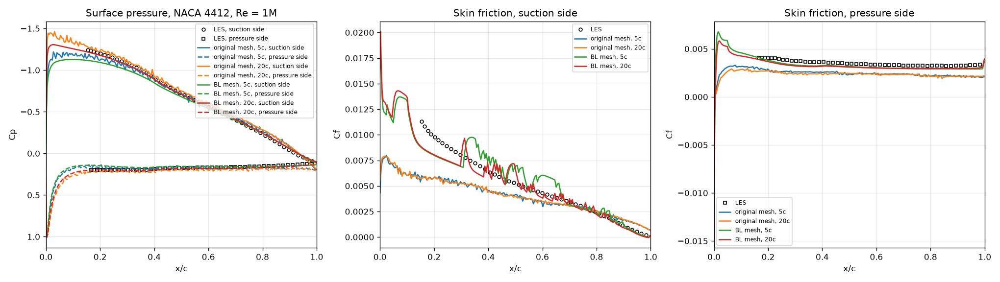
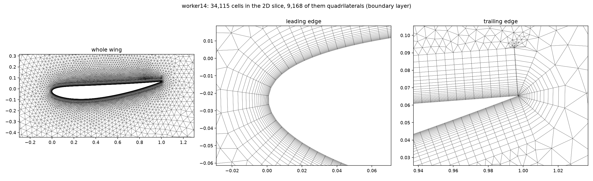
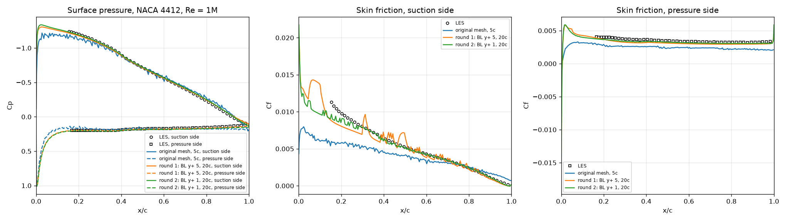
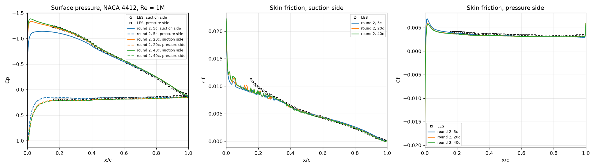
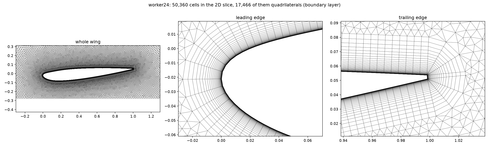
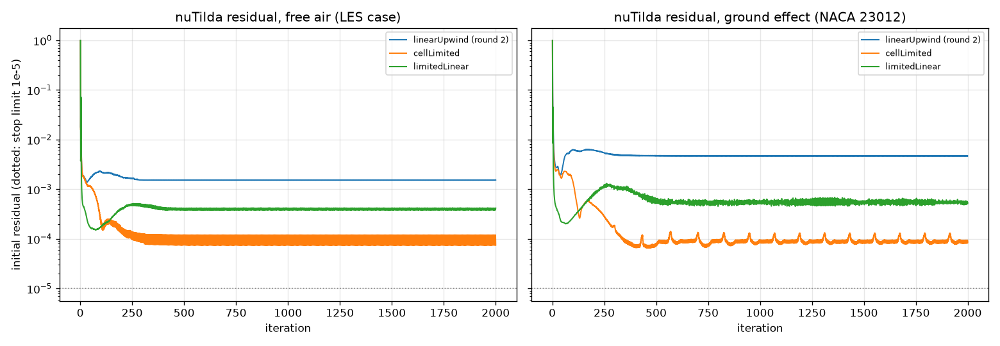
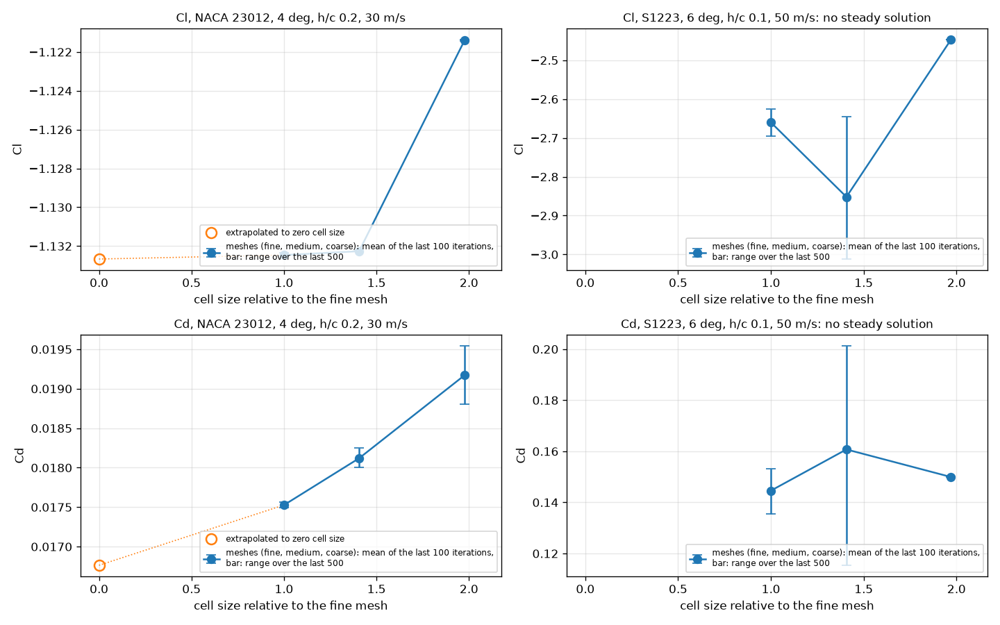

# 3. Mesh study

[README](../README.md) · ← [2. Ground-effect setup and first checks](02-ground-effect-setup.md) · [4. Wind-tunnel validation](04-wind-tunnel.md) → · [All steps](../README.md#how-we-got-here)

Three rounds of mesh study. Round 1 compared the original mesh with a
boundary-layer mesh, in a small and a large domain. Round 2 set the first cell
to y+ ≈ 1 and fixed the cell sizes; skin friction then matches the LES within
6–7%. Round 3 made the turbulence equation converge cleanly, measured the grid
convergence (GCI 0.04% for the downforce on the default mesh) and brought in the
convergence test that every run must pass.

*Words used here: [glossary](glossary.md). References: [list](references.md).*

**On this page:**

- [Mesh study, round 1](#mesh-study-round-1)
- [Mesh study, round 2](#mesh-study-round-2)
- [Mesh study, round 3: numerical verification](#mesh-study-round-3-numerical-verification)

---

## Mesh study, round 1

This round compared the original mesh with a boundary-layer mesh (`--bl`:
thin quadrilateral layers along the wing, the first one 0.0002 chords thick),
each in a 5-chord and a 20-chord domain (`--domain 20`). The case is the
free-air NACA 4412 at Re = 1M, checked against the LES:

| Mesh | Domain | Cl | Cd | Mean \|ΔCp\| suction side | Mean \|ΔCp\| pressure side | Mean \|ΔCf\| suction side | Mean \|ΔCf\| pressure side |
|---|---|---|---|---|---|---|---|
| original | 5 chords | 0.875 | 0.0276 | 0.034 | 0.021 | 0.00159 | 0.00108 |
| original | 20 chords | 0.978 | 0.0158 | 0.036 | 0.033 | 0.00161 | 0.00113 |
| boundary layer | 5 chords | 0.819 | 0.0309 | 0.043 | 0.020 | 0.00094 | 0.00032 |
| boundary layer | 20 chords | 0.906 | 0.0202 | **0.013** | **0.008** | **0.00069** | 0.00036 |

(Cf columns corrected after round 2, see the note there.)

**What round 1 showed:**
- **The boundary-layer mesh in the 20-chord domain matches the LES surface
  pressure 2.5–4 times better** than any other combination.
- **Domain size matters.** Going from 5 to 20 chords raises Cl by 11–12% and
  cuts Cd by 35–43%.
- **The boundary-layer mesh brings skin friction 2–3 times closer to the LES**,
  but the suction-side Cf became jagged. Its first cell sat at y+ 4–8
  (measured with `mesh_quality.py`). That is the buffer layer, where neither
  the wall-resolved nor the wall-function treatment works well.
- **The larger domain coarsened the cells near the wing.** The sampled window
  had 37% fewer cells, and in ground effect cells 1 chord from the wing were up
  to 3 times larger. gmsh interpolates the cell size between the wing and the
  now distant, coarse outer boundary.
- **In ground effect the mesh matters too.** For the NACA 23012 test case the
  downforce changed from Cl −1.30 (original mesh) to −1.12.

## Mesh study, round 2

This round fixes both problems:
- The first cell height is set from each sample's speed, so that y+ is about 1
  (`first_layer` in `groundGen.py`). This gives 36–46 layers between 10 and
  50 m/s.
- Cell sizes grow as 0.005 + 0.05 × distance from the wing (in chords),
  whatever the domain size.

It also checks 5, 20 and 40-chord domains, in free air against the LES and in
ground effect (`mesh_study.sh`, then `mesh_study_report.py`).

Free air, NACA 4412 at 5°, Re = 1M, against the LES:

| Domain | Cells (in the sampled window) | \|Cl\| | Cd | Mean \|ΔCp\| suction / pressure side | Mean \|ΔCf\| suction / pressure side |
|---|---|---|---|---|---|
| 5 chords | 50,736 (36,627) | 0.834 | 0.0299 | 0.038 / 0.019 | 0.00036 / 0.00020 |
| 20 chords | 59,076 (36,187) | 0.921 | 0.0190 | **0.009** / 0.014 | 0.00028 / 0.00025 |
| 40 chords | 63,178 (35,915) | 0.937 | 0.0167 | 0.010 / 0.018 | **0.00027** / 0.00026 |

Ground effect, NACA 23012 at 4°, h/c = 0.2, 30 m/s:

| Mesh | Domain | Cells | Cl | Cd | Cl within 0.5% of final from | Time, 2000 iterations |
|---|---|---|---|---|---|---|
| original (triangles at the wall) | 5 chords | 21,695 | −1.3035 | 0.0126 | iteration 406 | (3000 iterations: 361 s) |
| round 1: boundary layer, y+ 4–8 | 20 chords | 23,614 | −1.1249 | 0.0203 | iteration 442 | 385 s |
| round 2: boundary layer, y+ ≈ 1 | 20 chords | 50,360 | −1.1329 | 0.0182 | iteration 466 | 604 s |
| round 2: boundary layer, y+ ≈ 1 | 40 chords | 52,413 | −1.1315 | 0.0181 | iteration 471 | 624 s |

*The round-2 mesh in ground effect (the ground is the bottom edge of the left
picture). Thin layers wrap the nose and fan out at both corners of the blunt
trailing edge.* More pictures: [the mesh around the NACA 4412](../results/mesh_bl2_naca4412.png),
[the S1223 at 50 m/s](../results/mesh_bl2_s1223_U50.png) (thinnest first cell,
7e-6 chords), and [the Cl histories](../results/convergence_bl2_ground.png).

**What round 2 showed:**
- **y+ ≈ 1 along the whole wing**: median 0.6–0.8, at most 1.2 (free air,
  10 m/s) and 1.5 (ground effect, 30 m/s).
- **Skin friction now matches the LES within 6–7% on average**: mean |ΔCf|
  0.00028 / 0.00025 is 5.6% / 7.2% of the mean LES value, against 31% for the
  original mesh. The surface pressure stays as close as in round 1.
- **The domain no longer changes the mesh near the wing.** The sampled window
  has 35,900–36,600 cells in all three domains, and the median cell size at each
  distance from the wing agrees within a few percent (round 1: 37% fewer cells
  at 20 chords).
- **Domain size in free air:** lift keeps growing with the domain size R, as
  Cl∞ − Cl ∝ 1/R. The far field of a lifting wing decays only as 1/distance,
  and the far-field boundary forces the undisturbed flow onto it. Extrapolating
  from 20 and 40 chords gives Cl∞ ≈ 0.952, which also predicts the 5-chord
  value within 1%. 20 chords is 3.3% low, 40 chords 1.6%. The agreement with the
  LES is equally good at 20 and 40 chords.
- **Domain size in ground effect: 20 chords is enough.** From 20 to 40 chords,
  Cl changes by 0.13% and Cd by 0.6%. With a ground, the wing's mirror image
  below it cancels most of the far field (a vortex pair decays as
  1/distance²). Round 3 checks this at the largest ride height.
- **The mesh decides the downforce.** The two boundary-layer meshes agree
  within 0.7% in Cl. The original mesh over-predicted the downforce by 15% and
  under-predicted the drag by 30%.
- **Decision:** the boundary-layer mesh with y+ ≈ 1 and a 20-chord domain are
  now the defaults of `groundGen.py` (`--no-bl --domain 5` gives the original
  mesh). A sample takes about 5 minutes for 1000 iterations on one CPU core.

**Correction: how the LES files define skin friction.** The Cf stored in the
WING LES files is based on the local edge velocity U_e, the peak of each
velocity profile, not on the freestream: Cf = 2(u_τ/U_e)². On the suction
side U_e reaches 1.49 U∞. Our RANS values, like most CFD, use the freestream.
The files also store u_τ, so `validate_les.py` now uses Cf = 2u_τ²/U∞² for
the LES. This was checked at every station: the stored Cf equals
2(u_τ/U_max)² exactly at all 100 stations. All Cf numbers and figures on these pages use
the corrected comparison. Before the correction, the boundary-layer meshes
looked about twice too high on the suction side and the original mesh looked
best. With matching definitions the order reverses: each mesh improvement
brings Cf closer to the LES. The remaining difference just after 15% chord is
expected, because the LES boundary layer was tripped at 10% chord.

**Found: nuTilda is clipped in almost every iteration.** Every run with the
realistic incoming nuTilda (3e-5) printed `bounding nuTilda` in more than 99%
of its iterations. The convection scheme for nuTilda (linearUpwind with an
unlimited gradient) undershoots below zero where nuTilda drops steeply at the
edge of the boundary layer, and OpenFOAM resets those cells in every
iteration. This is why the nuTilda residual has stalled near 1e-3 since the
first realistic run. With the original 0.14, the clipping stops after 15
iterations and the residual converges. We suspected it also caused the small
steps left in the suction-side skin friction (rms 3%). They are about 0.04
chords apart, roughly the distance over which the boundary-layer edge climbs
one mesh layer. Round 3 showed that the steps stay when the clipping is gone,
so they come from the mesh itself. Wall distance, surface shape and wall
cells were checked and ruled out as causes of the clipping. Forces and pressures are steady (Cl changes by less than 0.01%
over the last 50 iterations), but the dataset should come from clean,
converging solutions.

## Mesh study, round 3: numerical verification

With the round-2 settings, `verification.sh` ran 11 cases of 2000 iterations
each, 4 at a time on separate CPU cores (54 minutes in all).
`verification_report.py` makes the tables and figures. It asks three
questions:
- Does a limited scheme stop the nuTilda clipping?
- How far is the default mesh from the mesh-independent answer?
- Is a 20-chord domain big enough at the largest ride height?

Cl and Cd are averages over the last 100 iterations (see "the drag flips" below).

**A. The nuTilda scheme.** The original linearUpwind is compared with two
alternatives: the same scheme with a limited gradient (`cellLimited`), and
the TVD scheme `limitedLinear`. Each runs in free air (the LES case) and in
ground effect (NACA 23012, 4°, h/c = 0.2, 30 m/s):

| Case | nuTilda scheme | Iterations with clipping | Most negative nuTilda clipped, last 100 iterations | Final nuTilda residual | Cl | Cd |
|---|---|---|---|---|---|---|
| free air | linearUpwind (round 2) | 1981 of 2000 | −8.6e-5 | 1.5e-3 | −0.9209 | 0.0190 |
| free air | **cellLimited** | **0** | none | **7.5e-5** | −0.9209 | 0.0190 |
| free air | limitedLinear | 1883 of 2000 | −2.2e-5 | 4.2e-4 | −0.9214 | 0.0190 |
| ground effect | linearUpwind (round 2) | 1990 of 2000 | −2.7e-4 | 4.7e-3 | −1.1329 | 0.0181 |
| ground effect | **cellLimited** | **10** (none after iteration 133) | none | **8.4e-5** | −1.1323 | 0.0181 |
| ground effect | limitedLinear | 1950 of 2000 | −1.1e-4 | 5.2e-4 | −1.1328 | 0.0181 |

- **The limited gradient stops the clipping; limitedLinear does not.** With
  cellLimited, nothing is clipped in free air. In ground effect, clipping
  happens only while the flow develops, in the first 133 iterations. The
  final nuTilda residual is 20–56 times lower. limitedLinear still clips in
  94–98% of the iterations. The clipped values were not rounding noise: up to
  9 times the incoming nuTilda (3e-5), but negative.
- **The forces hardly change**: Cl by at most 0.06%, Cd by at most 0.3%.
- **The clipping did not cause the small steps in the skin friction.** They
  stay with cellLimited (scatter 2.8% on the suction side in free air, 4.3% in
  ground effect), so they come from the mesh.
- **Against the LES**, the surface pressure is the same with all three
  schemes. Between 15% and 40% chord, cellLimited's suction-side skin friction
  is 2–5% lower than linearUpwind's (less than 1% further back). This is the
  region just behind the LES trip (10% chord), where all three runs are
  already below the LES. Its mean |ΔCf| on the suction side is 0.00038
  instead of 0.00028 (7.6% instead of 5.6% of the mean LES value).
  ([Figure](../results/scheme_test_les.png))
- **Decision: cellLimited stays the default.** A dataset should come from
  solutions that actually converge, and the small local change in Cf is
  smaller than the difference between RANS and LES there.

**B. Grid convergence.** Each case runs on three meshes. Every cell is √2
times smaller from one mesh to the next (`--refine 0.7071, 1, 1.4142`), so
each mesh has about twice the cells of the previous one. The grid convergence
index (GCI) follows Celik et al. (2008).

NACA 23012, 4°, h/c = 0.2, 30 m/s:

| Mesh | Cells | Cl | Cd | Cl within 0.5% of final from | y+ of the first cell, suction side (median / max) |
|---|---|---|---|---|---|
| fine (`--refine 1.4142`) | 99,563 | −1.1325 | 0.0175 | iteration 734 | 0.58 / 1.02 |
| **medium (default)** | 50,360 | −1.1323 | 0.0181 | iteration 477 | 0.82 / 1.53 |
| coarse (`--refine 0.7071`) | 25,480 | −1.1214 | 0.0192 | iteration 342 | 1.15 / 2.27 |
| extrapolated to zero cell size | | −1.1327 | 0.0168 | | |

| | Observed order of convergence | GCI, fine mesh | GCI, medium mesh |
|---|---|---|---|
| Cl | 11.7 | 0.02% (0.05% with safety factor 3) | **0.04%** (0.11% with safety factor 3) |
| Cd | 1.7 | 5.4% | 9.7% |

| Flow field, difference from the fine mesh (measured like the U-Net test error) | Pressure | Velocity |
|---|---|---|
| medium mesh (default) | **0.22%** | **0.15%** |
| coarse mesh | 1.11% | 0.42% |

- **Downforce is mesh-converged on the default mesh.** Its GCI is 0.04%. The
  observed order, 11.7, is far above the formal order 2. That means the
  coarse mesh is not yet in the asymptotic range (its Cl is 1% off). The GCI
  therefore uses order 2. Even with the more cautious safety factor 3
  recommended for such cases (Roache, 1998), it is 0.11%.
- **Drag converges more slowly.** It carries about 10% numerical uncertainty
  on the default mesh, and the extrapolated Cd is 7.5% below the default
  mesh's value. Drag depends on the thin boundary layer and wake, so it is
  the most mesh-sensitive quantity in 2D RANS. For drag predictions, for
  example the comparison with experiments, the fine mesh is the better
  choice.
- **The flow field that the U-Net learns is converged far below what the
  network can resolve.** The default mesh differs from the fine one by 0.22%
  in pressure and 0.15% in velocity, measured like the U-Net's test error. On
  the original dataset, the U-Net's own errors are 14.9% (pressure) and 2.5%
  (velocity): about 70 and 16 times larger.
- **1000 iterations are enough on the default mesh.** Cl and Cd averaged over
  iterations 901–1000 differ from those over 1901–2000 by 0.013% and 0.015%.
  The fine mesh needs about 1500 iterations (0.16% and 0.27% after 1000).
- **The drag flips between two values every iteration.** The flip is ±0.19%,
  ±0.67% and ±1.9% on the fine, medium and coarse meshes, against ±0.002%
  for Cl. The solver has settled into a cycle of two iterations. The cycle
  appears with all three nuTilda schemes, and it is also the band in the
  residual plot above. Averaging over the last 100 iterations removes it; with
  last-iteration values, the Cd convergence order looked like 1.3 instead of
  1.7. `groundGen.py` now saves the averages.

S1223, 6°, h/c = 0.1, 50 m/s (the hard case):

| Mesh | Cells | Cl | Cd | Cl range over the last 200 iterations | nuTilda clipped | Wing surface with reversed flow |
|---|---|---|---|---|---|---|
| fine | 114,167 | −2.66 | 0.145 | 2.6% | until the end | 19% |
| medium | 57,677 | −2.85 | 0.161 | 12.3% | until the end | 19% |
| coarse | 29,417 | −2.45 | 0.150 | 0.02% | until the end | 20% |

- **This case has no steady solution.** On the side facing the ground, the
  flow separates at about 62% chord on all three meshes. Behind that point,
  the flow next to the wall runs backwards over the rest of that side (19% of
  the whole surface).
  - On the medium and fine meshes, the forces keep swinging, Cl by 2.6–12%
    even after 2000 iterations.
  - The coarse mesh looks steady only because its larger numerical
    dissipation damps the motion. It still clips nuTilda in every iteration.
  - A GCI needs converged solutions, so none is computed.
- **This is the force-reduction region of ground effect.** Experiments on an
  inverted wing found the same: below a critical ride height, the boundary
  layer on the side facing the ground separates and the downforce stops
  growing (Zerihan & Zhang, 2000). A steady RANS solver cannot represent this
  unsteady flow.
- **Consequence for the dataset: every run is now checked.**
  - A run counts as converged if Cl varies by less than 0.1% over its last
    200 iterations and nuTilda is no longer clipped at the end.
  - Every normal run on the default mesh passes with a wide margin:
    0.003–0.03% after 1000 iterations. The S1223 runs fail: the fine and medium on both criteria,
    the coarse on the clipping.
  - Runs that fail are saved in `not_converged/`, so they cannot slip into the
    training data, and their share can be reported.
  - Every sample also stores the share of the wing surface with reversed
    flow.

**C. Domain size at the largest ride height.** NACA 23012, 4°, h/c = 0.6:
going from 20 to 40 chords changes Cl by 0.02% (−0.6985 vs −0.6986) and Cd by
0.14%. So 20 chords is enough at every ride height in the planned range.

**D. Cost: finding the sample points.** Before the first iteration, OpenFOAM
searches the mesh for each of the 16,384 points of the output grid. In these
runs, the start-up before the first iteration took 4 to 20 minutes, most of it
this search. That is 37–66% of the run time, and in 9 of the 11 runs longer
than the 2000 iterations themselves. `groundGen.py` now samples
the same points as 128 lines, one per grid row (`--sampling lines`, the new
default). OpenFOAM then searches only for the start of each line and walks
along it from cell to cell. The lines contain exactly the original points.
Inside the container, `sampling_test.py` re-sampled two finished round-2 runs
this way (one in ground effect, one in free air). The masks and the values at
every point were identical to the original samples. Re-sampling took 22–23 s,
including reading the mesh and the fields. The start-up of those runs had
taken 317 s and 152 s. In a full run, the first iteration now ends after 4 s.

**End-to-end check with the new defaults** (1000 iterations, one run at a
time, `data/smoke`):
- **NACA 23012 test case:** Cl −1.1321, Cd 0.0181, converged (Cl varies by
  0.028% over the last 200 iterations).
  - The sampled flow field differs from the 2000-iteration run by 0.009% in
    pressure and 0.001% in velocity, so stopping at 1000 iterations makes no
    measurable difference.
  - The whole sample took 182 s, meshing included; with the point cloud the
    start-up alone had taken 317 s.
- **S1223 hard case:** marked as not converged (Cl varies by 5.5%, nuTilda is
  clipped to the end, 19% of the surface has reversed flow) and saved in
  `not_converged/`.
- **Exactly reproducible:** for both cases, Cl in every one of the 1000
  iterations is bit-for-bit the same as in round 3. That run was made with the
  old sampling and 4 runs at a time.

**Decisions after round 3:**
- Defaults stay: cellLimited, the medium mesh, 20 chords, 1000 iterations.
- Cl and Cd are averages over the last 100 iterations.
- Runs that do not converge are kept out of the training data.
- The sample points are found row by row (`--sampling lines`): the same
  samples, with a much faster start.

**Next:** validation in ground effect against wind-tunnel data. Then a scan
of the parameter ranges, to find where steady RANS converges, and finally
the dataset.

---

[README](../README.md) · ← [2. Ground-effect setup and first checks](02-ground-effect-setup.md) · [4. Wind-tunnel validation](04-wind-tunnel.md) → · [All steps](../README.md#how-we-got-here)
