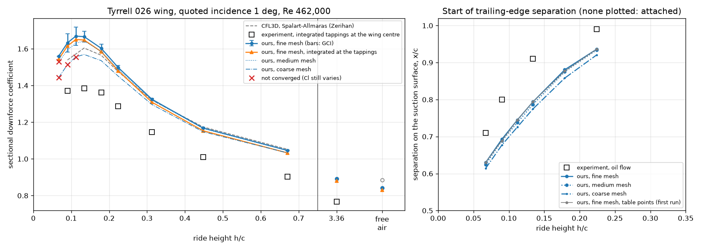
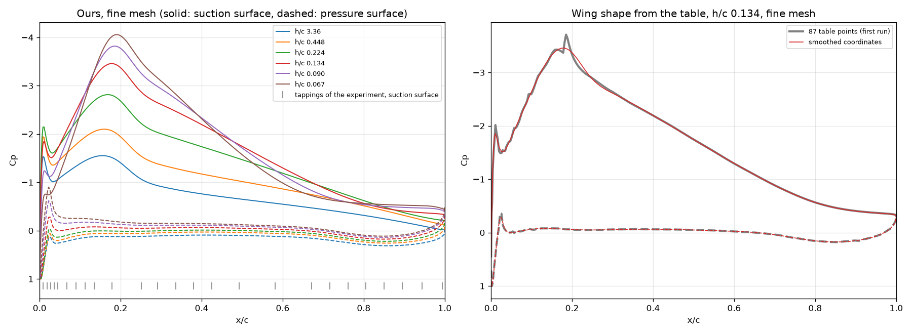
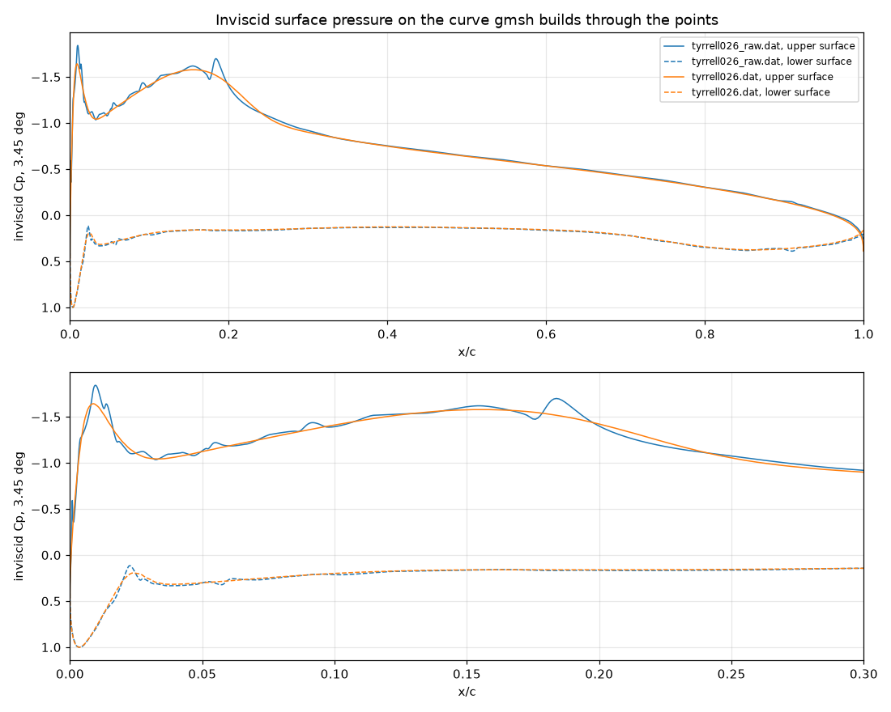

# 4. Validation in ground effect: the Tyrrell 026 wing

[README](../README.md) · ← [3. Mesh study](03-mesh-study.md) · [5. Airfoil shapes](05-airfoil-shapes.md) → · [All steps](../README.md#how-we-got-here)

With the setup checked in free air, we compared it with the wind-tunnel tests of
the Tyrrell 026 F1 front wing above a moving ground (Zerihan, 2001), at nine
ride heights on three meshes. The downforce the wing gains near the ground
matches the tunnel within 4%; the rest of the gap is an offset of about 14% at
every height, as expected from the finite wing in the tunnel. The comparison
also showed kinks in wing surfaces made from sparse points, which led to step
5.

*Words used here: [glossary](glossary.md). References: [list](references.md).*

---

The LES comparison checked the setup in free air. With a ground, the
reference is the wind tunnel study of Zerihan (2001; summarised in Zerihan &
Zhang, 2000). It is the standard test case for inverted wings in ground
effect.

**The experiment** (thesis, Chapters 2, 4 and 9):
- **Model:** the main element of the 1998 Tyrrell 026 F1 front wing at 80%
  scale. Chord 223.4 mm, span 1100 mm, with endplates; a modified NASA
  GA(W) section with a 0.007c thick trailing edge.
- **Tunnel:** the 2.1 m × 1.7 m tunnel at Southampton. It has a moving belt
  and boundary-layer suction ahead of it, so the ground has no boundary layer.
- **Flow:** 30 m/s, Reynolds number 0.43–0.46 million.
- **Transition:** free. Oil flow shows a laminar separation bubble at about
  30% chord on the suction surface. A second series had trips at 10% chord.
- **Incidence:** quoted incidences are 2.45° below the true angle to the
  chord line. The reference incidence, quoted 1°, is a true 3.45°.
- **Ride height:** measured to the lowest point with the wing at quoted 0°.
  The wing is then rotated about its quarter chord.
- **"Freestream" tests:** made 750 mm above the moving ground (h/c = 3.36),
  in the middle of the tunnel, not in free air.

**What we compare with:**
- **Sectional downforce at the wing centre** at eight ride heights (Table 15).
  It comes from integrating 45 surface pressure tappings. Zerihan calls it an
  estimate for trends: the tappings are too sparse to catch the suction spike
  at the leading edge.
- **His own 2D RANS results** (the CFL3D code; Spalart–Allmaras, the model we
  use, and k-ω; y+ ≈ 1; moving ground; fully turbulent; structured grids of
  25,000–30,600 cells in ground effect, 20,500 in free air). With
  Spalart–Allmaras, the trend with height was right,
  and the values were 12–17% above the tapping estimate. His "freestream" case
  has no ground: its grid has no ground block (Table 14).
- **Where the flow separates near the trailing edge**, from oil flow. At
  h/c = 0.224 a very small separated region appears at x/c ≈ 0.99. It moves
  forward to x/c 0.91 at h/c = 0.134, about 0.8 at 0.090 and about 0.7 at
  0.067. This is the separation that limits the downforce.

**Our setup** (`validation_zerihan.sh`):
- **Wing shape:** the coordinates of Table 2 (44 points per surface), read
  from the thesis and rotated back to zero incidence (`make_tyrrell026.py`).
  The table is printed at the reference incidence. Rotating it back needs
  3.454°, the thesis says 3.45°, and the thickness (12.6% at 24% chord,
  trailing edge 0.0073c) matches the description. The shape is smoothed
  within the rounding of the table (see "Problem found" below). The first
  run used the table points as they are. The coordinates are not part of this
  repository.
- **Conditions as in the experiment:** true incidence 3.45°, ride height
  set at 2.45° and the wing then rotated about the quarter chord
  (`--h-alpha 2.45`). Re = 462,000 (4.62 m/s with our 1 m chord).
- **Runs:** free air, h/c 3.36, and nine heights from h/c 0.671 down to
  0.067. Each runs on three meshes, each with about twice the cells of the one
  before: coarse, default and fine (`--refine` 0.7071, 1 and 1.4142). 2000
  iterations each; 33 runs, 1 h 51 min at 4 at a time.
- **Like-for-like integration:** `validation_zerihan.py` also integrates our
  pressures at the experiment's tapping positions, in the same way as the
  experiment. This tests how much of the 15% gap comes from the sparse
  tappings.

**Results** (fine mesh; `validation_zerihan.py`, table 1). GCI: the numerical
uncertainty of our downforce, from the three meshes (see the mesh study
below).

| h/c | Experiment | CFL3D S-A | Ours | GCI | Ours, at the tappings | vs experiment | vs CFL3D | Separation x/c, ours | Separation x/c, oil flow |
|---|---|---|---|---|---|---|---|---|---|
| free air | – | 0.885¹ | 0.842 | 0.1% | 0.831 | – | −4.9% | – | – |
| 3.36 | 0.766¹ | – | 0.892 | 0.0% | 0.879 | +14.8% | – | – | – |
| 0.671 | 0.902 | 1.052 | 1.046 | 0.2% | 1.032 | +14.4% | −0.6% | – | – |
| 0.448 | 1.009 | 1.174 | 1.168 | 0.3% | 1.153 | +14.3% | −0.5% | – | – |
| 0.313 | 1.145 | 1.320 | 1.325 | 0.4% | 1.309 | +14.3% | +0.4% | – | – |
| 0.224 | 1.286 | 1.475 | 1.498 | 0.9% | 1.480 | +15.1% | +1.5% | 0.94 | ≈ 0.99 |
| 0.179 | 1.362 | 1.565 | 1.603 | 1.3% | 1.585 | +16.4% | +2.4% | 0.88 | – |
| 0.134 | 1.385 | 1.604 | 1.666 | 1.8% | 1.648 | +19.0% | +3.9% | 0.79 | 0.91 |
| 0.112 | – | – | 1.669 | 3.0%² | 1.651 | – | – | 0.74 | – |
| 0.090 | 1.371 | 1.539 | 1.633 | 3.1%² | 1.615 | +17.8% | +6.1% | 0.69 | ≈ 0.8 |
| 0.067 | – | – | 1.560 | –³ | 1.544 | – | – | 0.63 | ≈ 0.7 |

"vs experiment" compares our pressures integrated at the tappings with the
experiment, "vs CFL3D" our force coefficients with CFL3D.

¹ The "freestream" row of Table 15 holds two different cases. The tests
were made 3.36 chords above the ground; the CFD for it had no ground.

² The coarse mesh did not pass the convergence test: its downforce still
varies by 0.12% (h/c 0.112) and 0.18% (0.090). That is less than a tenth of
the differences between the meshes, so the GCI uses the mean of its last 100
iterations.

³ No GCI: on the coarse mesh the downforce oscillates by 0.7% and nuTilda is
still clipped; on the default mesh it still drifts (0.15%).

*Left: sectional downforce. Grey dashes: Zerihan's 2D RANS (CFL3D); squares:
the experiment; blue: ours on the three meshes, with the GCI as bars on the
fine mesh; orange: ours integrated at the experiment's tapping positions;
crosses: runs that did not converge. Right of the vertical line: the height of
the "freestream" tests (h/c 3.36) and free air. Right: where the flow starts to
separate on the suction surface.*

**Mesh study** (`validation_zerihan.py`, table 2). Downforce on the three
meshes; the observed order of convergence p; the extrapolated value and the GCI
(Celik et al. 2008, with p at most 2 in the GCI); and how far the sampled flow
field of the default mesh is from the fine mesh's, measured like the U-Net
error.

| h/c | Downforce: coarse | default | fine | p | Extrapolated | GCI, fine mesh | Field, default vs fine: p / v |
|---|---|---|---|---|---|---|---|
| free air | 0.835 | 0.843 | 0.842 | (up and down) | 0.841 | 0.09% | 0.14% / 0.03% |
| 3.36 | 0.883 | 0.891 | 0.892 | 9.5 | 0.892 | 0.04% | 0.10% / 0.03% |
| 0.671 | 1.033 | 1.045 | 1.046 | 6.5 | 1.048 | 0.18% | 0.17% / 0.09% |
| 0.448 | 1.148 | 1.165 | 1.168 | 5.5 | 1.171 | 0.30% | 0.28% / 0.13% |
| 0.313 | 1.296 | 1.321 | 1.325 | 5.3 | 1.329 | 0.40% | 0.36% / 0.16% |
| 0.224 | 1.451 | 1.487 | 1.498 | 3.8 | 1.508 | 0.86% | 0.74% / 0.24% |
| 0.179 | 1.536 | 1.586 | 1.603 | 3.2 | 1.620 | 1.35% | 1.09% / 0.30% |
| 0.134 | 1.569 | 1.642 | 1.666 | 3.3 | 1.690 | 1.82% | 1.54% / 0.38% |
| 0.112 | 1.556* | 1.630 | 1.669 | 2.0 | 1.709 | 3.00% | 2.37% / 0.40% |
| 0.090 | 1.514* | 1.593 | 1.633 | 2.1 | 1.673 | 3.08% | 2.39% / 0.36% |
| 0.067 | 1.444* | 1.529* | 1.560 | – | – | – | 1.86% / 0.32% |

\* not converged (see the notes under the results table). Cells: coarse
23,000–48,000, default 46,000–95,000, fine 90,000–190,000 (the most at h/c
3.36).

- **Downforce converges steadily with the mesh.** Down to h/c 0.134, p is 3 to
  10, above the formal order of 2: the coarse mesh is not yet in the
  asymptotic range, so the GCI uses p = 2, the cautious choice. Below, p is
  about 2. In free air the three values go up and down, within 0.1%.
- **The uncertainty grows towards the ground:** from 0.04–0.4% down to h/c
  0.313, to 1.8% at 0.134 and about 3% at 0.112 and 0.090.

**Against CFL3D on each of our meshes** (`validation_zerihan.py`, table 4).
Zerihan's grids in ground effect had 25,000–30,600 cells (Table 14), about as
many as our coarse mesh:

| h/c | Ours, coarse | default | fine | extrapolated |
|---|---|---|---|---|
| 0.671 | −1.8% | −0.7% | −0.6% | −0.4% |
| 0.448 | −2.2% | −0.7% | −0.5% | −0.3% |
| 0.313 | −1.8% | +0.1% | +0.4% | +0.7% |
| 0.224 | −1.6% | +0.8% | +1.5% | +2.2% |
| 0.179 | −1.9% | +1.3% | +2.4% | +3.5% |
| 0.134 | −2.2% | +2.4% | +3.9% | +5.4% |
| 0.090 | −1.6%* | +3.5% | +6.1% | +8.7% |

**What the results show:**
- **The same curve as Zerihan's 2D RANS, down to h/c 0.224.** Same
  turbulence model, but a different code, mesh and solver. Our downforce is
  within 0.6% of his from h/c 0.671 down to 0.313, and within 1.5% at 0.224.
  Our largest downforce is at h/c 0.112–0.134 (1.669 and 1.666, equal within
  0.2%). CFL3D and the experiment also peak at 0.134, with 0.179 and 0.090 as
  their nearest heights.
- **Closer to the ground ours is higher, and that looks like mesh
  resolution.** The difference grows from +2.4% at h/c 0.179 to +6.1% at
  0.090. On our coarse mesh, which is about as large as his grids, our
  downforce is 1.6–2.2% below his at every height: the two curves have the
  same shape. Refining the mesh raises our downforce, most of all near the
  ground, where the GCI is largest. This suggests that most of the growing
  difference comes from mesh resolution, not from the model. A structured grid
  like his can do more with the same number of cells. But his grids had even
  fewer cells at the two lowest heights (Table 14), where ours need the most.
- **Both 2D RANS results are well above the experiment.** Integrated at the
  tappings, ours is 14.3–15.1% above the experiment from h/c 3.36 down to
  0.224, and 16–19% closer to the ground; CFL3D is 12–17% above. Zerihan put
  part of the gap down to the sparse tappings, which would miss the suction
  spike at the leading edge. But integrating our pressures only at the
  tapping positions lowers our downforce by just 1.0–1.2%: the tappings catch
  most of it. So the experiment's pressures themselves are lower. More likely
  causes are the differences between 2D RANS and the tunnel. The wing is
  finite (aspect ratio 4.9), and its tip vortices reduce the effective
  incidence even at the centre. And transition is free.
- **The ground effect itself matches the experiment within 4%.** How much
  downforce the wing gains as it gets closer to the ground, relative to h/c
  0.671, is the same in our runs (integrated at the tappings) as in the
  tunnel:

| h/c | 0.448 | 0.313 | 0.224 | 0.179 | 0.134 | 0.090 |
|---|---|---|---|---|---|---|
| Experiment | 1.119 | 1.269 | 1.426 | 1.510 | 1.535 | 1.520 |
| Ours, at the tappings | 1.117 | 1.268 | 1.434 | 1.536 | 1.597 | 1.565 |
| Difference | −0.1% | −0.1% | +0.6% | +1.7% | +4.0% | +3.0% |

*Downforce divided by its value at h/c 0.671.*

  So most of the gap to the experiment is an offset of about 14% that is the
  same at every height, as expected from a finite wing, whose tip vortices
  lower the effective incidence along the whole span; below h/c 0.2 our gain
  is up to 4% larger on top of it. A test is planned: the 2D wing at an
  incidence 1–2° lower should land on the tunnel's values if this
  explanation is right.
- **"Freestream" was two different cases.** The tests were made 3.36 chords
  above the moving ground. Zerihan's CFD for this case had no ground: Table 14
  lists no ground block for its grid. At the tests' height, our h/c 3.36 run
  is 14.8% above the experiment, in line with the other heights (the tunnel
  roof makes this comparison less exact; see below). Our free air is 4.9%
  below CFL3D's. Free air is the one case where our 20-chord domain
  matters: in round 2 it lowered the NACA 4412's lift by 3.3% (lift ∝ 1/R).
  A ground 3.36 chords away still adds 5.9% downforce, on all three meshes;
  part of that is this domain effect.
- **Separation: right onset, too far forward.** As in the oil flow, the flow
  starts to separate at the trailing edge around h/c 0.224, and the
  separation moves forward as the wing gets lower. But ours lies 0.05–0.12
  chords further forward. This is expected from a turbulence model that is
  turbulent from the leading edge. In the experiment the boundary layer stays
  laminar up to the bubble at 0.3c, so it reaches the trailing edge thinner.
  Zerihan's tests with trips at 10% chord had more separation and less
  downforce near the ground (3D balance: maximum CL 1.39 instead of 1.72).
  The mesh moves our separation point by 0.015–0.023 chords from the coarse
  to the fine mesh, and by at most 0.007 from the default to the fine mesh.
- **Converged:** all 11 runs on the fine mesh, 10 of 11 on the default and 8
  of 11 on the coarse mesh. The failures are all at the lowest heights, where
  13–20% of the wing surface has reversed flow. There the coarse mesh
  oscillates (and at h/c 0.067 still clips nuTilda), and on the default mesh
  the downforce still drifts at h/c 0.067. Zerihan had the same problem with
  CFL3D: steady runs oscillated, and only time-accurate runs settled on a
  steady result, after 3–4 days per case.
- **y+ of the first cell** (5–95% chord): at most 1.6–2.3 on the coarse mesh,
  1.2–1.7 on the default and 0.8–1.2 on the fine mesh (medians 0.9–1.2,
  0.7–0.9 and 0.5–0.65).
- **Run time:** 2000 iterations took 5–6 minutes on the coarse mesh, 9–11 on
  the default and 19–25 on the fine mesh, with 4 runs at a time. h/c 3.36 has
  1.6 times the cells and took 8, 18 and 44 minutes.

*Left: our surface pressure on the fine mesh at six heights; the ticks at the
bottom mark the experiment's tappings on the suction surface. As the wing gets
closer to the ground, the suction peak grows and moves back, and the pressure
recovery behind it gets steeper. Right: the first run (grey, the table points
as they are) against the smoothed wing (red), at h/c 0.134.*

**Problem found: kinks in the wing surface.** Our pressure distributions had
spikes, the largest at x/c = 0.18, next to the suction peak. They are not
physical. gmsh joins the points of an airfoil with a Catmull-Rom spline, which
bends sharply wherever the spacing of the points jumps. The spacing in the
table changes in steps from 0.001 to 0.05 chords. The shape changes very
little (at most 0.07 mm on the 223 mm model), but the pressure reacts to the
curvature. `shape_check.py` builds the same curve and computes the inviscid
pressure on it. It shows the same spikes:

The fix: `make_tyrrell026.py` now fits a smoothing spline (quintic, in arc
length) that stays within the rounding of the table's four decimals. The
table points are 9 µm (rms) and at most 34 µm from it, on the 223.4 mm model.
It is written with 200 points per surface.
- **Effect on the inviscid Cp:** the largest wiggle drops from 0.043 to
  0.003 on the suction surface, and from 0.103 to 0.017 on the pressure
  surface.
- **Effect in the RANS runs** (`validation_zerihan.py`, table 3): the spikes
  are gone (right of the figure above). Downforce changed by 0.0–0.6% and the
  separation point by at most 0.004 chords, so the first run's findings
  stand. The sampled pressure field changed by 0.1–0.7%, as much as the
  default mesh's own error at moderate heights. Kinks matter more for training
  data than for forces. The first run is kept in
  `ground_effect/data/validation_zerihan_raw` (not in this repository).
- **What remains** is a real, smooth bump in the shape at x/c 0.02. Zerihan's
  CFD shows it as well (a small deceleration at x/c 0.03 on the pressure
  surface); the experiment does not.
- **Earlier tests:** the airfoil files used there are much less affected
  (largest wiggle 0.010 for the NACA 23012 and 0.009 for the S1223).

**Known differences we cannot remove:**
- The experiment had free transition with a laminar bubble. Our turbulence
  model assumes turbulent flow from the leading edge.
- The wing is three-dimensional: aspect ratio 4.9, with endplates. The flow
  at its centre is close to 2D, but the tip vortices change it somewhat.
- The tunnel has a roof. It is about 7 chords above the wing near the ground,
  but only about 4 chords above it in the "freestream" tests, almost as close
  as the ground (3.36 chords). There it partly cancels the ground's effect,
  so that test lies somewhere between our free-air and our h/c 3.36 runs.
  Neither CFD has the roof: Zerihan's top boundary at 7 chords is not a wall
  (it extrapolates the flow), and ours is 20 chords away.

**What this means for the dataset:**
- **The default mesh stays.** Its sampled flow fields are within 0.1–0.4%
  (pressure) of the fine mesh's down to h/c 0.313, 0.7–1.5% from 0.224 to
  0.134 and 1.9–2.4% below; velocity within 0.4% everywhere. The U-Net's test
  errors are about 15% (pressure) and 2.5% (velocity), 6 to 100 times larger.
  The fine mesh would take 2.2 times as long.
- **Separated flow close to the ground may not converge,** even at this
  moderate incidence: the default mesh failed at h/c 0.067, with 19% of the
  wing surface in reversed flow. The convergence test keeps such runs out of
  the data; the parameter scan will show how much of the range they affect.
- **Airfoil files:** the UIUC files have the same kinks, most of them worse
  than the Tyrrell table. They are smoothed before the dataset is made
  ([step 5](05-airfoil-shapes.md)).

---

[README](../README.md) · ← [3. Mesh study](03-mesh-study.md) · [5. Airfoil shapes](05-airfoil-shapes.md) → · [All steps](../README.md#how-we-got-here)
