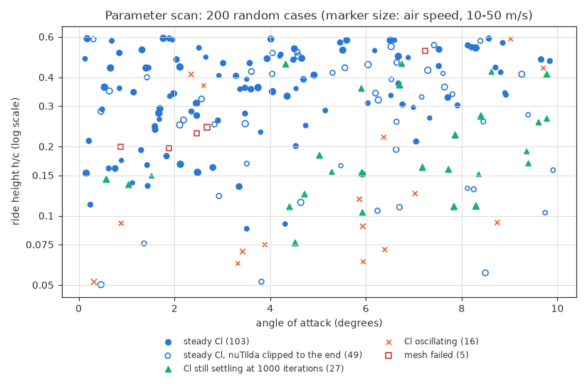
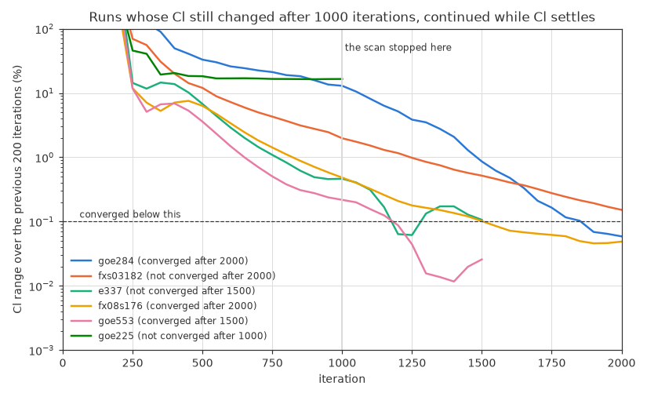

# 6. Parameter scan: where does steady RANS converge?

[README](../README.md) · ← [5. Airfoil shapes](05-airfoil-shapes.md) · [7. The dataset](07-dataset.md) → · [All steps](../README.md#how-we-got-here)

Before making the dataset, 200 runs drawn like the dataset showed where steady
RANS converges in the planned range: Cl becomes steady in most runs, but close
to the ground the flow separates and many runs find no steady solution. The scan
set the rules for keeping a run (Cl steady; runs still settling continue up to
3000 iterations) and changed the ride height to a log-uniform draw.

*Words used here: [glossary](glossary.md). References: [list](references.md).*

---

Before making the dataset, `param_scan.sh` ran 200 cases drawn the way the
dataset draws them: a random airfoil from the 1,462 smoothed files, angle of
attack 0–10°, ride height h/c 0.05–0.6 and air speed 10–50 m/s (chord
Reynolds number 1–5 million), all drawn uniformly, with the default settings
(1000 iterations). With 4 runs at a time it took 4 hours: 4.7 minutes per run
(median; 10–90%: 4.2–5.4 minutes), 55,000 cells. `param_scan_report.py` sorts
the runs into groups (one row per run in `results/param_scan.csv`).

**By the convergence test of round 3** of the [mesh study](03-mesh-study.md) (Cl within 0.1% over the last 200
iterations, and nuTilda no longer clipped at the end), only 103 of the 200
runs (52%) would have given a sample, and none of the 11 below h/c 0.082. Half
of the failures came from the clipping alone:

| The 200 runs | Runs |
|---|---|
| Cl steady, nuTilda not clipped at the end | 103 |
| Cl steady, but nuTilda clipped until the end | 49 |
| Cl still settling: its range shrinks 2–5 times every 200 iterations | 27 |
| Cl oscillating | 16 |
| Mesh failed: gmsh could not extrude the boundary layer at the trailing edge (fx76mp160 twice, marsden, fx08s176, sd8000) | 5 |

*Each run in the plane of angle of attack and ride height. The oscillating
runs (orange) lie mostly close to the ground: 10 of the 16 below h/c 0.12.
Three of the other six are Wortmann sections (fx77080, and fx77w121 twice).*

**The clipping.**
- **All or nothing:** in each run it either stops within the first 700
  iterations (in most by 350), or goes on in 506–994 of the 1000 iterations,
  until the end (87 runs).
- **When:** it gets more likely close to the ground, at larger angles and at
  higher speeds (a logistic fit gives each a clear effect). Above h/c 0.3 and
  below 5°, none of the 14 runs at 10–20 m/s clipped until the end, but 9 of
  the 40 faster ones did. 13 of the 87 runs had no separated flow at all.
- **Where:** `clip_cells.py` finds the cells that OpenFOAM reset in the last
  iteration. A reset cell holds exactly the average of its neighbours that
  OpenFOAM puts there, to round-off, which practically never happens by
  chance; runs without clipping have none. In the scan run of goe280 (h/c
  0.109, 6.7°), 2 of 53,837 cells were reset, 1.7 and 5.1 chords behind the
  trailing edge, at the outer fringe of the wake: nuTilda there is a few times
  its incoming value, while its largest value in the flow is 2,300 times the
  incoming one. In every run checked, including the hard S1223 case of round 3
  (78–118 cells), all reset cells lie behind the wing, none at the wing itself.
- Negative values of the Spalart–Allmaras variable where it drops steeply, at
  the edges of wakes and boundary layers, are a known artifact of
  second-order schemes. Allmaras et al. (2012) introduced a form of the model
  ("SA-neg") that handles them without clipping; OpenFOAM clips them instead.

**Test 1: what does the clipping change?** (`clip_test.sh`, then
`clip_test_report.py`.) Four of the scan's runs with a steady Cl and nuTilda
clipped until the end, from just above the ground to h/c 0.4, ran again with
exactly the same settings: for 2000 iterations, and with first-order upwind
convection of nuTilda, which cannot undershoot, so nothing is clipped. The
first 1000 iterations of every rerun were bit for bit those of the scan.

| Case (h/c, α, U) | Wing surface with reversed flow | 2000 instead of 1000 iterations: Cl, field p / v | First-order upwind: Cl, field p / v |
|---|---|---|---|
| e186 (0.251, 3.5°, 49.6 m/s) | 0% | 0.00%, 0.00% / 0.00% | −0.09%, 0.09% / 0.01% |
| goe281 (0.400, 1.4°, 27.2 m/s) | 0% | 0.00%, 0.00% / 0.00% | −0.12%, 0.12% / 0.01% |
| goe280 (0.109, 6.7°, 32.6 m/s) | 19% | 0.00%, 0.03% / 0.01% | −5.07%, 5.48% / 0.75% (not steady: Cl varies by 1.4%) |
| n9 (0.052, 3.8°, 25.0 m/s) | 22% | +0.08%, 0.08% / 0.01% | −7.73%, 6.85% / 0.51% |

*Differences from the scan run; flow fields measured like the U-Net test error.*

- **The clipped runs are converged.** 1000 more iterations change Cl and the
  flow field by at most 0.08%. At the end, 0–3 cells are still reset, all in
  the wake, 0.3–5.2 chords behind the trailing edge (one of them inside the
  sampled window).
- **In attached flow, the clipping changes nothing that matters:** a scheme
  that cannot clip gives the same flow within 0.12%.
- **In separated flow, the first-order scheme gives 5–8% less downforce, but
  not because of the clipping.** The two other second-order schemes of
  `groundGen.py` clip far more than the default: linearUpwind with an
  unlimited gradient (the original case) resets 400–470 cells in the last
  iteration, some of them along the wing, and limitedLinear about 30. Yet all
  three second-order schemes give the same downforce within 0.7% and the same
  flow field within 0.6% (pressure) and 0.1% (velocity):

| Case | nuTilda scheme | Cells reset in the last iteration | Cl | Field p / v |
|---|---|---|---|---|
| goe280 | cellLimited (default) | 3 | reference | reference |
| | linearUpwind | 398 | +0.36% | 0.36% / 0.08% |
| | limitedLinear | 28 | +0.26% | 0.26% / 0.04% |
| | upwind (first order) | 0 | −5.07% | 5.50% / 0.75% |
| n9 | cellLimited (default) | 1 | reference | reference |
| | linearUpwind | 474 | +0.62% | 0.55% / 0.09% |
| | limitedLinear | 34 | +0.67% | 0.56% / 0.04% |
| | upwind (first order) | 0 | −7.79% | 6.92% / 0.52% |

*Differences from the default scheme after 2000 iterations.*

  So the 5–8% comes from the first-order scheme, which is diffusive where the
  flow crosses the cells, as in the separated shear layer (in the attached
  boundary layer the cells follow the flow). Between second-order schemes,
  separated flow differs by less than 0.7%, far below the U-Net's error. In
  round 3, in attached flow, they had agreed within 0.06%.

**Test 2: do settling runs converge if they continue?** Six of the scan's runs
whose Cl still changed after 1000 iterations ran again, continuing 500
iterations at a time while Cl was settling (its range over the last 200
iterations below 0.7 times its range over the 200 before), up to 2000:

| Case | Cl range after 1000 iterations | Iterations | Cl range at the end | Converged |
|---|---|---|---|---|
| goe284 | 12.9% | 2000 | 0.059% | yes |
| fx08s176 | 0.48% | 2000 | 0.049% | yes |
| goe553 | 0.22% | 1500 | 0.026% | yes |
| fxs03182 | 1.98% | 2000 | 0.15%, still shrinking (0.6 times every 200 iterations) | no |
| e337 | 0.46% | 1500 | 0.11%: down to 0.06%, then up again, so it stopped | no |
| goe225 | 16.5%, oscillating | 1000 | not continued | no |
| fxs03182, up to 3000 iterations | 1.98% | 2500 | 0.046% | yes |

- **Continuing a run gives the same answer as running it longer:** fxs03182
  continued from 1000 to 2000 iterations ends with the same flow as fxs03182
  run straight to 2000 (0.014% / 0.001%).
- With up to 3000 iterations, fxs03182 converges at 2500, so the limit is now
  3000. Only runs that are still settling get the extra iterations.

**Decisions for the dataset:**
- **A run counts as converged when its Cl is steady** (within 0.1% over the
  last 200 iterations). Clipping no longer counts against it, but every sample
  records it (`clipped`, and `clip_min`: the most negative value clipped in the
  last 100 iterations), so samples can still be filtered later.
- **A run whose Cl is still settling after 1000 iterations continues,** 500
  iterations at a time, up to 3000 (`--max-iterations`). In the scan, 27 runs
  (14%) were settling.
- **The ranges stay:** α 0–10°, h/c 0.05–0.6, U 10–50 m/s. In part of this
  range steady RANS finds no steady solution (the oscillating runs). They stay
  out of the training data, so the network learns the steady part of the
  range.
- **The ride height is now drawn log-uniformly** (`--h-sampling log`): as many
  runs between h/c 0.05 and 0.1 as between 0.3 and 0.6, where the uniform draw
  had 6 times fewer. The flow changes fastest close to the ground, and
  Zerihan's test heights were spaced roughly this way too. More runs will then
  be unsteady. From the scan's results by ride height, about 75–80% of the runs
  should give a sample (84–90% with the uniform draw).

Share of the scan's runs by ride height:

| h/c | Runs | Earlier test | Cl steady | Cl steady or settling |
|---|---|---|---|---|
| 0.05–0.082 | 11 | 0% | 36% | 45% |
| 0.082–0.135 | 22 | 23% | 55% | 77% |
| 0.135–0.222 | 33 | 42% | 58% | 91% |
| 0.222–0.365 | 57 | 61% | 88% | 96% |
| 0.365–0.6 | 77 | 64% | 87% | 94% |

---

[README](../README.md) · ← [5. Airfoil shapes](05-airfoil-shapes.md) · [7. The dataset](07-dataset.md) → · [All steps](../README.md#how-we-got-here)
