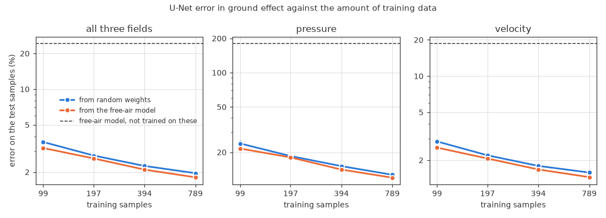

# 8. Training the U-Net: the learning curve

[README](../README.md) · ← [7. The dataset](07-dataset.md) · [9. Downforce](09-downforce.md) → · [Workflow](../README.md#workflow)

We trained the U-Net of the reproduction on the ground-effect samples, from
random weights and from the free-air model, on 12.5–100% of the 789 training
samples, and tested every model on the 30 test airfoils it has not seen. With
all 789 samples the error is 1.8% (the free-air model as it is: 24%), and it is
still falling as samples are added. Starting from the free-air model helps most
when data are scarce.

*Words used here: [glossary](glossary.md). References: [list](references.md).*

---

We train the same network as in the reproduction, with the same loss,
optimiser, batch size, learning-rate schedule and error measure as
[Run 3](01-reproduction.md). The code is
copied into `ground_effect/` (`unet.py`, `unet_data.py`, `train_unet.py`), so
that it runs on a rented GPU with only this folder. As a check, the copied
code gives the 80k-iteration model of Run 3 exactly the same errors on the
original test set (p 14.86%, v 2.45%, combined 2.96%).

Two things are new for the ground:
- **Pressure offset.** The original code subtracts the mean pressure over all
  128 × 128 points. That includes the masked points, where p = 0. An airfoil
  alone masks only 1–3% of the points, but the ground masks 16–47%, so we
  take the mean over the air only. On the original test set this changes the
  errors of the Run 3 model very little (p 14.86 → 14.75%, combined 2.96%).
- **Validation samples** (about 10%) are chosen by a checksum of the file
  name, so they stay the same when more data is added.

**The free-air model does not work near the ground.** Used as it is on the
first 516 ground-effect samples, the Run 3 model has a combined error of 24.6%
(pressure 180%, velocity 18.9%), against 2.96% in free air. The error grows
closer to the ground: 28% for h/c 0.05–0.08, 21% for h/c 0.37–0.6.

**The data used here.** The first 1000 runs gave 867 converged samples (120
runs did not converge and 13 failed): 789 for training and 78 for
validation. The test set, 120 runs on the 30 test airfoils, gave 102 samples
(13 did not converge and 5 failed). The second 1000 runs
([849 more samples](07-dataset.md)) are not used here yet.

## Learning curve

We trained models on 12.5, 25, 50 and 100% of the 789 training samples,
each from random weights and from the free-air model of Run 3 (transfer
learning), with 2 seeds, and tested them all on the 102 test samples, whose
30 airfoils are not in the training data (`learning_curve.py`). The 16 runs
of 80,000 iterations took about 3 hours on Kaggle's two Tesla T4 GPUs (see
[How to run it](howto.md)).

Combined error on the test samples, mean of the 2 seeds (they differ by 0.17
points at most):

| Training samples | From random weights | From the free-air model |
|---|---|---|
| none (free-air model as it is) | – | 24.20% |
| 99 | 3.59% | 3.19% |
| 197 | 2.76% | 2.61% |
| 394 | 2.25% | 2.10% |
| 789 | 1.96% | 1.81% |

- **The network adapts to the ground with little data.** 99 samples bring
  the error from 24% down to 3.2%, and 789 samples to 1.8% (pressure 12.0%,
  velocity 1.45%). As in free air, the pressure is the hardest field.
- **More data still helps.** From 394 to 789 samples the error drops by
  13–14%, and the curve does not level off yet. The second 1000 runs will add
  a point at about 1,550 samples.
- **The free-air model helps most when data are scarce.** With 99 samples,
  starting from it lowers the error from 3.59 to 3.19%, and it is better on 78
  of the 102 test samples. With 197–789 samples it is ahead by 0.15 points,
  but most of that comes from one airfoil (next point): without it, the lead
  is 0.05–0.06 points.
- **One test airfoil lies outside the training shapes.** e864 is a symmetric
  strut section, 39% thick; only one of the 1,462 training airfoils is
  thicker, and 95% are at most 19% thick. Its 2 test samples have errors of
  10% and 14% (from the free-air model; 14% and 20% from random weights),
  which raises the mean by 0.2–0.3 points. Without e864 the test error (1.60%
  and 1.66%) is about the same as the validation error (1.65% and 1.60%): new
  airfoils like those in training are predicted as well as new flow
  conditions.
- **The pressure is hardest closest to the ground.** For h/c 0.05–0.08 its
  error is 15–16% on both the test and the validation samples, against 8–11%
  from h/c 0.135 up (models from the free-air model, 789 samples).

---

[README](../README.md) · ← [7. The dataset](07-dataset.md) · [9. Downforce](09-downforce.md) → · [Workflow](../README.md#workflow)
