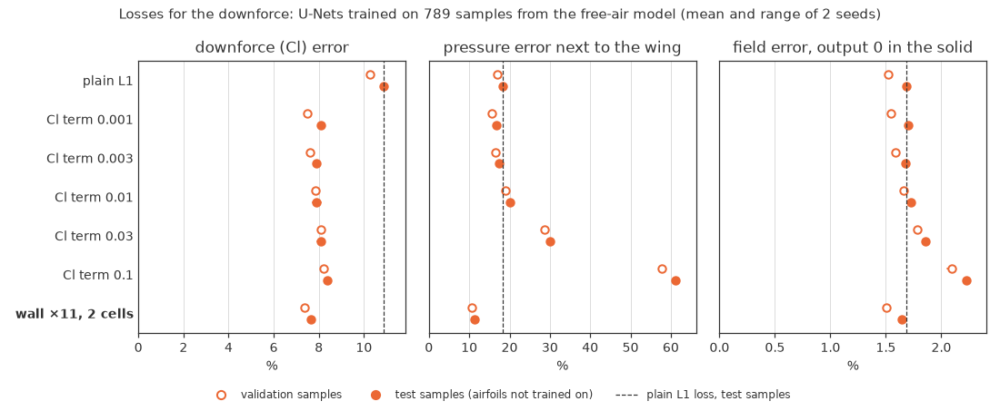

# 9. Downforce from the predicted pressure

[README](../README.md) · ← [8. U-Net learning curve](08-unet-learning-curve.md) · [Workflow](../README.md#workflow)

The 1.8% field error hides an 11% error in the downforce computed from the
predicted pressure: the error sits in the cells next to the wing. We compared
two additions to the loss. Weighting the cells next to the wing 11 times more
brings the downforce error to 7.7%, and we use it from now on.

*Words used here: [glossary](glossary.md). References: [list](references.md).*

---

The field error of the [learning curve](08-unet-learning-curve.md) is averaged over the whole image. For a wing, the number
that matters most is the downforce, so we also compute Cl from the predicted
pressure (`unet_data.lift_weights`). On the 128 × 128 grid the wing is a
staircase of cells: the pressure in the air cell above each top face pushes
the wing down, and the one below each bottom face pushes it up. On the
simulated pressure this is 3% off OpenFOAM's Cl on average (mean difference
0.04 on the 102 test samples, with slightly less downforce). So we compare
the Cl of the predicted pressure with the Cl of the simulated pressure, both
computed in this way.

**The 1.8% field error hides an 11% downforce error.** With the plain L1
loss (789 samples, from the free-air model), Cl is off by 0.13 on average:
11% of the mean |Cl| of 1.24, with R² 0.81 (the free-air model as it is:
121%). The error sits at the wing's surface. In the air cells next to the
wing the pressure is 18% off, against 9.5% more than 4 cells away. Most of
the Cl error comes from the side facing the ground, where the suction peak
is (mean |ΔCl| 0.11 there, against 0.05 on the top side).

We tried two additions to the loss (`train_unet.py --cl-weight`,
`--wall-weight` and `--wall-cells`), each with 789 samples, the free-air
model as the start and 2 seeds (about 4 hours on Kaggle in all):
- a **Cl term**: the batch's mean |Cl error| times a weight (0.001 to 0.1)
  is added to the L1 loss;
- a **wall weighting**: the L1 loss counts more in the air cells near the
  wing: 11 times more within 2 cells first, then also 4 and 31 times, and
  within 1 and 4 cells.

Test samples, mean of the 2 seeds (the figure also shows the validation
samples and the range of the seeds; `loss_study.py`):

| Loss | Field error, as the original | Field error, output 0 in the solid | Pressure next to the wing | Downforce (Cl) |
|---|---|---|---|---|
| plain L1 | 1.81% | 1.69% | 18.3% | 10.9% |
| Cl term 0.001 | 1.83% | 1.70% | 16.8% | 8.1% |
| Cl term 0.003 | 1.80% | 1.68% | 17.5% | 7.9% |
| Cl term 0.01 | 1.85% | 1.72% | 20.1% | 7.9% |
| Cl term 0.03 | 2.02% | 1.86% | 30.1% | 8.1% |
| Cl term 0.1 | 2.44% | 2.23% | 61.1% | 8.4% |
| wall ×4, 2 cells | 1.86% | 1.65% | 12.7% | 8.2% |
| wall ×11, 1 cell | 1.91% | 1.65% | 11.4% | 7.6% |
| wall ×11, 2 cells | 2.00% | 1.64% | 11.2% | 7.7% |
| wall ×11, 4 cells | 2.07% | 1.65% | 11.4% | 7.9% |
| wall ×31, 2 cells | 2.16% | 1.66% | 10.5% | 7.4% |

- **The Cl term fixes the sum, not the pressure.** Every weight lowers the
  Cl error by about a quarter, to 7.9–8.4%. But the larger the weight, the
  worse the pressure next to the wing (61% off at 0.1): the network learns
  pressures whose errors cancel in the sum. With the weight 0.001 the field
  hardly changes, and the pressure next to the wing is only a little better
  than with the plain loss (16.8% against 18.3%).
- **The wall weighting fixes the pressure at the wing.** With 11 times over
  2 cells, it lowers the pressure error next to the wing from 18% to 11% and
  the Cl error from 10.9% to 7.7% (R² 0.81 → 0.90). Cl comes closer to the
  simulation on 63 and 70 of the 102 test samples (the two seeds). Its
  larger field error (2.00%) is
  output inside the wing and the ground, where every target is 0: the
  weighting makes those cells count less. The geometry is an input, so the
  output there can be set to 0 at no cost. Then its field error is the lowest
  of all (1.64%, against 1.69% with the plain loss).
- **Its weight and width matter little.** From 11 to 31 times and from 1 to
  4 cells, the Cl error is 7.35–7.60% on the validation samples, and the two
  seeds differ by up to 0.4 points. A larger weight lowers the pressure error
  next to the wing a little more (10.1% at 31 times against 10.6% at 11
  times, validation samples) but raises the field error (1.57% against
  1.51%, output 0 in the solid). 4 times is too little (Cl 7.90%).
- **We use the wall weighting from now on, 11 times over 2 cells**, with the
  output set to 0 in the solid. It has the lowest Cl error on the validation
  samples (7.35%, against 7.38% at 31 times, 7.47% for the best Cl term and
  10.3% for the plain loss), and its field error is as low as any (1.51%,
  output 0 in the solid).

**Next:** more training runs (about 870 samples per 1000 runs); then the
learning curve again with the wall weighting; ride-height sweeps of two
airfoils the U-Net has not seen, the Tyrrell 026 and the NACA 4412; and
figures of predicted and simulated flow fields.

---

[README](../README.md) · ← [8. U-Net learning curve](08-unet-learning-curve.md) · [Workflow](../README.md#workflow)
