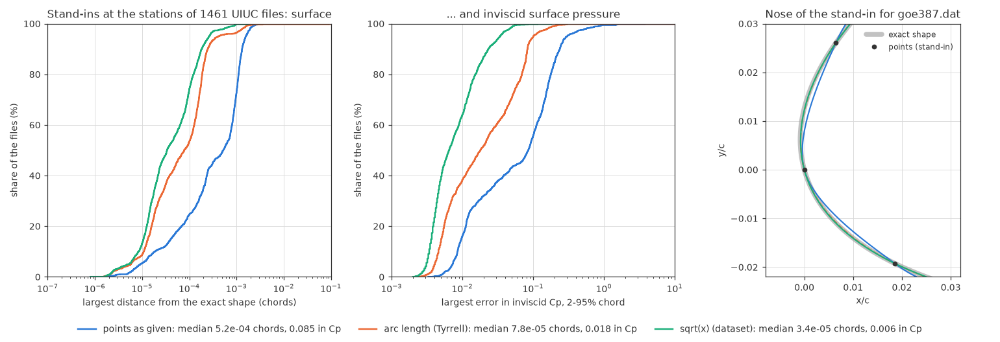
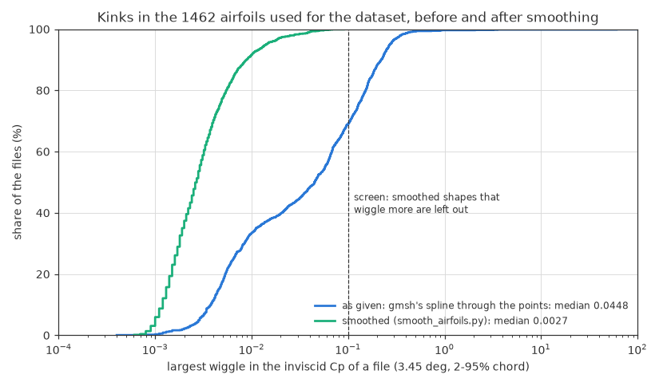
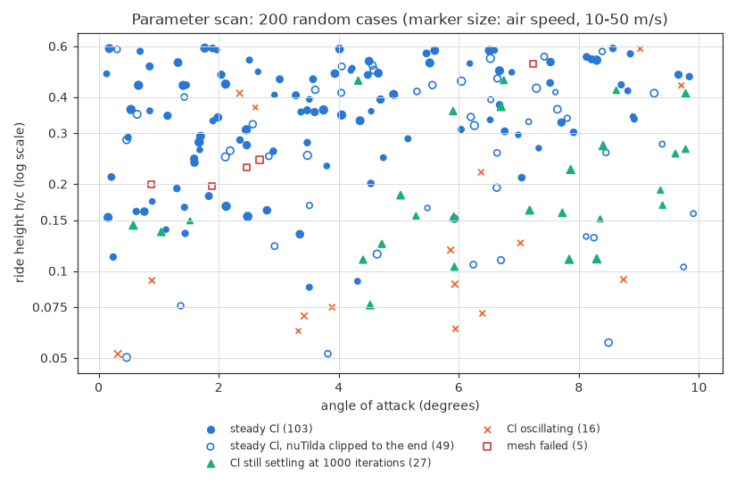
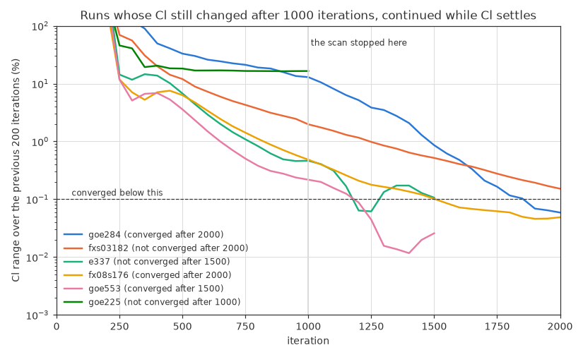

# The ground-effect dataset

[README](../README.md) · [Reproduction](reproduction.md) · [Ground-effect CFD](cfd_validation.md) · **Dataset** · [U-Net](unet.md) · [How to run it](howto.md)

The training data are 2D RANS runs of random airfoils at random angles of attack
(0–10°), ride heights (h/c 0.05–0.6) and speeds (10–50 m/s). This page covers
the airfoil files, which we smoothed first, the parameter scan that showed where
steady RANS converges and set the rules for keeping a run, and the samples made
so far.

*Words used here are explained in the [glossary](../README.md#words-used-here); the references are listed in the [README](../README.md#reference).*

**On this page:**

- [Airfoil shapes for the dataset](#airfoil-shapes-for-the-dataset)
- [Parameter scan: where does steady RANS converge?](#parameter-scan-where-does-steady-rans-converge)
- [The samples](#the-samples)

---

## Airfoil shapes for the dataset

The [Tyrrell wing](cfd_validation.md#validation-in-ground-effect-the-tyrrell-026-wing) showed that gmsh's spline puts kinks into the surface wherever
the spacing of the points jumps. Before making the dataset, all 1,497 UIUC
files that `groundGen.py` draws from (and the 30 test files) were checked in
the same way, and smoothed.

**The files.**
- **Few points.** A file has 61 points (median), and 10% of the files have 33
  or fewer. Next to the leftmost point, the longer of its two segments is 0.011
  chords long (median; 0.03 in 10% of the files). So for most files, the curve
  between the points decides the shape of the nose, not the points themselves.
- **Kinks.** On the surface groundGen meshes from the points, the largest
  wiggle in the inviscid Cp of a file (`shape_check.py`, at 3.45°) is 0.046
  (median). It is above 0.03 in 843 files and above 0.1 in 475. The Tyrrell
  table had 0.043 and 0.103.
- **Padded with zeros.** 849 files carry fewer decimals than they are written
  with. Of the 837 files written with seven decimals, 566 carry five (like
  0.1234500), and 137 carry four. Most of them are Göttingen sections. The x
  values are often round stations (0.05), so only the y values tell how
  precisely a file was given: 3 decimals in 35 files, 4 in 234, 5 in 986, 6 in
  106, 7 in 89 and 8 in 47.

**The smoothing** (`smooth_airfoils.py`) replaces the points of each file with
a smooth curve through them:
- **y as a function of ξ = ±√(x − x₀)** (+ on the upper surface, − on the
  lower), with x₀ the nose. Behind a round leading edge, y grows like
  √(x − x₀). So as a function of ξ the surface runs smoothly over the nose, and
  a spline gets the nose right from the few points most files have there.
- **A quintic smoothing spline** (Schoenberg 1964, Reinsch 1967): of all curves
  that stay within the rounding of the points, the one with the smallest third
  derivative. "Within the rounding" means Σ((y − f)/σ)² = n, with σ from the
  decimals the file carries (and the rounding of x, through its effect on ξ).
  The spline has a knot at every point, so it cannot swing out between points
  that are far apart. The two trailing-edge points stay in place.
- **The nose x₀** is the leftmost point of a quintic smoothing spline in arc
  length (FITPACK, as for the Tyrrell wing), near the leftmost point of the file.
- **Resampled** with 200 points per surface, spaced by a cosine in arc length:
  dense at the nose and at the trailing edge, without jumps.

**Test against known shapes** (`smoothing_test.py`). The true shapes of the
files are unknown, so each file gets a stand-in whose shape is known: a NACA
4-digit airfoil with about the file's thickness, camber and kind of trailing
edge, sampled at the file's own stations and rounded to its decimals. Three
surfaces are compared with the exact shape: gmsh's spline through the points
(what groundGen did so far), the arc-length smoothing of the Tyrrell wing, and
the √x smoothing.

| Stand-ins of the 1,462 files used | gmsh through the points | smoothed in arc length | smoothed in √x |
|---|---|---|---|
| Largest distance from the exact shape (chords): median / 90% / 99% | 5.2e-4 / 1.3e-3 / 2.2e-3 | 7.8e-5 / 2.5e-4 / 1.6e-3 | **3.4e-5 / 1.8e-4 / 7.9e-4** |
| Largest error in inviscid Cp, 2–95% chord: median / 90% / 99% | 0.085 / 0.24 / 0.83 | 0.018 / 0.083 / 0.19 | **0.0065 / 0.023 / 0.051** |
| Largest wiggle in inviscid Cp: median / largest | 0.039 / 39,756 | 0.0021 / 5,767 | **0.0014 / 0.0049** |

*Left and middle: share of the files below a given error (one stand-in per
file). Right: the nose of the stand-in for goe387, which has only one point
between x/c = 0 and 0.02 on each surface. gmsh's spline (blue) misses the
nose; the √x curve (green) follows the exact shape (grey).*

- The √x curve is closer to the exact shape than gmsh's spline in 93% of the
  files, and its Cp error is smaller in 99%. Against the arc-length smoothing:
  closer in 83%, smaller Cp error in 88%.
- Gmsh's spline and the arc-length spline both go far off for a few station
  layouts (largest Cp errors 41,350 and 12,551). The √x curve never does.
- Its error follows the precision of the file: median 6.4e-4 chords for the
  35 files that carry three decimals, 1.4e-4 for four, 2.8e-5 for five, and
  below 1.5e-5 for six to eight. All its errors above 1e-3 chords and above
  0.1 in Cp come from four files whose lower surface stops short of the
  trailing edge (dbln526, ste87151, ste87391, stf86361). groundGen closes them
  with a straight line, smoothed or not, and all three surfaces have the same
  error there.
- One stand-in fails (n63215b): it has two leading-edge points at the same x,
  and the nose comes out to their right. The smoothing then stops with an
  error instead of writing a file. The real n63215b file smooths normally.

**The real files** (`shape_check.py`):

| 1,462 files used | As given | Smoothed |
|---|---|---|
| Largest wiggle in inviscid Cp: median / 90% / 99% | 0.045 / 0.22 / 0.43 | **0.0027 / 0.0088 / 0.039** |
| Files with a wiggle above 0.03 / above 0.1 | 817 / 453 | **25 / 0** |

- **How far the surface moves:** 4.5e-4 chords (median), 2.1e-3 (90%) and
  4.0e-3 (99%). In 80% of the files it moves most at the nose (x/c < 0.05),
  where gmsh's spline was furthest off on the stand-ins. On the 223 mm Tyrrell
  model, 4.5e-4 chords would be 0.1 mm.
- **How far the curve stays from the points:** 0.58 half units of the last
  decimal they carry (rms), as intended: that is the rounding error of the
  decimals (1/√3). The largest distance is 2.6 half units in the median file
  and 5.8 in 99% of the files.
- The 30 test files are all kept: their largest wiggle drops from 0.035
  (median) to 0.0018, and is at most 0.017.

**Files left out (35).** Rules in `smooth_airfoils.py`, with the reason
printed for each file. The dataset keeps 1,462 of the 1,497 files, and all 30
test files:
- **Errors in the points (8):** a station missing or listed twice (cap21c;
  wb140: 0.175 twice, where 0.200 belongs), a copied leading-edge point
  (eh3012), or a misplaced point, where the contour turns by more than 30° at
  one point between 10% and 90% chord: naca63206 (0.6002 where about 0.650
  belongs), naca63a210, du861372 (0.29795 where about 0.248 belongs), goe481,
  goe802a. 99% of the files stay below 14° there.
- **Not a whole airfoil (3):** the chord does not run from 0 to 1: e664ex
  (with an extended flap, to 1.2), ua79sff (a flap alone) and ua79sfm (a main
  element alone).
- **The contour crosses itself (9),** as groundGen closes it: dsma523a, e340,
  e378, fx38153, fx62k131, fx63147, fx72150b, fx72ls160, mh150. In fx63147
  the lower surface lies above the upper one over the last 1% of the chord; in
  e378 the surfaces cross back and forth over the rear half.
- **After smoothing, the contour crosses itself (3):** e341, s4180, strand.
  Both surfaces run into a cusp at the trailing edge, closer together than the
  rounding of their points can resolve.
- **After smoothing, the pressure still wiggles (12):** the inviscid Cp of the
  smoothed shape wiggles by more than 0.1, the level of the raw Tyrrell table
  that needed smoothing. The points have errors, or features finer than they
  resolve: wrong points near the nose (goe451, goe388), surfaces that almost
  touch over the rear half (e377), a cove resolved by too few points
  (goe802b), points noisier than their seven decimals (npl9615, npl9660),
  chamfered blunt trailing edges (fx79w470a, fx79w660a), and b707c, p51hroot,
  goe229 and dfvlrr4.
- Two files had a point that groundGen treats as part of a blunt trailing
  edge's base at the end of the lower surface (bacj, naca6412). That point is
  dropped before smoothing; groundGen closes the base with a straight line, as
  before.

**Tried and dropped** (on the stand-ins of all files, or of every fifth file):
- **A cubic smoothing spline in ξ** (Reinsch's original): its curvature is
  pulled to zero at the ends, which bends the last few percent of the chord.
  On 300 files its median error was 4.3e-5 chords against 2.8e-5 for the
  quintic, and its largest error lay beyond 90% chord in 108 files (11 with
  the quintic).
- **FITPACK's quintic spline in ξ:** as accurate as the quintic smoothing
  spline, but between two trailing-edge points 0.1 chords apart it swung 4.2
  chords off on goe411 (0.07 on goe420), because it places its own knots.
- **Other noses:** a parabola through the nearest points fails where they are
  sparse. The smoothest curve in ξ, and smoothing splines with a knot at every
  point in arc length, put the nose further from the exact one (the latter:
  35 of 300 files more than 20% further off, 2 closer).
- **Other smoothing levels:** generalized cross-validation smooths clean files
  too much. The unbiased risk estimate (UBRE) gives the same as the rounding.
- **A cap on the decimals:** smoothing every file as if it had at most 4
  decimals makes precise files 3.5 times less accurate (median 4.3e-5 → 1.5e-4
  chords). At 5 decimals it does not help the files that are noisier than their
  digits. Reading the decimals each file carries handles the padded files
  instead.
- **An automatic outlier test** on the points (how far a point lies from the
  cubic through its four neighbours in ξ): the noses and trailing-edge
  closures of good airfoils score as high as the errors. Instead, the rules
  were set after looking at the worst files of the scan. The 30° limit for a
  misplaced point lies in a gap: no file turns by between 23° and 31°, and the
  files at 20–23° are sparse, strongly cambered sections whose points look
  consistent (saratov, goe462). The
  wiggle limit is the raw Tyrrell table's level. The files just below it are
  mostly Wortmann sections (0.03–0.09), whose pressure wiggles as much before
  smoothing as after: the wiggle is in their tabulated shape near the nose.

**Decision:** the dataset uses the smoothed files (1,462 airfoils, written to
`data/airfoil_database_smooth` by `smooth_airfoils.py`; see
[How to run it](howto.md)): `groundGen.py --airfoil-dir
/work/data/airfoil_database_smooth`. The default stays the original folder, so
that all earlier runs can be repeated. The Tyrrell 026 wing keeps its
arc-length smoothing, which was validated; for that table the √x curve differs
from it by at most 21 µm.

**Next:** scan the parameter ranges (where steady RANS converges), then
generate the dataset.

## Parameter scan: where does steady RANS converge?

Before making the dataset, `param_scan.sh` ran 200 cases drawn the way the
dataset draws them: a random airfoil from the 1,462 smoothed files, angle of
attack 0–10°, ride height h/c 0.05–0.6 and air speed 10–50 m/s (chord
Reynolds number 1–5 million), all drawn uniformly, with the default settings
(1000 iterations). With 4 runs at a time it took 4 hours: 4.7 minutes per run
(median; 10–90%: 4.2–5.4 minutes), 55,000 cells. `param_scan_report.py` sorts
the runs into groups (one row per run in `results/param_scan.csv`).

**By the convergence test of [round 3](cfd_validation.md#mesh-study-round-3-numerical-verification)** (Cl within 0.1% over the last 200
iterations, and nuTilda no longer clipped at the end), only 103 of the 200
runs (52%) would have given a sample, and none of the 11 below h/c 0.082. Half
of the failures came from the clipping alone:

| The 200 runs | Runs |
|---|---|
| Cl steady, nuTilda not clipped at the end | 103 |
| Cl steady, but nuTilda clipped until the end | 49 |
| Cl still settling: its range shrinks 2–5 times every 200 iterations | 27 |
| Cl oscillating | 16 |
| Mesh failed: gmsh could not extrude the boundary layer at the trailing edge (fx76mp160 twice, marsden, fx08s176, sd8000) | 5 |

*Each run in the plane of angle of attack and ride height. The oscillating
runs (orange) lie mostly close to the ground: 10 of the 16 below h/c 0.12.
Three of the other six are Wortmann sections (fx77080, and fx77w121 twice).*

**The clipping.**
- **All or nothing:** in each run it either stops within the first 700
  iterations (in most by 350), or goes on in 506–994 of the 1000 iterations,
  until the end (87 runs).
- **When:** it gets more likely close to the ground, at larger angles and at
  higher speeds (a logistic fit gives each a clear effect). Above h/c 0.3 and
  below 5°, none of the 14 runs at 10–20 m/s clipped until the end, but 9 of
  the 40 faster ones did. 13 of the 87 runs had no separated flow at all.
- **Where:** `clip_cells.py` finds the cells that OpenFOAM reset in the last
  iteration. A reset cell holds exactly the average of its neighbours that
  OpenFOAM puts there, to round-off, which practically never happens by
  chance; runs without clipping have none. In the scan run of goe280 (h/c
  0.109, 6.7°), 2 of 53,837 cells were reset, 1.7 and 5.1 chords behind the
  trailing edge, at the outer fringe of the wake: nuTilda there is a few times
  its incoming value, while its largest value in the flow is 2,300 times the
  incoming one. In every run checked, including the hard S1223 case of round 3
  (78–118 cells), all reset cells lie behind the wing, none at the wing itself.
- Negative values of the Spalart–Allmaras variable where it drops steeply, at
  the edges of wakes and boundary layers, are a known artifact of
  second-order schemes. Allmaras et al. (2012) introduced a form of the model
  ("SA-neg") that handles them without clipping; OpenFOAM clips them instead.

**Test 1: what does the clipping change?** (`clip_test.sh`, then
`clip_test_report.py`.) Four of the scan's runs with a steady Cl and nuTilda
clipped until the end, from just above the ground to h/c 0.4, ran again with
exactly the same settings: for 2000 iterations, and with first-order upwind
convection of nuTilda, which cannot undershoot, so nothing is clipped. The
first 1000 iterations of every rerun were bit for bit those of the scan.

| Case (h/c, α, U) | Wing surface with reversed flow | 2000 instead of 1000 iterations: Cl, field p / v | First-order upwind: Cl, field p / v |
|---|---|---|---|
| e186 (0.251, 3.5°, 49.6 m/s) | 0% | 0.00%, 0.00% / 0.00% | −0.09%, 0.09% / 0.01% |
| goe281 (0.400, 1.4°, 27.2 m/s) | 0% | 0.00%, 0.00% / 0.00% | −0.12%, 0.12% / 0.01% |
| goe280 (0.109, 6.7°, 32.6 m/s) | 19% | 0.00%, 0.03% / 0.01% | −5.07%, 5.48% / 0.75% (not steady: Cl varies by 1.4%) |
| n9 (0.052, 3.8°, 25.0 m/s) | 22% | +0.08%, 0.08% / 0.01% | −7.73%, 6.85% / 0.51% |

*Differences from the scan run; flow fields measured like the U-Net test error.*

- **The clipped runs are converged.** 1000 more iterations change Cl and the
  flow field by at most 0.08%. At the end, 0–3 cells are still reset, all in
  the wake, 0.3–5.2 chords behind the trailing edge (one of them inside the
  sampled window).
- **In attached flow, the clipping changes nothing that matters:** a scheme
  that cannot clip gives the same flow within 0.12%.
- **In separated flow, the first-order scheme gives 5–8% less downforce, but
  not because of the clipping.** The two other second-order schemes of
  `groundGen.py` clip far more than the default: linearUpwind with an
  unlimited gradient (the original case) resets 400–470 cells in the last
  iteration, some of them along the wing, and limitedLinear about 30. Yet all
  three second-order schemes give the same downforce within 0.7% and the same
  flow field within 0.6% (pressure) and 0.1% (velocity):

| Case | nuTilda scheme | Cells reset in the last iteration | Cl | Field p / v |
|---|---|---|---|---|
| goe280 | cellLimited (default) | 3 | reference | reference |
| | linearUpwind | 398 | +0.36% | 0.36% / 0.08% |
| | limitedLinear | 28 | +0.26% | 0.26% / 0.04% |
| | upwind (first order) | 0 | −5.07% | 5.50% / 0.75% |
| n9 | cellLimited (default) | 1 | reference | reference |
| | linearUpwind | 474 | +0.62% | 0.55% / 0.09% |
| | limitedLinear | 34 | +0.67% | 0.56% / 0.04% |
| | upwind (first order) | 0 | −7.79% | 6.92% / 0.52% |

*Differences from the default scheme after 2000 iterations.*

  So the 5–8% comes from the first-order scheme, which is diffusive where the
  flow crosses the cells, as in the separated shear layer (in the attached
  boundary layer the cells follow the flow). Between second-order schemes,
  separated flow differs by less than 0.7%, far below the U-Net's error. In
  round 3, in attached flow, they had agreed within 0.06%.

**Test 2: do settling runs converge if they continue?** Six of the scan's runs
whose Cl still changed after 1000 iterations ran again, continuing 500
iterations at a time while Cl was settling (its range over the last 200
iterations below 0.7 times its range over the 200 before), up to 2000:

| Case | Cl range after 1000 iterations | Iterations | Cl range at the end | Converged |
|---|---|---|---|---|
| goe284 | 12.9% | 2000 | 0.059% | yes |
| fx08s176 | 0.48% | 2000 | 0.049% | yes |
| goe553 | 0.22% | 1500 | 0.026% | yes |
| fxs03182 | 1.98% | 2000 | 0.15%, still shrinking (0.6 times every 200 iterations) | no |
| e337 | 0.46% | 1500 | 0.11%: down to 0.06%, then up again, so it stopped | no |
| goe225 | 16.5%, oscillating | 1000 | not continued | no |
| fxs03182, up to 3000 iterations | 1.98% | 2500 | 0.046% | yes |

- **Continuing a run gives the same answer as running it longer:** fxs03182
  continued from 1000 to 2000 iterations ends with the same flow as fxs03182
  run straight to 2000 (0.014% / 0.001%).
- With up to 3000 iterations, fxs03182 converges at 2500, so the limit is now
  3000. Only runs that are still settling get the extra iterations.

**Decisions for the dataset:**
- **A run counts as converged when its Cl is steady** (within 0.1% over the
  last 200 iterations). Clipping no longer counts against it, but every sample
  records it (`clipped`, and `clip_min`: the most negative value clipped in the
  last 100 iterations), so samples can still be filtered later.
- **A run whose Cl is still settling after 1000 iterations continues,** 500
  iterations at a time, up to 3000 (`--max-iterations`). In the scan, 27 runs
  (14%) were settling.
- **The ranges stay:** α 0–10°, h/c 0.05–0.6, U 10–50 m/s. In part of this
  range steady RANS finds no steady solution (the oscillating runs). They stay
  out of the training data, so the network learns the steady part of the
  range.
- **The ride height is now drawn log-uniformly** (`--h-sampling log`): as many
  runs between h/c 0.05 and 0.1 as between 0.3 and 0.6, where the uniform draw
  had 6 times fewer. The flow changes fastest close to the ground, and
  Zerihan's test heights were spaced roughly this way too. More runs will then
  be unsteady. From the scan's results by ride height, about 75–80% of the runs
  should give a sample (84–90% with the uniform draw).

Share of the scan's runs by ride height:

| h/c | Runs | Earlier test | Cl steady | Cl steady or settling |
|---|---|---|---|---|
| 0.05–0.082 | 11 | 0% | 36% | 45% |
| 0.082–0.135 | 22 | 23% | 55% | 77% |
| 0.135–0.222 | 33 | 42% | 58% | 91% |
| 0.222–0.365 | 57 | 61% | 88% | 96% |
| 0.365–0.6 | 77 | 64% | 87% | 94% |

**The dataset** is made by `dataset.sh`: 1000 runs (about 21–22 hours), and a
test set from the 30 test airfoils. Running 8 at a time instead of 4 does not
help on this laptop (Ryzen 7 7730U, 8 cores): each run then takes twice as
long (9.4 instead of 4.7 minutes for 1000 iterations, with the same mesh
sizes), so the laptop finishes the same number of runs per hour.

## The samples

`dataset.sh` makes the training runs 1000 at a time, each time with new random
seeds, so no case is repeated. Every run is listed in `samples.csv`. Runs whose
Cl does not become steady go to `not_converged/` and are not used for
training.

| | Runs | Samples (Cl steady) | Not converged | Failed before a sample |
|---|---|---|---|---|
| Training, first 1000 runs | 1000 | 867 | 120 | 13 |
| Training, second 1000 runs | 1000 | 849 | 136 | 15 |
| Test set (the 30 test airfoils) | 120 | 102 | 13 | 5 |

So 86% of the runs give a sample, more than the 75–80% expected from the
parameter scan. About 10% of the training samples are kept for validation,
chosen by a checksum of the file name. 2000 more training runs are being
made.
