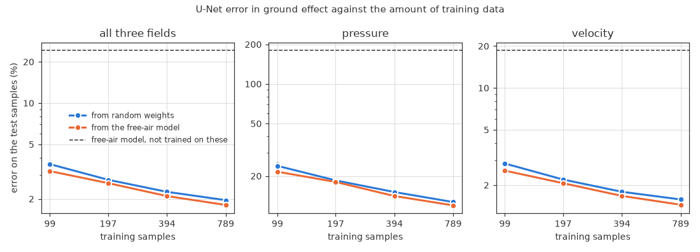
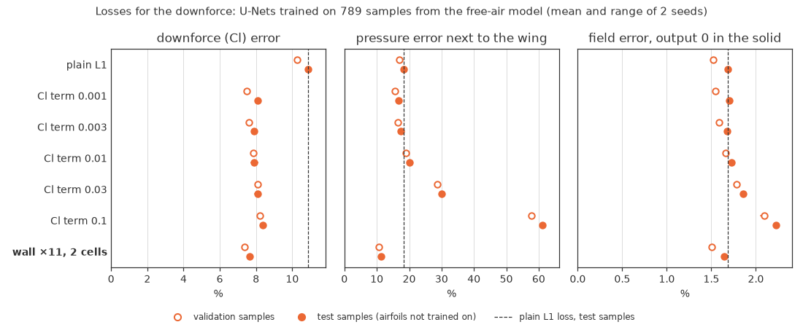

# Training the U-Net on the ground-effect data

[README](../README.md) · [Reproduction](reproduction.md) · [Ground-effect CFD](cfd_validation.md) · [Dataset](dataset.md) · **U-Net** · [How to run it](howto.md)

We train the U-Net of the reproduction on the ground-effect samples, from random
weights and from the free-air model, and test it on 30 airfoils it has not
seen. Then we compute the downforce from the predicted pressure, and compare
losses that make it more accurate.

*Words used here are explained in the [glossary](../README.md#words-used-here); the references are listed in the [README](../README.md#reference).*

**On this page:**

- [Learning curve](#learning-curve)
- [Downforce from the predicted pressure](#downforce-from-the-predicted-pressure)

---

We train the same network as in the reproduction, with the same loss,
optimiser, batch size, learning-rate schedule and error measure as
[Run 3](reproduction.md#run-3-same-setup-80k-iterations-papers-training-length). The code is
copied into `ground_effect/` (`unet.py`, `unet_data.py`, `train_unet.py`), so
that it runs on a rented GPU with only this folder. As a check, the copied
code gives the 80k-iteration model of Run 3 exactly the same errors on the
original test set (p 14.86%, v 2.45%, combined 2.96%).

Two things are new for the ground:
- **Pressure offset.** The original code subtracts the mean pressure over all
  128 × 128 points. That includes the masked points, where p = 0. An airfoil
  alone masks only 1–3% of the points, but the ground masks 16–47%, so we
  take the mean over the air only. On the original test set this changes the
  errors of the Run 3 model very little (p 14.86 → 14.75%, combined 2.96%).
- **Validation samples** (about 10%) are chosen by a checksum of the file
  name, so they stay the same when more data is added.

**The free-air model does not work near the ground.** Used as it is on the
first 516 ground-effect samples, the Run 3 model has a combined error of 24.6%
(pressure 180%, velocity 18.9%), against 2.96% in free air. The error grows
closer to the ground: 28% for h/c 0.05–0.08, 21% for h/c 0.37–0.6.

**The data used here.** The first 1000 runs gave 867 converged samples (120
runs did not converge and 13 failed): 789 for training and 78 for
validation. The test set, 120 runs on the 30 test airfoils, gave 102 samples
(13 did not converge and 5 failed). The second 1000 runs
([849 more samples](dataset.md#the-samples)) are not used here yet.

## Learning curve

We trained models on 12.5, 25, 50 and 100% of the 789 training samples,
each from random weights and from the free-air model of Run 3 (transfer
learning), with 2 seeds, and tested them all on the 102 test samples, whose
30 airfoils are not in the training data (`learning_curve.py`). The 16 runs
of 80,000 iterations took about 3 hours on Kaggle's two Tesla T4 GPUs (see
[How to run it](howto.md)).

Combined error on the test samples, mean of the 2 seeds (they differ by 0.17
points at most):

| Training samples | From random weights | From the free-air model |
|---|---|---|
| none (free-air model as it is) | – | 24.20% |
| 99 | 3.59% | 3.19% |
| 197 | 2.76% | 2.61% |
| 394 | 2.25% | 2.10% |
| 789 | 1.96% | 1.81% |

- **The network adapts to the ground with little data.** 99 samples bring
  the error from 24% down to 3.2%, and 789 samples to 1.8% (pressure 12.0%,
  velocity 1.45%). As in free air, the pressure is the hardest field.
- **More data still helps.** From 394 to 789 samples the error drops by
  13–14%, and the curve does not level off yet. The second 1000 runs will add
  a point at about 1,550 samples.
- **The free-air model helps most when data are scarce.** With 99 samples,
  starting from it lowers the error from 3.59 to 3.19%, and it is better on 78
  of the 102 test samples. With 197–789 samples it is ahead by 0.15 points,
  but most of that comes from one airfoil (next point): without it, the lead
  is 0.05–0.06 points.
- **One test airfoil lies outside the training shapes.** e864 is a symmetric
  strut section, 39% thick; only one of the 1,462 training airfoils is
  thicker, and 95% are at most 19% thick. Its 2 test samples have errors of
  10% and 14% (from the free-air model; 14% and 20% from random weights),
  which raises the mean by 0.2–0.3 points. Without e864 the test error (1.60%
  and 1.66%) is about the same as the validation error (1.65% and 1.60%): new
  airfoils like those in training are predicted as well as new flow
  conditions.
- **The pressure is hardest closest to the ground.** For h/c 0.05–0.08 its
  error is 15–16% on both the test and the validation samples, against 8–11%
  from h/c 0.135 up (models from the free-air model, 789 samples).

## Downforce from the predicted pressure

The error above is averaged over the whole image. For a wing, the number
that matters most is the downforce, so we also compute Cl from the predicted
pressure (`unet_data.lift_weights`). On the 128 × 128 grid the wing is a
staircase of cells: the pressure in the air cell above each top face pushes
the wing down, and the one below each bottom face pushes it up. On the
simulated pressure this is 3% off OpenFOAM's Cl on average (mean difference
0.04 on the 102 test samples, with slightly less downforce). So we compare
the Cl of the predicted pressure with the Cl of the simulated pressure, both
computed in this way.

**The 1.8% field error hides an 11% downforce error.** With the plain L1
loss (789 samples, from the free-air model), Cl is off by 0.13 on average:
11% of the mean |Cl| of 1.24, with R² 0.81 (the free-air model as it is:
121%). The error sits at the wing's surface. In the air cells next to the
wing the pressure is 18% off, against 9.5% more than 4 cells away. Most of
the Cl error comes from the side facing the ground, where the suction peak
is (mean |ΔCl| 0.11 there, against 0.05 on the top side).

We tried two additions to the loss (`train_unet.py --cl-weight`,
`--wall-weight` and `--wall-cells`), each with 789 samples, the free-air
model as the start and 2 seeds (about 4 hours on Kaggle in all):
- a **Cl term**: the batch's mean |Cl error| times a weight (0.001 to 0.1)
  is added to the L1 loss;
- a **wall weighting**: the L1 loss counts more in the air cells near the
  wing: 11 times more within 2 cells first, then also 4 and 31 times, and
  within 1 and 4 cells.

Test samples, mean of the 2 seeds (the figure also shows the validation
samples and the range of the seeds; `loss_study.py`):

| Loss | Field error, as the original | Field error, output 0 in the solid | Pressure next to the wing | Downforce (Cl) |
|---|---|---|---|---|
| plain L1 | 1.81% | 1.69% | 18.3% | 10.9% |
| Cl term 0.001 | 1.83% | 1.70% | 16.8% | 8.1% |
| Cl term 0.003 | 1.80% | 1.68% | 17.5% | 7.9% |
| Cl term 0.01 | 1.85% | 1.72% | 20.1% | 7.9% |
| Cl term 0.03 | 2.02% | 1.86% | 30.1% | 8.1% |
| Cl term 0.1 | 2.44% | 2.23% | 61.1% | 8.4% |
| wall ×4, 2 cells | 1.86% | 1.65% | 12.7% | 8.2% |
| wall ×11, 1 cell | 1.91% | 1.65% | 11.4% | 7.6% |
| wall ×11, 2 cells | 2.00% | 1.64% | 11.2% | 7.7% |
| wall ×11, 4 cells | 2.07% | 1.65% | 11.4% | 7.9% |
| wall ×31, 2 cells | 2.16% | 1.66% | 10.5% | 7.4% |

- **The Cl term fixes the sum, not the pressure.** Every weight lowers the
  Cl error by about a quarter, to 7.9–8.4%. But the larger the weight, the
  worse the pressure next to the wing (61% off at 0.1): the network learns
  pressures whose errors cancel in the sum. With the weight 0.001 the field
  hardly changes, and the pressure next to the wing is only a little better
  than with the plain loss (16.8% against 18.3%).
- **The wall weighting fixes the pressure at the wing.** With 11 times over
  2 cells, it lowers the pressure error next to the wing from 18% to 11% and
  the Cl error from 10.9% to 7.7% (R² 0.81 → 0.90). Cl comes closer to the
  simulation on 63 and 70 of the 102 test samples (the two seeds). Its
  larger field error (2.00%) is
  output inside the wing and the ground, where every target is 0: the
  weighting makes those cells count less. The geometry is an input, so the
  output there can be set to 0 at no cost. Then its field error is the lowest
  of all (1.64%, against 1.69% with the plain loss).
- **Its weight and width matter little.** From 11 to 31 times and from 1 to
  4 cells, the Cl error is 7.35–7.60% on the validation samples, and the two
  seeds differ by up to 0.4 points. A larger weight lowers the pressure error
  next to the wing a little more (10.1% at 31 times against 10.6% at 11
  times, validation samples) but raises the field error (1.57% against
  1.51%, output 0 in the solid). 4 times is too little (Cl 7.90%).
- **We use the wall weighting from now on, 11 times over 2 cells**, with the
  output set to 0 in the solid. It has the lowest Cl error on the validation
  samples (7.35%, against 7.38% at 31 times, 7.47% for the best Cl term and
  10.3% for the plain loss), and its field error is as low as any (1.51%,
  output 0 in the solid).

**Next:** more training runs (about 870 samples per 1000 runs); then the
learning curve again with the wall weighting; ride-height sweeps of two
airfoils the U-Net has not seen, the Tyrrell 026 and the NACA 4412; and
figures of predicted and simulated flow fields.
